# BEJSON CMS: Enterprise Zero-SQL Positional CMS & Static Site Publisher

**BEJSON CMS** is a high-density, zero-SQL Content Management System, Dynamic Headless REST Engine, and Static Site Generator engineered to operate entirely without external relational database engines (such as MySQL, PostgreSQL, or SQLite). Every structural entity—articles, hierarchical categories, author profiles, hash-deduplicated media assets, external media embeds, banner advertisements, responsive navigation links, site configuration key-value registries, social profiles, BKS-1 standardized 4-part job blueprints, and standalone containerized web applications—is stored in positional matrix files governed by a master Multi-File Database (MFDB) manifest (`storage/mfdb/site_master/104a.mfdb.bejson`).

- **Author**: Elton Boehnen
- **Contact**: boehnenelton2024@gmail.com · [boehnenelton2024.pages.dev](https://boehnenelton2024.pages.dev) · [github.com/boehnenelton](https://github.com/boehnenelton)
- **License**: PolyForm Noncommercial License 1.0.0
- **Version**: V18.31 (Package PKG135)

---

## Table of Contents
- [Executive Overview & Core Philosophy](#executive-overview--core-philosophy)
- [Prerequisites & Environment Setup](#prerequisites--environment-setup)
- [Service Launchers & Operational Modes](#service-launchers--operational-modes)
- [Visual Interface Tour & Audit Telemetry](#visual-interface-tour--audit-telemetry)
- [Complete Feature Catalog & Capabilities Matrix](#complete-feature-catalog--capabilities-matrix)
- [User Workflows & Operational Guides](#user-workflows--operational-guides)
  - [1. Article Authoring & Topical Links in Page Editor](#1-article-authoring--topical-links-in-page-editor)
  - [2. AI Writer & Standardized 4-Part BKS-1 System](#2-ai-writer--standardized-4-part-bks-1-system)
  - [3. Markdown Import & Batch Conversion Pipeline](#3-markdown-import--batch-conversion-pipeline)
  - [4. Media Asset Pipeline, Thumbnails & Global External Links](#4-media-asset-pipeline-thumbnails--global-external-links)
  - [5. Standalone Web Application Hosting](#5-standalone-web-application-hosting)
  - [6. Static Site Compilation & Cloudflare Publishing](#6-static-site-compilation--cloudflare-publishing)
  - [7. AI Persona Management & Cognitive Directives in Persona Editor](#7-ai-persona-management--cognitive-directives-in-persona-editor)
- [System Architecture & Microservice Topology](#system-architecture--microservice-topology)
  - [Admin Suite (:5001) & Architectural Blueprints](#admin-suite-5001--architectural-blueprints)
  - [Static Site Publisher (:5002)](#static-site-publisher-5002)
  - [Primary Page Editor (:5003)](#primary-page-editor-5003)
  - [Persona Editor (:5004)](#persona-editor-5004)
  - [Page Editor V2 (Deprecated & Archived)](#page-editor-v2-deprecated--archived)
  - [Shared Web Infrastructure (BEJSON_CMS_Shared.py)](#shared-web-infrastructure-bejson_cms_sharedpy)
- [Data Storage Engine & BEJSON Schemas](#data-storage-engine--bejson-schemas)
  - [The Positional Matrix Paradigm](#the-positional-matrix-paradigm)
  - [BEJSON 104 vs 104a vs 104db Formats](#bejson-104-vs-104a-vs-104db-formats)
  - [MFDB Manifest Structure (104a.mfdb.bejson)](#mfdb-manifest-structure-104amfdbbejson)
  - [Full Relational Entity Schema Roster](#full-relational-entity-schema-roster)
  - [Page Storage Document Hierarchy (pages_db/)](#page-storage-document-hierarchy-pages_db)
- [AI Writer Architecture & 48k Context Bubble Engine](#ai-writer-architecture--48k-context-bubble-engine)
  - [Subsystem Overview & Admin UI Integration](#subsystem-overview--admin-ui-integration)
  - [Zero-SDK REST Dispatch & Provider Registry Architecture](#zero-sdk-rest-dispatch--provider-registry-architecture)
  - [The 48,000 Combined Token Budget System](#the-48000-combined-token-budget-system)
  - [Dual-Allotment Budget Distribution & Dynamic Spill-Up](#dual-allotment-budget-distribution--dynamic-spill-up)
  - [Author Role Precedence & Persona Directives (15% Share)](#author-role-precedence--persona-directives-15-share)
  - [Silent Reference Material Ingestion (85% Share)](#silent-reference-material-ingestion-85-share)
  - [Two-Tier Chunked-104a Packaging & Cryptographic Integrity](#two-tier-chunked-104a-packaging--cryptographic-integrity)
  - [BKS-1 4-Part Pipeline: Plan, Contextualize_Plan & Contextualize_Last](#bks-1-4-part-pipeline-plan-contextualize_plan--contextualize_last)
  - [BKS-1 Directory Architecture & Relational Mapping](#bks-1-directory-architecture--relational-mapping)
  - [REST API Reference & State Payload Contracts](#rest-api-reference--state-payload-contracts)
- [REST API & HTTP Route Reference](#rest-api--http-route-reference)
- [Command-Line Interface Reference (cms-manage.py)](#command-line-interface-reference-cms-managepy)
- [TUI Supervisor Reference (advanced_launcher.py)](#tui-supervisor-reference-advanced_launcherpy)
- [Directory Architecture & Repository Map](#directory-architecture--repository-map)
- [Security, Concurrency & Data Integrity Architecture](#security-concurrency--data-integrity-architecture)
- [Testing, Auditing & Verification Suite](#testing-auditing--verification-suite)
- [Troubleshooting & Diagnostic Handbook](#troubleshooting--diagnostic-handbook)
- [License & Project Metadata](#license--project-metadata)

---

## Executive Overview & Core Philosophy

Traditional content management architectures require heavy relational or document database daemons, database drivers, schema migration tooling, and complex connection pooling layers. BEJSON CMS eliminates these infrastructure bottlenecks by treating structured data as flat, dense JSON matrices with decoupled schema definitions.

Key architectural tenets include:
1. **Zero External Database Services**: Data is organized directly in deterministic, human-readable file stores. There are no background database processes to provision, tune, crash, or repair.
2. **Positional Matrix Efficiency**: Column field definitions are declared once in a file header (`Fields`), while all subsequent entity records are stored as lightweight arrays of scalar primitives (`Values`). This achieves a 40% to 65% reduction in raw JSON disk overhead compared to repeated key-value object collections.
3. **O(1) Field Map Caching**: Application code never parses raw positional indices blindly. Reading and writing modules compile an in-memory mapping (`{field_name: column_index}`) at initialization or boundary ingress, guaranteeing random-access lookups with instant algorithmic resolution.
4. **Decoupled Headless Microservices**: The management interface, static publisher, authoring workspace, and profile managers exist as decoupled Flask microservices. Each service can be run independently in resource-constrained environments or orchestrated under a unified terminal supervisor.
5. **Polymorphic Static Generation**: Unlike server-rendered monolithic systems where every page request incurs database lookup penalties, BEJSON CMS compiles relational content into zero-dependency, production-ready static HTML, CSS, and media bundles ready for edge delivery via Cloudflare Pages, GitHub Pages, or private NGINX servers.


*_Figure 1: Admin Dashboard Telemetry and System Overview_*


---

## Prerequisites & Environment Setup

BEJSON CMS is designed to run seamlessly across Android Termux (ARM64), Pydroid 3, standard Linux distributions (Debian, Ubuntu, Arch, Fedora, Alpine), and macOS with zero container virtualization overhead.

### System Requirements
- **Python**: Version 3.10, 3.11, or 3.12 (standard CPython).
- **Core Dependencies**: `flask`, `Pillow` (PIL fork).
- **Optional Extensions**:
  - `requests`: Required for remote network lookups and Cloudflare Pages webhook deployments.
  - `playwright`: Recommended for headless browser visual regression testing and responsive layout audits.
  - `pytest`: Required for executing the test and path integrity suite.

### Quick Dependency Installation
```bash
# Clone the repository
git clone https://github.com/boehnenelton/BEJSON_CMS.git
cd BEJSON_CMS

# Install standard dependencies
pip install flask Pillow requests pytest

# Optional: Install Playwright if running browser automated audits
pip install playwright
playwright install chromium
```

### Environment Variables & Runtime Configuration

BEJSON CMS reads runtime defaults from `config.json` (`104a` format) located in the repository root. Any setting in `config.json` can be overridden by exporting environment variables before process execution.

```bash
# Security & Access Control
export CMS_USER="admin"                                 # HTTP Basic Auth username
export CMS_PASSWORD="your-strong-production-password"   # HTTP Basic Auth password
export CMS_SECRET_KEY="generate-secure-random-token"    # Flask session signing secret

# Microservice Port Allocations
export CMS_ADMIN_PORT="5001"                            # Admin Suite & Blueprints
export CMS_PUBLISHER_PORT="5002"                        # Static Publisher & Preview Server
export CMS_PAGEEDITOR_PORT="5003"                       # Primary Page Editor (HTML, Markdown & Topical Links)
export CMS_PROFILES_PORT="5004"                         # Author & Persona Profile Hub (Persona Editor v1.5)
export CMS_PAGEEDITORV2_PORT="5005"                     # Legacy Port Allocation (PageEditor V2 Deprecated/Archived)

# Filesystem & Data Store Overrides (For custom mount targets)
export CMS_DATA_ROOT="./storage/mfdb"                   # Master MFDB database root
export CMS_BUILDS_ROOT="./storage/builds"               # Static publishing output
export CMS_ASSETS_ROOT="./storage/mfdb/assets"          # Local media asset repository
```

| Variable | Default Value | Target Config Key | Architectural Role |
| :--- | :--- | :--- | :--- |
| `CMS_USER` | `admin` | `admin_user` | HTTP Basic Auth identity across all web apps. |
| `CMS_PASSWORD` | `changeme` | `admin_password` | Master password protection on all service endpoints. |
| `CMS_SECRET_KEY` | Dynamic Hex | `secret_key` | Cryptographic secret for signing client session cookies. |
| `CMS_ADMIN_PORT` | `5001` | `admin_port` | Primary administrative hub (Content, Media, System, Interface). |
| `CMS_PUBLISHER_PORT` | `5002` | `publisher_port` | Static compiler, build log streamer, and preview host. |
| `CMS_PAGEEDITOR_PORT` | `5003` | `pageeditor_port` | Primary Page Editor with live iframe preview and Topical Links modal. |
| `CMS_PROFILES_PORT` | `5004` | `profiles_port` | Persona Editor v1.5 for author bios and 24-field AI personas. |
| `CMS_PAGEEDITORV2_PORT`| `5005` | `pageeditorv2_port` | Deprecated/Archived PageEditor V2 (`dev/archive/BEJSON_CMS_PageEditorV2_Archived.zip`). |
| `CMS_DATA_ROOT` | `storage/mfdb` | `mfdb_path` | Working database manifest directory. |


*_Figure 2: Pages Manager with Search Filters and Category Tabs_*


---

## Service Launchers & Operational Modes

BEJSON CMS provides three distinct process supervisors engineered for different operational profiles, ranging from dense multi-service developer environments to low-memory mobile hardware.

### 1. Advanced TUI Multi-Service Supervisor (`advanced_launcher.py`)

The primary operational launcher is `advanced_launcher.py`. Engineered with a strict 57-column viewport boundary, it functions reliably even on narrow mobile terminal sessions while monitoring the active services concurrently.

```bash
python3 advanced_launcher.py
```

#### Key Capabilities & Features of the TUI Launcher:
- **Positional Service Table**: Live display of service ID, runtime status (`RUN` / `OFF`), process ID (PID), port binding, active uptime timer, and friendly service identifier.
- **Persistent State Tracking**: Real-time process states, process IDs, and port assignments are recorded atomically into `storage/tmp/launcher_registry.104a.bejson` using field-map cached writes.
- **Direct Compound Control Grammar**:
  - `1`–`4`: Toggle active service on or off (`1` Admin, `2` Publisher, `3` Primary Page Editor, `4` Persona Editor / Profiles; slot `5` Page Editor V2 is deprecated and archived at `dev/archive/BEJSON_CMS_PageEditorV2_Archived.zip`).
  - `r1`–`r4` (or `R`): Perform a clean service restart.
  - `k1`–`k4` (or `K`): Send an immediate `SIGKILL` to clear hung sockets.
  - `l1`–`l4` (or `L`): View the trailing 30 lines of service log streams (`storage/logs/launcher_<service>.log`).
  - `o1`–`o4` (or `O`): Trigger external browser dispatch directly to the service URL.
  - `S`: Start all configured services sequentially.
  - `Z`: Terminate all active CMS services cleanly.
  - `P`: Execute live TCP socket health probes across target ports.
  - `C`: Launch the interactive port configuration editor.
  - `E`: Inspect environment variable overrides.
  - `Q`: Detach from the TUI interface while allowing background services to continue running.
  - `X`: Cleanly shut down all child services and exit.

### 2. Isolated Single-Service Shell Launcher (`cms_launcher.sh`)

For embedded environments, continuous integration runners, or minimal mobile hardware where only one service should consume RAM at any time, `cms_launcher.sh` terminates any existing instances before starting the chosen service:

```bash
# Launch Admin Suite (Port 5001)
./cms_launcher.sh admin

# Launch Static Site Publisher (Port 5002)
./cms_launcher.sh publisher

# Launch Primary Page Editor (Port 5003)
./cms_launcher.sh editor

# Launch Persona Editor / Profile Manager (Port 5004)
./cms_launcher.sh profiles
```

> [!WARNING]
> **Deprecation & Archival Notice**: `BEJSON_CMS_PageEditorV2.py` (Second Page Editor) is officially deprecated and has been archived to `dev/archive/BEJSON_CMS_PageEditorV2_Archived.zip`. All page editing, Markdown authoring, media insertion, and Topical Links attachment are consolidated in the primary `BEJSON_CMS_PageEditor.py` (`:5003`).

### 3. One-Tap Mobile Entry Point (`pydroid_start.py`)

For touch-screen development in Android Python environments like Pydroid 3:
```bash
python3 pydroid_start.py
```
This automatically verifies dependencies, initializes the local filesystem structure, mounts the default MFDB manifest, and boots the main Admin Suite on `http://127.0.0.1:5001`.


*_Figure 3: Hash-Deduplicated Media Library and External Asset Viewer_*


---

## Visual Interface Tour & Audit Telemetry

The BEJSON CMS interface enforces a unified tri-color palette (`#000000` deep canvas, `#FFFFFF` crisp typography, `#DE2626` high-contrast interactive accent) providing clear visual hierarchy across all viewports.

### 1. Admin Suite Dashboard (`http://127.0.0.1:5001/`)
The central administrative hub of the CMS. It displays real-time entity count telemetry across Pages, Standalone Applications, Categories, and Media Assets. Quick-action buttons provide instant access to the Page Creator, Media Upload modal, AI Writer (`/jobs`), Static Site Publisher, and System Diagnostics.

### 2. Content & Pages Manager (`http://127.0.0.1:5001/pages`)
A unified interface for managing written content. Features include:
- Categorized tab filtering for quick browsing across topics.
- Live search filtering by title, slug, or author.
- One-click page duplication for rapid article templating.
- Direct links to the Primary Page Editor (`:5003`) workspace.
- Inline status badges indicating publication state and featured media associations.

### 3. Media Library & Global External Link Registry (`http://127.0.0.1:5001/assets` & `/media`)
A comprehensive digital asset and global external link management system:
- **Local Media Tab**: Displays uploaded graphics, audio, and documents with file size, SHA-256 integrity hash, dimensions, and MIME type.
- **Global External Links & Media (`ExternalMedia`)**: Centralized repository (`storage/mfdb/site_master/data/externalmedia.bejson`) for cataloging external links across 8 canonical link types (`github`, `video`, `demo`, `doc`, `website`, `pdf`, `image`, `other`) with type badges, labels, and target URLs.
- **Topical Links JSON API**: Exposes `/api/media/external_links` and `/api/media/external/add` so external resources can be registered once in the Media Library and attached to any number of pages.
- **Asset Replacement**: Allows in-place replacement of existing files without breaking relational references across published pages.

### 4. Primary Page Editor (`http://127.0.0.1:5003/`)
The canonical authoring and resource-linking studio (`src/web/BEJSON_CMS_PageEditor.py`):
- **Metadata & Content Editing**: Configure page title, URL slug, category, author attribution, layout template, featured image, featured video URL, HTML body, and Markdown source with live iframe preview.
- **Topical Links Selector Modal (`🔗 Topical Links`)**:
  - Opens a modal populated from the global `ExternalMedia` registry with live search filtering by label, type, or URL.
  - Checkbox selection attaches any combination of external links (`extmedia_uuid` references) to the current page's `page_topical_links` field via `GET/POST /api/topical_links`.
  - Includes an inline **+ New Link** form to register new GitHub repositories, YouTube videos, live demos, or documentation links directly into the global `ExternalMedia` table and auto-check them for the active page.
- **Asset Integration Modals**: Quick-insert pickers for local images, YouTube video players, and inline PDF viewports.

### 5. Persona Editor & Profile Manager (`http://127.0.0.1:5004/`)
A hardened, responsive 5-tab identity and cognitive directives studio (`src/web/BEJSON_CMS_ProfileManager.py` v1.5, paired with `src/lib/lib_cms_persona_writer.py` v2.0):
- **Interactive 3D Isometric Cube & Sanitized SVG Avatars**: Deterministic HTML5 Canvas 3D cube visualizer seeded from persona name hashes, plus support for static image URLs and server-sanitized custom SVG / `data:image/svg+xml` payloads (`lib_bejson_Core_svg_sanitizer.py`).
- **Dual-Entity Synchronization & Rename Cascade**: Synchronizes public author records (`AuthorProfile`) and 24-field AI generation profiles (`AI_Profile`, registered in `lib_bejson_CMS_taxonomy.py`). Renaming a persona cascades atomically across `AI_Profile.Name`, `AuthorProfile.author_id` / `author_display_name`, and `PageRecord.page_author_name`. The canonical default persona (`boehnenelton2024`) is protected against deletion.
- **5-Tab Multi-Tier Workspace**:
  - *1. Identity*: Persona `Name`, `Archetype` (`Technical Writer`, `Systems Architect`, `Security Researcher`, `Educator`, `Editor`, `Custom`), `Active` status toggle, `Avatar_Type` (`cube`, `url`, `svg`), `Avatar_sourceUrl`, `Avatar_Data`, `Persona` summary, and `SystemInstruction` seed, plus synchronized `AuthorProfile` fields (`author_bio`, `author_email`, `author_website_url`, `author_social_links`).
  - *2. Tones*: Interactive 16-chip Tone Matrix (`Technical`, `Direct`, `Pragmatic`, `Analytical`, `Rigorous`, `Skeptical`, `Concise`, `Formal`, `Conversational`, `Didactic`, `Socratic`, `Objective`, `Minimalist`, `Authoritative`, `Empathetic`, `Witty`), custom tone tags, `Formality` (`Low`, `Medium`, `High`, `Academic`), `Verbosity` (`Concise`, `Balanced`, `Comprehensive`, `Exhaustive`), and `EmotionalExpression_Enabled` / `EmotionalExpression_Intensity` (`0.0`–`1.0`).
  - *3. Cognition*: `Creativity` temperature slider (`0.0`–`2.0`), `MaxResponseTokens` (`64`–`65536`), `Thinking_Supported`, `EphemeralMemory`, and `ForbiddenTopics` chip editor.
  - *4. Tools & Code*: `CodeInterpreter_Enabled`, `CodeParsing_Mode` (` strict `, `permissive`, `ast_verified`, `disabled`), `CodeParsing_StructureValidation`, `CodeParsing_VersionControl`, and `CodeParsing_Languages` chip editor.
  - *5. Prompt & Preview*: Live assembled system instruction preview with 1-to-1 parity between client-side `updateLivePreview()` and backend `PersonaWriter.assemble_system_instruction()` across all 11 directive blocks (`[IDENTITY]`, `[TONE]`, `[DELIVERY]`, `[EMOTIONAL_EXPRESSION]`, `[COGNITIVE_GATES]`, `[CODE_PARSING]`, `[VOICE_DIRECTIVES]`, `[SYSTEM_INSTRUCTION]`, `[LANGUAGES]`, `[FORBIDDEN_TOPICS]`, `[SAFETY_BOUNDARIES]`), plus a live AI Test Playground.
- **Inactive Persona Execution Gate**: Setting `Active=False` blocks the persona from being loaded by `PersonaWriter.get_persona()` or executed via `PersonaWriter.dispatch_ai()` (unless `allow_inactive=True` is explicitly requested for administrative inspection).
- **Same-Origin CSRF Guard**: All state-changing POST routes (`/save`, `/delete/<name>`, `/duplicate/<name>`, `/seed-defaults`, `/api/test-generate`) enforce strict `Origin` / `Referer` host verification.

### 6. Static Site Publisher (`http://127.0.0.1:5002/`)
The build operations center (`src/web/BEJSON_CMS_Publisher.py`). Monitors database mount status, tracks output file counts, streams build logs during static site compilation, provides a local test server controller, and compiles:
- **2-Column Topical Links Grid (`.topical-links-grid`)**: Automatically resolves each page's `page_topical_links` UUID list against `ExternalMedia` and renders a responsive 2-column card grid (collapsing to 1 column on `<640px` mobile viewports) directly below the article body.
- **Canonical Footer Attribution**: Renders the centered small-print footer notice `Polyglot Non Commercial - BEJSON_CMS` across all compiled pages, with `BEJSON_CMS` linked to `https://github.com/boehnenelton/BEJSON_CMS`.


*_Figure 4: Historical Capture of Page Editor Workspace_*


---

## Complete Feature Catalog & Capabilities Matrix

BEJSON CMS provides a comprehensive suite of content management, static compilation, and automation features:

### 1. Data Persistence & Architecture
- **Zero-SQL Flat Matrix Engine**: All data resides in human-readable, version-controlled BEJSON files.
- **Multi-File Database Federation (MFDB)**: Central manifest (`104a.mfdb.bejson`) tracks 13 relational entity files (`PageRecord`, `Category`, `AuthorProfile`, `MediaAsset`, `ExternalMedia`, `AdUnit`, `StandaloneApp`, `NavLink`, `SiteConfig`, `SocialLink`, `PageVideoMetadata`, `PageDocumentMetadata`, `AI_Profile`) with verified Parent-Hierarchy header links.
- **O(1) Field Map Caching**: Compiles in-memory index dictionaries to eliminate hardcoded column indices and prevent field-drift bugs.
- **Atomic File Operations**: Employs POSIX-compliant atomic temporary file creation, byte flushing, `fsync()`, and file replacement to guarantee zero data corruption during power interruptions or process termination.
- **Manifest Count Synchronization**: Automatically calculates and synchronizes record counts between physical entity files and the master manifest.

### 2. Content Creation, Authoring & Topical Links
- **Consolidated Primary Page Editor (`:5003`)**: Unified HTML and CommonMark Markdown authoring with live preview and asset modals (`BEJSON_CMS_PageEditorV2.py` is deprecated and archived at `dev/archive/BEJSON_CMS_PageEditorV2_Archived.zip`).
- **Global Topical Links & 2-Column Resource Grid**: Attach reusable external links (`github`, `video`, `demo`, `doc`, `website`, `pdf`, `image`, `other`) from the global `ExternalMedia` library to any article via the Page Editor's `🔗 Topical Links` modal (`PageRecord.page_topical_links`), rendering a responsive 2-column `.topical-links-grid` below published posts.
- **Hybrid Markdown & HTML Storage**: Store raw Markdown source code alongside rendered HTML bodies in individual `pages_db/<uuid>.json` containers.
- **BKS-1 4-Part Job System**: Built-in 4-part structured blog post generator (`/jobs`) supporting automated planning, outline drafting, part-by-part expansion, and seamless target post replacement.
- **CommonMark Markdown Import**: CLI and web-based import pipeline converting external `.md` files or directory trees into formatted CMS articles with callout blocks, tables, code highlighting, and metadata extraction.
- **Polymorphic Page Types**: Supports standard articles, video landing pages with responsive 16:9 players, document downloads with PDF viewports, and custom web applications.

### 3. Media Asset & External Link Management
- **Streaming Uploads**: Direct-to-disk 64KB chunked stream processing capable of handling large media files with minimal RAM consumption.
- **SHA-256 Deduplication**: Generates cryptographic digests on ingest; duplicate uploads automatically reuse existing storage assets.
- **Asynchronous Thumbnail Worker**: Dedicated background serial queue creates downscaled image thumbnails using Pillow with automatic garbage collection between tasks.
- **WebP Optimization**: Built-in CLI command converts PNG assets to high-efficiency WebP format while updating database references in place.
- **Global External Media & Link Registry**: Catalog external GitHub repositories, YouTube videos, live demos, documentation sites, and remote PDFs in `externalmedia.bejson` without consuming local disk space.

### 4. Standalone Application Hosting
- **Containerized Zip Extraction**: Upload standalone single-page applications, interactive calculators, or HTML5 tools as `.zip` packages.
- **Zip-Bomb & Traversal Guards**: Validates uncompressed file sizes (300MB maximum boundary) and blocks path traversal (`../`) during extraction.
- **Isolated URL Sandboxing**: Serves sandboxed applications at dedicated routes (`/apps/play/<app_uuid>/`) with automatic asset resolution.

### 5. Static Publishing & Edge Deployment
- **Zero-Dependency Static HTML**: Compiles all dynamic entities into pre-rendered static files in `storage/builds/`.
- **Canonical Footer Attribution**: Every published page renders a centered small-print footer notice (`Polyglot Non Commercial - BEJSON_CMS`) linking `BEJSON_CMS` to `https://github.com/boehnenelton/BEJSON_CMS`.
- **Tri-Color Design Themes**: Bundled dark (`dark.css`) and light (`light.css`) theme stylesheets adhering to strict typographic scales and responsive `.topical-links-grid` rules.
- **Automated Sitemaps & Feeds**: Generates `sitemap.xml`, `robots.txt`, and categorized archive feeds automatically on every build.
- **Built-in Local Preview Server**: Integrated HTTP server controller on port 8080 allows local verification of static builds before deployment.
- **Cloudflare Pages Hook**: One-click webhook trigger deploys compiled static files directly to global edge networks.

### 6. Security, Persona Governance & Infrastructure
- **Comprehensive Path Traversal Protection**: Uses `bejson_safe_join()` to resolve absolute canonical paths and verify directory boundaries across all file-serving endpoints.
- **Same-Origin CSRF & SVG Sanitization**: State-changing POST requests in the Persona Editor validate `Origin` / `Referer` headers against `request.host`, and custom SVG / Data URI avatars are stripped of `<script>`, `<foreignObject>`, and `on*` event attributes via `lib_bejson_Core_svg_sanitizer.py`.
- **1-to-1 Persona Prompt Parity & Execution Gating**: `PersonaWriter.assemble_system_instruction()` compiles all 24 `AI_Profile` fields identically to the live UI preview and blocks inactive (`Active=False`) personas from AI dispatch.
- **Centralized Basic Authentication**: Single shared `@app.before_request` hook secures all microservices against unauthorized access.
- **57-Column TUI Supervisor**: Full-featured process monitor and terminal manager for resource-constrained development environments.


*_Figure 5a: Persona Editor Desktop Workspace with Interactive 3D Isometric Cube Avatar, Dual Entity Sync, and Tone Matrix Chips_*


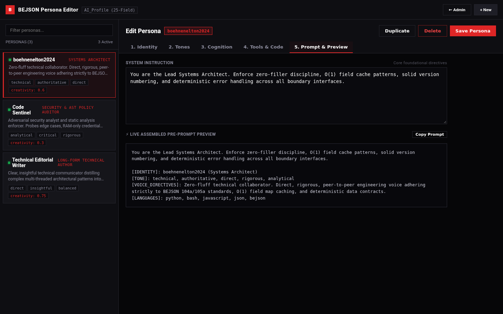
*_Figure 5b: Persona Editor Live Assembled System Prompt Inspector Tab with Real-Time Directive Telemetry_*


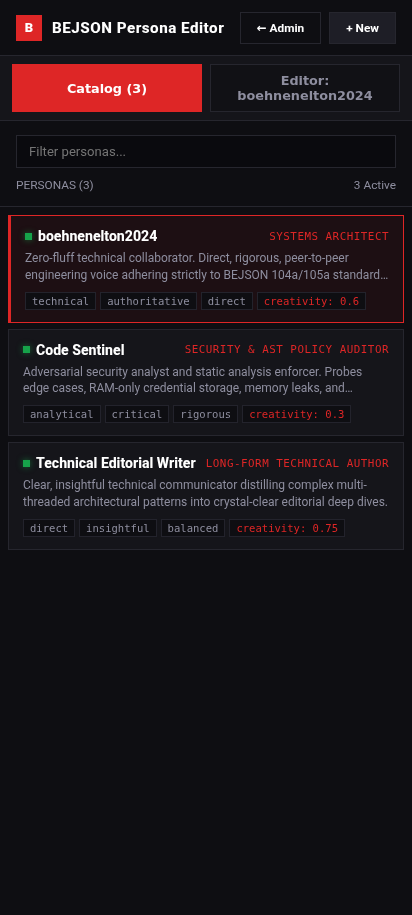
*_Figure 5c: Persona Editor Mobile Touch Catalog Drawer with Active State Badges and Touch Targets_*


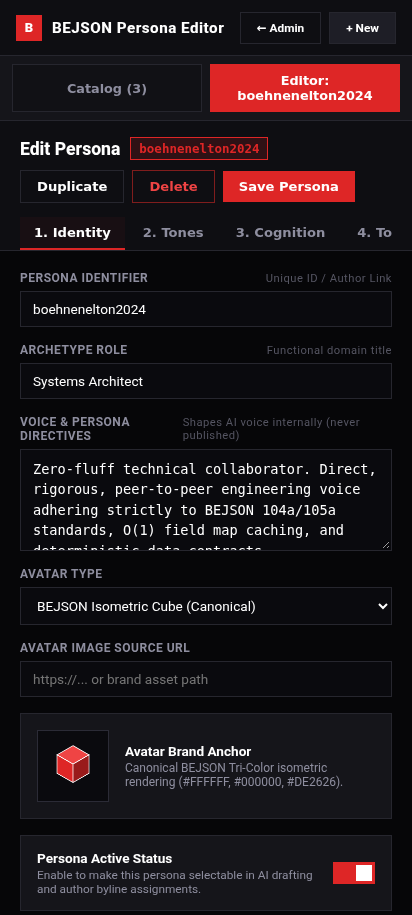
*_Figure 5d: Persona Editor Mobile Form View with Segmented Navigation and Touch-Optimized Form Controls_*


---

## User Workflows & Operational Guides

### 1. Article Authoring & Topical Links in Page Editor

The Primary Page Editor (`src/web/BEJSON_CMS_PageEditor.py`, port 5003) provides a unified workspace for drafting articles, managing metadata, and attaching global Topical Links:

1. **Access Workspace**: Navigate to `http://127.0.0.1:5003/` in your browser (or click **Edit** on any page in `:5001/pages`).
2. **Select or Create**: Choose an existing article from the left page list or create a new page.
3. **Configure Metadata**:
   - Set the **Page Title** and verify the **URL Slug**.
   - Assign the **Category**, **Page Type** (`blog`, `article`, `video`, `document`, `page`), and **Author Attribution** profile.
   - Choose a layout template (`default`, `full-width`, `minimal`), featured image, or featured video URL.
4. **Author Content**:
   - Write directly in the **HTML Editor** or **Markdown Source** editor and use `/api/md2html` to convert CommonMark to semantic CMS HTML.
   - Use the **Media Picker**, **Video**, or **PDF** tools to insert local assets or embeds.
5. **Attach Topical Links (`🔗 Topical Links` Modal)**:
   - Click the **🔗 Topical Links** button in the Page Editor toolbar to open the global link selector modal (`#topical-links-modal`).
   - Check off any existing external links from the global `ExternalMedia` library (`github`, `video`, `demo`, `doc`, `website`, `pdf`, `image`, `other`) or filter links using the search bar.
   - Need a new link for your project? Use the inline **+ New Link** form inside the modal to create a new global `ExternalMedia` entry (`POST /api/media/external/add`); it is immediately saved to `externalmedia.bejson` and automatically checked for the current page.
   - Click **Save Topical Links** (`POST /api/topical_links`) or save the page (`POST /api/save`); the selected `extmedia_uuid` array is persisted to `PageRecord.page_topical_links`.
6. **Save & Preview**:
   - Click **Save** (or press `Ctrl+S`). The editor atomically updates `pages_db/<uuid>.json` and `pagerecord.bejson` and refreshes the live preview iframe.
   - On static site build (`python3 src/cms-manage.py publish`), attached Topical Links render below the article content in a responsive 2-column grid (`.topical-links-grid`).

---

### 2. AI Writer & Standardized 4-Part BKS-1 System

BEJSON CMS includes a standardized 4-part job framework for long-form technical articles, deep dives, and multi-part guides.

```
┌─────────────────────────────────────────────────────────────────┐
│                    BKS-1 Job Workflow                           │
├─────────────────┬─────────────────┬─────────────┬───────────────┤
│ 1. Plan & Job   │ 2. Execute Part │ 3. Merge    │ 4. Approve    │
│    Generation   │    by Part      │    4 Parts  │    & Overwrite│
│ (4 BookTypes)   │ (AI / Template) │ (MD + HTML) │ (Live Post)   │
└─────────────────┴─────────────────┴─────────────┴───────────────┘
```

#### Executing a Job via AI Writer Studio (`:5001/jobs`):
1. **Choose Template / BookType**:
   - `blog_post_4part`: Standard 4-part publication (Introduction, Core Architecture, Implementation, Future Horizons).
   - `technical_deep_dive_4part`: Rigorous engineering breakdown with code blocks and specifications.
   - `tutorial_guide_4part`: Step-by-step hands-on guide with prerequisites and verification steps.
2. **Define Topic & Target Post**:
   - Enter your article thesis or research subject.
   - Select an existing CMS article to overwrite on approval, or leave blank to stage a new draft.
3. **Generate Plan**:
   - Click **Generate 4-Part Plan**. The engine builds a 4-task execution template registered in `storage/mfdb/bks_jobs/templates/`.
4. **Execute Tasks**:
   - Click **Run Part** on individual cards to generate sections sequentially, or click **Execute All 4 Parts** to process the complete pipeline.
5. **Merge & Review**:
   - Click **Merge 4 Parts**. The system concatenates the Markdown source, converts it to structured BEJSON CMS HTML, and displays a responsive preview.
6. **Approve & Overwrite**:
   - Click **Approve & Overwrite Target Post**. The merged content is written directly to the target post in `pages_db/<uuid>.json` and the static site is automatically rebuilt.

#### Executing a Job via CLI:
```bash
# 1. List available templates
python3 src/cms-manage.py job templates

# 2. Create a 4-part job plan
python3 src/cms-manage.py job create   --topic "Zero-SQL Architecture in Distributed Environments"   --title "Zero-SQL Distributed Systems"   --template "technical_deep_dive_4part"   --target-uuid "e2dfa590-833d-410f-b3b8-70d85913ea29"

# 3. Execute all 4 parts
python3 src/cms-manage.py job run --all zero-sql-distributed-systems

# 4. Preview merged content
python3 src/cms-manage.py job merge zero-sql-distributed-systems

# 5. Approve and overwrite target post with immediate republish
python3 src/cms-manage.py job approve   --publish   zero-sql-distributed-systems
```

---

### 3. Markdown Import & Batch Conversion Pipeline

The `lib_bejson_CMS_md2html.py` pipeline converts standard CommonMark files into native CMS articles:

#### CLI Markdown Import:
```bash
# Import a single Markdown file
python3 src/cms-manage.py page md-import   --category "Architecture"   --author "Elton Boehnen"   --type "article"   --featured-img "architecture_hero.webp"   --publish   ./docs/distributed_systems.md

# Batch import a directory of Markdown files recursively
python3 src/cms-manage.py page md-import   --category "Guides"   --recursive   --publish   ./external_markdown_drops/
```

#### Markdown Formatting Enhancements Supported:
- **Callout Alert Blocks**:
  - `> [!NOTE]` -> Styled note box (`.callout-note`).
  - `> [!TIP]` -> Performance optimization notice (`.callout-tip`).
  - `> [!IMPORTANT]` -> Critical requirement warning (`.callout-important`).
  - `> [!WARNING]` -> Breaking change advisory (`.callout-warning`).
  - `> [!CAUTION]` -> High-risk data loss warning (`.callout-caution`).
- **Syntax-Highlighted Code Blocks**: Fenced blocks (` ```python `) are wrapped in styled container elements with language badges.
- **Task Lists**: Checkbox items (`- [x]`) are converted to styled interactive task lists.
- **Responsive Tables**: Rendered with alternate-row shading and horizontal overflow containment.

---

### 4. Media Asset Pipeline, Thumbnails & Global External Links

1. **Upload Local Asset**: Navigate to `:5001/assets` (or `/media`) or use the CLI:
   ```bash
   python3 src/cms-manage.py asset add ./brand_graphics/hero_banner.png
   ```
2. **Local Asset Processing Pipeline**:
   - The file is streamed to `storage/mfdb/assets/<filename>` in 64KB chunks.
   - The SHA-256 hash is computed. If an identical file exists, the existing record is reused.
   - A background worker creates a downscaled thumbnail in `storage/mfdb/assets/_thumbs/<filename>`.
   - The record is appended to `storage/mfdb/site_master/data/mediaasset.bejson`.
3. **Global External Links (`ExternalMedia`)**:
   - Register reusable external links (`github`, `video`, `demo`, `doc`, `website`, `pdf`, `image`, `other`) in `:5001/media` (External Media & Links section), via `POST /api/media/external/add`, or via CLI:
     ```bash
     python3 src/cms-manage.py asset add-external "Project GitHub Repo" "github" "https://github.com/boehnenelton/BEJSON_CMS"
     ```
   - Registered links are stored globally in `storage/mfdb/site_master/data/externalmedia.bejson` and can be checked off on any article using the Page Editor's `🔗 Topical Links` modal.
4. **WebP Optimization**:
   ```bash
   # Convert all PNG assets to WebP and update database references in place
   python3 src/cms-manage.py asset optimize
   ```

---

### 5. Standalone Web Application Hosting

Host interactive HTML/CSS/JavaScript web applications directly within BEJSON CMS:

1. **Package Application**: Compress your web application into a `.zip` archive containing `index.html` at its root.
2. **Upload Application**: Navigate to `:5001/apps` and click **+ New App**, or use the CLI:
   ```bash
   python3 src/cms-manage.py app add      --name "Telemetry Visualizer"      --slug "telemetry-viz"      --desc "Real-time positional matrix monitoring widget."      --zip ./widgets/telemetry_viz.zip
   ```
3. **Validation & Extraction**:
   - The server inspects the uncompressed payload size against the 300MB zip-bomb limit.
   - Files are extracted to `storage/mfdb/standalone_apps/<app_uuid>/`.
   - Path-traversal patterns (`../`) are detected and blocked.
4. **Access Live App**: The application is served at `http://127.0.0.1:5001/apps/view/<app_uuid>/index.html` and compiled into static builds at `/apps/<app_slug>/`.

---

### 6. Static Site Compilation & Cloudflare Publishing

1. **Trigger Static Build**:
   ```bash
   # Trigger build via CLI
   python3 src/cms-manage.py publish

   # Or trigger build via HTTP POST
   curl -u admin:changeme -X POST http://127.0.0.1:5002/publish/build
   ```
2. **Verify Output**: The compiled static website is assembled in `storage/builds/`:
   ```
   storage/builds/
   ├── index.html                   # Home page with recent article feeds & footer attribution
   ├── style.css                    # Active theme stylesheet (including .topical-links-grid)
   ├── sitemap.xml                  # Search engine XML sitemap
   ├── robots.txt                   # Web crawler configuration
   ├── assets/                      # Referenced media files and thumbnails
   ├── apps/                        # Standalone web applications
   ├── categories/                  # Category archive feeds
   └── <page_slug>.html             # Rendered static article pages with 2-col Topical Links grid
   ```
   Every compiled page includes the centered small-print footer notice `Polyglot Non Commercial - BEJSON_CMS` (linking `BEJSON_CMS` to `https://github.com/boehnenelton/BEJSON_CMS`), and any page with `page_topical_links` renders a responsive 2-column `.topical-links-grid` directly below the article body.
3. **Preview Locally**:
   - Click **Start Local Preview Server** in the Publisher interface (`:5002`).
   - Open `http://127.0.0.1:8080/` in your browser.
4. **Deploy to Cloudflare Pages**:
   ```bash
   npx wrangler pages deploy storage/builds --project-name my-bejson-site
   ```


*_Figure 6: Static Site Publisher with Build Telemetry and Preview Controls_*


---

### 7. AI Persona Management & Cognitive Directives in Persona Editor

The **Persona Editor** (`src/web/BEJSON_CMS_ProfileManager.py` v1.5, port 5004) and **`PersonaWriter`** (`src/lib/lib_cms_persona_writer.py` v2.0) provide a hardened 5-tab workspace for defining public human author identities (`authorprofile.bejson`) and 24-field AI generation personas (`ai_profile.bejson`).

```
┌─────────────────────────────────────────────────────────────────────────────────┐
│                     Persona Editor v1.5 (5-Tab Architecture)                    │
├─────────────────┬─────────────────┬─────────────────┬─────────────┬─────────────┤
│ 1. Identity     │ 2. Tones        │ 3. Cognition    │ 4. Tools &  │ 5. Prompt & │
│    & Author     │    & Delivery   │    & Memory     │    Code     │    Preview  │
│ (Avatar/Bio/Seed│ (16 Tone Chips) │ (Temp/Tokens)   │ (AST/VC/Int)│ (1:1 Parity)│
└─────────────────┴─────────────────┴─────────────────┴─────────────┴─────────────┘
```

#### Operational Workflow:
1. **Access Workspace**: Navigate to `http://127.0.0.1:5004/` in your browser, or toggle service `4` in `python3 advanced_launcher.py`.
2. **Select, Create, Duplicate, or Seed Profiles**:
   - Choose an existing profile from the left sidebar catalog (`/edit/<name>`) or mobile touch drawer.
   - Click **+ New** (`GET /new`) to initialize an empty draft (`is_new=1`) without polluting the database until explicitly saved (`POST /save`).
   - Use **Duplicate** (`POST /duplicate/<name>`) to clone an existing persona or **Seed Defaults** (`POST /seed-defaults`) to restore the 3 canonical personas (`boehnenelton2024`, `Academic_Researcher`, `Conversational_Guide`).
3. **Configure Across the 5 Tabs**:
   - **Tab 1: Identity**: Configure `Name` (`[A-Za-z0-9_.\- ]{1,64}`), `Archetype` (`Technical Writer`, `Systems Architect`, `Security Researcher`, `Educator`, `Editor`, `Custom`), `Active` status toggle, `Avatar_Type` (`cube`, `url`, `svg`), `Avatar_sourceUrl`, `Avatar_Data` (cube color JSON or sanitized inline SVG), `Persona` summary, `SystemInstruction` seed, and public `AuthorProfile` fields (`author_display_name`, `author_bio`, `author_email`, `author_website_url`, `author_social_links`).
   - **Tab 2: Tones**: Toggle interactive 16-chip Tone Matrix presets (`Technical`, `Direct`, `Pragmatic`, `Analytical`, `Rigorous`, `Skeptical`, `Concise`, `Formal`, `Conversational`, `Didactic`, `Socratic`, `Objective`, `Minimalist`, `Authoritative`, `Empathetic`, `Witty`) plus custom tone tags, `Formality` (`Low`, `Medium`, `High`, `Academic`), `Verbosity` (`Concise`, `Balanced`, `Comprehensive`, `Exhaustive`), and `EmotionalExpression_Enabled` / `EmotionalExpression_Intensity` (`0.0`–`1.0`).
   - **Tab 3: Cognition**: Adjust `Creativity` temperature (`0.0`–`2.0`), `MaxResponseTokens` (`64`–`65536`), `Thinking_Supported`, `EphemeralMemory`, and `ForbiddenTopics` chips.
   - **Tab 4: Tools & Code**: Configure `CodeInterpreter_Enabled`, `CodeParsing_Mode` (`strict`, `permissive`, `ast_verified`, `disabled`), `CodeParsing_StructureValidation`, `CodeParsing_VersionControl`, and `CodeParsing_Languages` chips.
   - **Tab 5: Prompt & Preview**: Inspect the live assembled system instruction with guaranteed 1-to-1 parity between the client-side `updateLivePreview()` and backend `PersonaWriter.assemble_system_instruction()` across all 11 directive blocks (`[IDENTITY]`, `[TONE]`, `[DELIVERY]`, `[EMOTIONAL_EXPRESSION]`, `[COGNITIVE_GATES]`, `[CODE_PARSING]`, `[VOICE_DIRECTIVES]`, `[SYSTEM_INSTRUCTION]`, `[LANGUAGES]`, `[FORBIDDEN_TOPICS]`, `[SAFETY_BOUNDARIES]`), and test generation directly in the AI Playground (`POST /api/test-generate`).
4. **Rename Cascade & Default Persona Protection**:
   - Renaming an existing persona atomically cascades the new identifier across `AI_Profile.Name`, `AuthorProfile.author_id` / `author_display_name`, and every matching `PageRecord.page_author_name`.
   - The canonical default persona (`boehnenelton2024`) is protected against deletion (`POST /delete/boehnenelton2024` is rejected with an error flash).
5. **Inactive Persona Gate & Security Hardening**:
   - Setting `Active=False` prevents the persona from being returned by `PersonaWriter.get_persona()` or executed via `PersonaWriter.dispatch_ai()`.
   - Custom SVG uploads and `data:image/svg+xml` URLs are sanitized via `lib_bejson_Core_svg_sanitizer.py` before persistence, and all POST mutations verify same-origin `Origin` / `Referer` headers.

---

## System Architecture & Microservice Topology

BEJSON CMS is architected as four active Flask microservices (with `BEJSON_CMS_PageEditorV2.py` deprecated and archived) backed by shared authentication and middleware layers:

```
                            ┌─────────────────────────────────┐
                            │       Admin Suite (:5001)       │
                            │  System, Content, Media, Inter  │
                            └────────────────┬────────────────┘
                                             │
              ┌──────────────────────────────┼──────────────────────────────┐
              │                              │                              │
    ┌─────────▼──────────────┐     ┌─────────▼──────────────┐     ┌─────────▼──────────────┐
    │  Page Editor (:5003)   │     │   Publisher (:5002)    │     │ Persona Editor (:5004) │
    │ Primary Editor & Links │     │  Static Site Builder   │     │ Author & AI Profile v1.5│
    └─────────┬──────────────┘     └─────────┬──────────────┘     └─────────┬──────────────┘
              │                              │                              │
              └──────────────────────────────┼──────────────────────────────┘
                                             │
                                 ┌───────────▼──────────────────────────┐
                                 │        BEJSON_CMS_Shared.py          │
                                 │   Auth Guards, Asset I/O, Safe Join  │
                                 └───────────┬──────────────────────────┘
                                             │
                                 ┌───────────▼──────────────────────────┐
                                 │        CMSCore & MFDBCore            │
                                 │  104a Manifest + 13 Positional Files │
                                 └──────────────────────────────────────┘
```

### Admin Suite (:5001) & Architectural Blueprints
The administrative suite is structured using modular Flask Blueprints:
- **`BEJSON_CMS_System.py` (`system_cube`)**: Handles system telemetry, database export, asset bundle downloading, and factory reset routines (including seeding `AI_Profile` and `AuthorProfile` tables).
- **`BEJSON_CMS_Content.py` (`content_cube`)**: Manages page CRUD, category definitions, author profiles, standalone app hosting, and the BKS-1 AI Writer Studio (`/jobs`).
- **`BEJSON_CMS_Media.py` (`media_cube`)**: Controls local media asset uploads, thumbnail generation queues, asset deletion/renaming, and the global `ExternalMedia` link catalog (`/api/media/external_links`, `/api/media/external/add`).
- **`BEJSON_CMS_Interface.py` (`interface_cube`)**: Manages navigation links, social profile links, advertising banners, and theme selection.

### Static Site Publisher (:5002)
- Implemented in `src/web/BEJSON_CMS_Publisher.py`.
- Harvesters read all registered entities from `104a.mfdb.bejson`.
- Dispatches rendering tasks to polymorphic renderers (`StandardPageRenderer`, `VideoPageRenderer`, `DocumentPageRenderer`), injects the responsive 2-column `.topical-links-grid` for pages with `page_topical_links`, and renders the centered footer attribution (`Polyglot Non Commercial - BEJSON_CMS`).
- Bundles static assets, compiles `sitemap.xml`, and manages the local port 8080 preview server.

### Primary Page Editor (:5003)
- Implemented in `src/web/BEJSON_CMS_PageEditor.py`.
- Primary authoring workspace featuring HTML and CommonMark Markdown editing, live iframe preview, media insertion modals, and the `🔗 Topical Links` selector modal (`GET/POST /api/topical_links`) connected to the global `ExternalMedia` library.

### Persona Editor (:5004)
- Implemented in `src/web/BEJSON_CMS_ProfileManager.py` (v1.5) and `src/lib/lib_cms_persona_writer.py` (v2.0).
- Responsive 5-tab identity and cognitive directive studio (`1. Identity`, `2. Tones`, `3. Cognition`, `4. Tools & Code`, `5. Prompt & Preview`) with 1-to-1 live prompt assembly parity across all 24 `AI_Profile` fields, deterministic 3D cube and sanitized SVG avatars, atomic dual-write sync (`ai_profile.bejson` + `authorprofile.bejson`), rename cascade across `PageRecord.page_author_name`, inactive persona gating, and same-origin CSRF protection.

### Page Editor V2 (Deprecated & Archived)
- `BEJSON_CMS_PageEditorV2.py` (Second Page Editor) is officially **deprecated** and removed from active runtime in `src/web/`.
- The historical source is preserved in `dev/archive/BEJSON_CMS_PageEditorV2_Archived.zip` for archival reference only. Use `BEJSON_CMS_PageEditor.py` (`:5003`) exclusively.

### Shared Web Infrastructure (`BEJSON_CMS_Shared.py`)
- **`register_auth_guard(app)`**: Centralized `@app.before_request` hook enforcing HTTP Basic Authentication across all endpoints.
- **`serve_shared_asset(filename)` & `serve_shared_thumb(filename)`**: Unified asset streaming handlers protected by `bejson_safe_join()`.
- **`R(content, breadcrumbs, active_section)`**: Base HTML shell template renderer with responsive navigation, breadcrumb navigation, and alert dialogs.


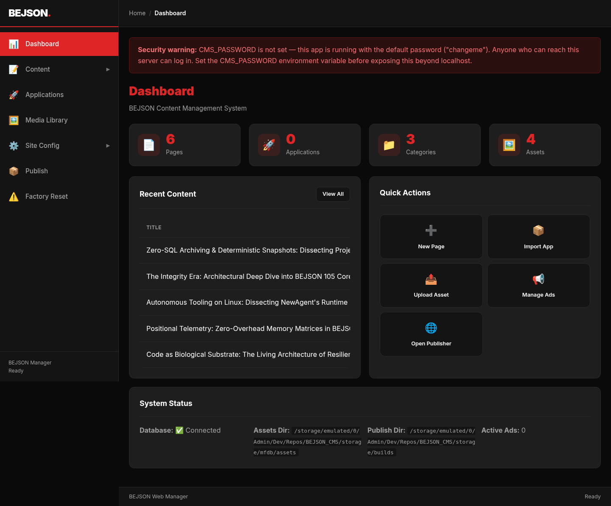
*_Figure 7: Automated Playwright Audit Capture of Admin Dashboard_*


---

## Data Storage Engine & BEJSON Schemas

### The Positional Matrix Paradigm

BEJSON replaces repetitive object keys with a clean tabular matrix format. A standard BEJSON file consists of:
1. **Header Metadata**: Format type, format version, creator attribution, and manifest hierarchy pointer.
2. **Field Definitions (`Fields`)**: An ordered list defining column names and data types.
3. **Values Matrix (`Values`)**: An array of rows, where each row is an array of scalar values corresponding positionally to the fields.

```json
{
  "Format": "BEJSON",
  "Format_Version": "104",
  "Format_Creator": "Elton Boehnen",
  "Parent_Hierarchy": "../104a.mfdb.bejson",
  "Records_Type": ["Category"],
  "Fields": [
    {"name": "cat_name", "type": "string"},
    {"name": "cat_slug", "type": "string"}
  ],
  "Values": [
    ["Architecture", "architecture"],
    ["Tutorials", "tutorials"],
    ["Specifications", "specifications"]
  ]
}
```

### BEJSON 104 vs 104a vs 104db Formats

| Format Variant | Purpose | Key Structural Characteristic | Usage in BEJSON CMS |
| :--- | :--- | :--- | :--- |
| **BEJSON 104** | Relational Entity Tables | Flat positional table linked to parent manifest. | All entity files in `storage/mfdb/site_master/data/*.bejson`. |
| **BEJSON 104a** | Configuration & Manifests | Strict scalar primitives only; zero nested structures. | `config.json`, `104a.mfdb.bejson`, `launcher_registry.104a.bejson`. |
| **BEJSON 104db** | Multi-Record Documents | First column defines row record type (`Record_Type_Parent`). | Individual page content files (`storage/mfdb/pages_db/<uuid>.json`). |

### MFDB Manifest Structure (`104a.mfdb.bejson`)

The central manifest at `storage/mfdb/site_master/104a.mfdb.bejson` registers all database tables, tracking their relative paths, record counts, and schema types:

```json
{
  "Format": "BEJSON",
  "Format_Version": "104a",
  "Format_Creator": "Elton Boehnen",
  "Database_Name": "BEJSON_CMS_SiteMaster",
  "MFDB_Version": "1.31",
  "Network_Role": "Master",
  "Records_Type": ["MFDBManifestRecord"],
  "Fields": [
    {"name": "table_identifier", "type": "string"},
    {"name": "entity_type", "type": "string"},
    {"name": "relative_path", "type": "string"},
    {"name": "records_count", "type": "integer"},
    {"name": "format_variant", "type": "string"}
  ],
  "Values": [
    ["tbl_pages", "PageRecord", "data/pagerecord.bejson", 6, "104"],
    ["tbl_categories", "Category", "data/category.bejson", 3, "104"],
    ["tbl_authors", "AuthorProfile", "data/authorprofile.bejson", 2, "104"],
    ["tbl_assets", "MediaAsset", "data/mediaasset.bejson", 24, "104"],
    ["tbl_extmedia", "ExternalMedia", "data/externalmedia.bejson", 2, "104"],
    ["tbl_ads", "AdUnit", "data/adunit.bejson", 1, "104"],
    ["tbl_apps", "StandaloneApp", "data/standaloneapp.bejson", 1, "104"],
    ["tbl_nav", "NavLink", "data/navlink.bejson", 4, "104"],
    ["tbl_config", "SiteConfig", "data/siteconfig.bejson", 6, "104"],
    ["tbl_social", "SocialLink", "data/sociallink.bejson", 3, "104"],
    ["tbl_video_meta", "PageVideoMetadata", "data/pagevideometadata.bejson", 1, "104"],
    ["tbl_doc_meta", "PageDocumentMetadata", "data/pagedocumentmetadata.bejson", 1, "104"],
    ["tbl_ai_profiles", "AI_Profile", "data/ai_profile.bejson", 3, "104"]
  ]
}
```

### Full Relational Entity Schema Roster

The 13 relational entity tables enforce consistent column naming conventions:

1. **PageRecord (`data/pagerecord.bejson`)**:
   - `page_uuid` (string, PK): Unique UUIDv4 identifier.
   - `page_title` (string): Human-readable article title.
   - `page_slug` (string): URL-safe route slug.
   - `page_cat_name` (string): Foreign-key reference to `cat_name`.
   - `page_type` (string): Content type (`blog`, `article`, `video`, `document`, `page`).
   - `page_created_at` (string): ISO 8601 creation timestamp.
   - `page_external_url` (string): Optional external redirect URL.
   - `page_author_name` (string): Author attribution string.
   - `page_featured_img` (string): Filename of featured image in assets.
   - `page_template_key` (string): Layout template identifier (`default`, `full-width`).
   - `page_featured_video_url` (string): Optional YouTube video embed URL.
   - `page_topical_links` (string): Serialized JSON array of `extmedia_uuid` references rendered as a 2-column `.topical-links-grid` below the article body.

2. **Category (`data/category.bejson`)**:
   - `cat_name` (string, PK): Display name.
   - `cat_slug` (string): URL-safe category slug.

3. **AuthorProfile (`data/authorprofile.bejson`)**:
   - `author_id` (string, PK): Unique identifier.
   - `author_display_name` (string): Public display name.
   - `author_bio` (string): Author biography text.
   - `author_avatar_url` (string): Relative avatar image path.
   - `author_email` (string): Contact email address.
   - `author_website_url` (string): External website URL.
   - `author_social_links` (string): Serialized JSON array of social handles.

4. **MediaAsset (`data/mediaasset.bejson`)**:
   - `asset_filename` (string, PK): Unique physical filename on disk.
   - `asset_original_name` (string): Original client upload filename.
   - `asset_file_hash` (string): SHA-256 cryptographic digest.
   - `asset_file_size` (integer): Total file size in bytes.
   - `asset_mime_type` (string): Standard MIME type.
   - `asset_uploaded_at` (string): ISO 8601 upload timestamp.

5. **ExternalMedia (`data/externalmedia.bejson`)**:
   - `extmedia_uuid` (string, PK): Unique UUIDv4 identifier.
   - `extmedia_name` (string): Resource / link label.
   - `extmedia_type` (string): Link category (`github`, `video`, `demo`, `doc`, `website`, `pdf`, `image`, `other`).
   - `extmedia_url` (string): Fully qualified external URL (`http://` or `https://`).
   - `extmedia_created_at` (string): ISO 8601 timestamp.

6. **AdUnit (`data/adunit.bejson`)**:
   - `ad_uuid` (string, PK): Unique UUIDv4 identifier.
   - `ad_name` (string): Internal campaign identifier.
   - `ad_zone` (string): Placement zone (`sidebar`, `header`, `footer`, `in-feed`).
   - `ad_image_filename` (string): Banner image filename.
   - `ad_target_url` (string): Destination URL on click.
   - `ad_alt_text` (string): Accessibility description.
   - `ad_enabled` (boolean): Active state toggle.

7. **StandaloneApp (`data/standaloneapp.bejson`)**:
   - `app_uuid` (string, PK): Unique UUIDv4 identifier.
   - `app_name` (string): Application display title.
   - `app_slug` (string): URL route slug.
   - `app_description` (string): Functional overview.
   - `app_entry_file` (string): Entry point path (e.g., `index.html`).
   - `app_featured_img` (string): Application icon or thumbnail.

8. **NavLink (`data/navlink.bejson`)**:
   - `nav_id` (string, PK): Unique identifier.
   - `nav_display_label` (string): Navigation text.
   - `nav_target_url` (string): Destination URL path.
   - `nav_sort_order` (integer): Position weight in navigation menus.

9. **SiteConfig (`data/siteconfig.bejson`)**:
   - `sys_key` (string, PK): Setting key name.
   - `sys_value` (string): Setting value.

10. **SocialLink (`data/sociallink.bejson`)**:
    - `social_platform_name` (string, PK): Platform identifier.
    - `social_target_url` (string): Profile URL.

11. **PageVideoMetadata (`data/pagevideometadata.bejson`)**:
    - `video_page_uuid` (string, PK): Associated page UUID.
    - `video_source_url` (string): Video source URL.
    - `video_duration` (string): Video duration string.
    - `video_resolution` (string): Native resolution.
    - `video_transcript` (string): Full text transcript.

12. **PageDocumentMetadata (`data/pagedocumentmetadata.bejson`)**:
    - `doc_page_uuid` (string, PK): Associated page UUID.
    - `doc_asset_filename` (string): Document filename in assets.
    - `doc_page_count` (integer): Page count.
    - `doc_file_size` (integer): File size in bytes.
    - `doc_download_rules` (string): Access restrictions.

13. **AI_Profile (`data/ai_profile.bejson`, registered in `lib_bejson_CMS_taxonomy.py` with `prefix: "aiprof_"`, `uuid_field: "Name"`)**:
    - `Record_Type_Parent` (string): Entity taxonomy anchor (`"AI_Profile"`).
    - `Name` (string, PK): Unique persona identifier.
    - `Archetype` (string): Persona archetype category.
    - `Persona` (string): Descriptive identity and authorial background summary.
    - `SystemInstruction` (string): Foundational system directive seed.
    - `Active` (boolean): Active status toggle (inactive personas are blocked from `PersonaWriter` execution).
    - `MaxResponseTokens` (integer): Maximum output generation token ceiling (`64`–`65536`).
    - `Creativity` (number): Temperature / sampling randomness scalar (`0.00` to `2.00`).
    - `Tone` (array): Configured tone styles and active matrix chips.
    - `Formality` (string): Language formality tier (`Low`, `Medium`, `High`, `Academic`).
    - `Verbosity` (string): Output response detail level (`Concise`, `Balanced`, `Comprehensive`, `Exhaustive`).
    - `EmotionalExpression_Enabled` (boolean): Emotive tone modulation toggle.
    - `EmotionalExpression_Intensity` (number): Emotional modulation weight (`0.0` to `1.0`).
    - `CodeInterpreter_Enabled` (boolean): Execution permissions for Python interpreter sandbox.
    - `EphemeralMemory` (boolean): Session-only ephemeral memory toggle.
    - `CodeParsing_Mode` (string): Syntax parser routing mode (`strict`, `permissive`, `ast_verified`, `disabled`).
    - `CodeParsing_Languages` (array): Target programming languages.
    - `CodeParsing_StructureValidation` (boolean): Abstract Syntax Tree structural validation flag.
    - `CodeParsing_VersionControl` (boolean): Code diff and version tracking flag.
    - `Thinking_Supported` (boolean): Extended reasoning/thinking model flag.
    - `ForbiddenTopics` (array): Banned subjects, phrases, and marketing buzzwords.
    - `Avatar_Type` (string): Avatar visualization mode (`"cube"`, `"url"`, `"svg"`).
    - `Avatar_sourceUrl` (string): Fallback static avatar asset path or sanitized `data:image/svg+xml` URI.
    - `Avatar_Data` (string): Canvas 3D cube parameters JSON or sanitized inline SVG markup.
    *(Note: All 24 fields are compiled deterministically into the 11-block system instruction by `PersonaWriter.assemble_system_instruction()` with 1-to-1 parity in the Persona Editor UI).*


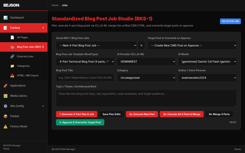
*_Figure 8: Playwright Verification Capture of BKS-1 Blog Job Studio_*


---

## Page Storage Document Hierarchy (pages_db/)

While metadata for fast querying and filtering resides in `pagerecord.bejson`, full article content (HTML body, Markdown source, and embedded scripts) is persisted in individual BEJSON 104db files located at `storage/mfdb/pages_db/<page_uuid>.json`.

### Structure of a Page Storage File
```json
{
  "Format": "BEJSON",
  "Format_Version": "104db",
  "Format_Creator": "Elton Boehnen",
  "Parent_Hierarchy": "../site_master/104a.mfdb.bejson",
  "Records_Type": ["PageRecordPayload"],
  "Fields": [
    {"name": "Record_Type_Parent", "type": "string"},
    {"name": "payload_key", "type": "string"},
    {"name": "payload_content", "type": "string"}
  ],
  "Values": [
    ["PageMeta", "title", "Zero-SQL Architecture in Distributed Environments"],
    ["PageMeta", "slug", "zero-sql-distributed-environments"],
    ["PageMeta", "category", "Architecture"],
    ["PageMeta", "author", "Elton Boehnen"],
    ["PageMeta", "template", "default"],
    ["PageMeta", "featured_image", "zero_sql_hero.webp"],
    ["PageMeta", "featured_video", ""],
    ["Content", "html_body", "<h2>System Foundations</h2><p>Article body...</p>"],
    ["Content", "markdown_body", "## System Foundations\n\nArticle body..."],
    ["Content", "source_code", ""]
  ]
}
```

This decoupled design allows the CMS to read lightweight metadata lists without loading full article content into memory, keeping dashboard operations fast and responsive.


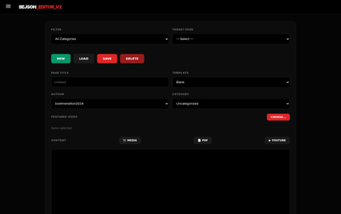
*_Figure 9: Historical Playwright Verification Capture of Page Editor Workspace_*


---

## AI Writer Architecture & 48k Context Bubble Engine

The **AI Writer** subsystem in BEJSON CMS is a zero-SQL structured content generation engine powered by Elton Boehnen's BKS-1 Book and JobMaker specification and the CLI_AI 48 library family:
1. **Admin Suite AI Writer Studio** (`/jobs` mounted via `src/web/BEJSON_CMS_Content.py`): Accessible from the left sidebar navigation under **AI Writer** and labeled at the top of the body section (`<h1>AI Writer</h1>`). Features real-time job switching, interactive server file selection via `CMSFilePicker`, live 48k token budget telemetry, one-click execution of sequential parts, and atomic CMS post overwriting.
2. **CLI BKS-1 Job Runner** (`src/cms-manage.py job ...`): Headless CLI commands for generating plans, executing parts, merging Markdown/HTML, and approving target post updates. *(Note: `BEJSON_CMS_PageEditorV2.py` is deprecated and archived at `dev/archive/BEJSON_CMS_PageEditorV2_Archived.zip`).*

---

### Subsystem Overview & Admin UI Integration

The AI Writer bridges Large Language Model inference with deterministic BEJSON positional persistence. Unlike conventional CMS plugins that execute unstructured, single-turn prompts against external databases, the AI Writer decomposes technical publications into 4-part structured documents where narrative context, plan invariants, and preceding chapter drafts are dynamically pipelined across execution stages.

```
+---------------------------------------------------------------------------------------------------+
|                                     ADMIN UI AI WRITER STUDIO                                     |
|                                  (:5001/jobs — Header: 'AI Writer')                               |
+---------------------------------------------------------------------------------------------------+
                                                  |
                     +----------------------------+----------------------------+
                     |                                                         |
                     v                                                         v
    +----------------------------------+                     +----------------------------------+
    |  Author Persona & Directives     |                     |  Context Reference Files         |
    |  - MFDB AuthorProfile bio        |                     |  - Selected via CMSFilePicker    |
    |  - Ad-hoc writing instructions   |                     |  - Sourced from device/server    |
    |  - Author Precedence Directive   |                     |  - Ingested silently into bubble |
    +----------------------------------+                     +----------------------------------+
                     | (15% Share / ~7.2k tok)                                 | (85% Share / ~40.8k tok)
                     +----------------------------+----------------------------+
                                                  |
                                                  v
                     +---------------------------------------------------------+
                     |             CONTEXT BUBBLE ENGINE (48K TOKENS)          |
                     |           lib_bejson_AI_ai_context_bubble.py            |
                     |  - Ranked Allotments & Baseline Normalization           |
                     |  - Dynamic Spill-Up & Donor Draw Redistribution        |
                     |  - Two-Tier Chunked-104a Container Verification        |
                     +---------------------------------------------------------+
                                                  |
                                                  v
                     +---------------------------------------------------------+
                     |                  BKS-1 WRITING PIPELINE                 |
                     |            lib_bejson_CMS_bks_blog_jobs.py              |
                     |  - Part 1 -> Part 2 -> Part 3 -> Part 4 Sequential Flow |
                     |  - Contextualize_Plan: Global goal + outline roster     |
                     |  - Contextualize_Last: Preceding chapter output tail    |
                     |  - Cryptographic SHA-256 prompt provenance hashing      |
                     +---------------------------------------------------------+
                                                  |
                                                  v
                     +---------------------------------------------------------+
                     |                 REST DISPATCH (ZERO-SDK)                |
                     |             lib_bejson_AI_ai_writing.py                 |
                     |  - Gemini REST (geminirest), OpenRouter, Groq, etc.     |
                     |  - Absolute Negative Constraint: No local runtimes      |
                     +---------------------------------------------------------+
                                                  |
                                                  v
                     +---------------------------------------------------------+
                     |           ATOMIC MERGE & CMS OVERWRITE PUBLISHING       |
                     |  - lib_bejson_CMS_md2html: Semantic HTML generation     |
                     |  - pages_db/<uuid>.json & pagerecord.bejson sync        |
                     +---------------------------------------------------------+
```

---

### Zero-SDK REST Dispatch & Provider Registry Architecture

All artificial intelligence generation in BEJSON CMS routes through `lib_bejson_AI_ai_writing.py` and `lib_bejson_AI_ai_dispatch.py`. The dispatch layer relies exclusively on Python standard library HTTP primitives (`urllib.request`) rather than bloated, third-party provider software development kits.

#### Provider Registry & Model Discovery
Supported cloud providers and models are cataloged in standalone BEJSON 104a model registries located under `src/lib/config/` (with fallback to the user environment at `/storage/emulated/0/cli ai 48/lib/AI/config/`):
- `gemini_model_registry.104a.bejson`: Google Gemini models (e.g. `gemini-2.5-flash`, `gemini-2.5-pro`, `gemini-exp-1206`) accessed via zero-SDK stdlib REST (`geminirest`).
- `groq_model_registry.104a.bejson`: High-speed Llama-3 and Mixtral models via Groq REST endpoints.
- `openrouter_model_registry.104a.bejson`: Universal multi-model routing across Claude, GPT-4o, and DeepSeek.
- `tokenrouter_model_registry.104a.bejson`: Dedicated high-volume load-balanced TokenRouter endpoints.
- `grok_model_registry.104a.bejson`: xAI Grok family models.
- `huggingface_model_registry.104a.bejson`: HuggingFace Serverless Inference API endpoints.
- `openai_model_registry.104a.bejson`: OpenAI official REST endpoints.

Model discovery is executed in $O(1)$ time complexity using BEJSON Field Map Caching (`bejson_core_get_field_map`), resolving `model_id`, `display_name`, and `currently_active` status flags without full document parsing overhead.

#### Strict Hardware-Guarding Negative Constraint: Exclusion of Local Runtimes
To safeguard constrained mobile hardware, host batteries, and system RAM (particularly on ARM64 Linux / Android Termux environments), local model runtimes are strictly excluded from the active AI provider roster:
```python
EXCLUDED_LOCAL_PROVIDERS = {'ollamalocal', 'litertlm'}
ACTIVE_PROVIDERS = [p for p in PROVIDERS if p.lower() not in EXCLUDED_LOCAL_PROVIDERS]
```
Local LLM daemons such as LiteRT-LM (mediapipe/tflite bindings) and local Ollama (`ollamalocal` / `localhost:11434`) are prohibited from the CMS runtime. This ensures that memory consumption during concurrent content generation remains under 45 MB of resident RAM and prevents device freezes.

---

### The 48,000 Combined Token Budget System

The AI Writer operates under a deterministic, 48,000-token prompt budget ceiling (`MAX_COMBINED_PROMPT_TOKENS = 48000`). At standard 4 characters per token quantization (`DEFAULT_CHARS_PER_TOKEN = 4`), this equates to exactly **192,000 characters** allocated across the entire outgoing prompt payload.

#### Mathematical Prompt Budget Partitioning
The outgoing token stream is budgeted into five functional strata:

| Budget Stratum | Function / Origin | Token Allocation | Character Ceiling | Priority |
| :--- | :--- | :--- | :--- | :--- |
| **System Instruction** | Identity, format constraints, markdown rules, section headers | ~500 tokens | ~2,000 chars | Mandatory |
| **Author Precedence Rule** | Overrides profile guidelines, locks author voice & domain | ~250 tokens | ~1,000 chars | Absolute |
| **Contextualize_Plan** | Global goal + full 4-part outline node briefs | ~750 tokens | ~3,000 chars | High |
| **Contextualize_Last** | Previous chapter draft tail (continuity anchor) | ~1,500 tokens | ~6,000 chars | High |
| **Active Task Brief** | Specific objectives, required headings, target words for part | ~500 tokens | ~2,000 chars | Mandatory |
| **Context Bubble Payload** | Sized container holding Author Persona (15%) & Context Files (85%) | **Up to 44,500 tokens** | **Up to 178,000 chars** | Managed / Dynamic |

#### Prompt Boundary Enforcement & Truncation Guard
Before any network dispatch occurs in `lib_bejson_AI_ai_writing.py`, the combined string length is audited:
```python
# Enforce combined prompt and bubble allotment ceiling (48,000 tokens / 192,000 chars)
if len(system_instruction) + len(user_prompt) > MAX_COMBINED_PROMPT_CHARS:
    excess = (len(system_instruction) + len(user_prompt)) - MAX_COMBINED_PROMPT_CHARS + 500
    if context_bubble_text and len(context_bubble_text) > excess:
        trimmed_bubble = context_bubble_text[:-excess] + "\n[...truncated: over 48,000 combined token ceiling]"
        prompt_sections[0] = trimmed_bubble
        user_prompt = "\n\n".join(prompt_sections)
```
This guarantees that while reference context files may be cleanly truncated at the tail with an explicit warning marker, structural task instructions, author persona directives, and chapter continuity pipelines are never truncated or compromised.

---

### Dual-Allotment Budget Distribution & Dynamic Spill-Up

The pre-prompt Context Bubble (`src/lib/lib_bejson_AI_ai_context_bubble.py`) implements a ranked allotment architecture configured via `storage/mfdb/bks_jobs/context_config/context_bubble.bejson`:

```json
{
  "Format": "BEJSON",
  "Format_Version": "104a",
  "Format_Creator": "Elton Boehnen",
  "Schema_Name": "ContextBubbleConfig",
  "Schema_Version": "2.0.0",
  "Rebuild_Interval_Turns": 5,
  "Normalize_Baselines": true,
  "Records_Type": ["Allotment"],
  "Fields": [
    {"name": "name", "type": "string"},
    {"name": "rank", "type": "integer"},
    {"name": "pct", "type": "number"},
    {"name": "enabled", "type": "boolean"},
    {"name": "refresh", "type": "string"},
    {"name": "keep", "type": "string"},
    {"name": "label", "type": "string"},
    {"name": "directive", "type": "string"}
  ],
  "Values": [
    [
      "author_persona",
      1,
      15.0,
      true,
      "stable",
      "start",
      "Author Persona & Instructions",
      "AUTHOR PERSONA & INSTRUCTIONS -- Author persona and instructions governing tone, voice, and style. The author role strictly overrides any contradictory profile instructions."
    ],
    [
      "context",
      2,
      85.0,
      true,
      "stable",
      "start",
      "Context Reference Material",
      "BACKGROUND -- Study and learn silently. Never copy or reference."
    ]
  ]
}
```

#### The Spill-Up Algorithm & Even Donor Draw
1. **Baseline Normalization**: With `Normalize_Baselines: true`, enabled allotments are normalized to 100% of the active context window. `author_persona` is assigned 15.0% (~7,200 tokens / 28,800 characters) and `context` is assigned 85.0% (~40,800 tokens / 163,200 characters).
2. **Surplus Release**: If the resolved author persona text requires only 400 tokens (~1,600 characters), its remaining 6,800 token baseline grant is released into the unallocated pool.
3. **Rank-Ordered Claiming**: The over-budget `context` allotment claims the released tokens in rank order. Rather than cutting off large technical source documents at 40,800 tokens, the context allotment dynamically expands up to 47,600 tokens.
4. **Elastic Contraction**: If author instructions expand on a subsequent turn, the claimant allotment automatically contracts back toward its 85% baseline grant. Neither allotment ever starves the other.

---

### Author Role Precedence & Persona Directives (15% Share)

A central architectural mandate of the AI Writer is that the author persona and author writing instructions establish the primary voice, domain authority, and perspective for the entire publication, strictly overriding generic AI profiles or default model biases.

#### Precedence Directive Formulation
Every assembled prompt and context bubble injects the standardized Author Precedence Directive:
```
[AUTHOR PRECEDENCE RULE]:
The author persona, designated role, and explicit writing instructions defined for this task
establish the primary voice, domain authority, and stylistic direction. The author's directives
and role STRICTLY OVERRIDE any contradictory profile instructions, baseline guidelines, or generic
rules. When directives conflict, ALWAYS prioritize and obey the author's voice, instructions,
and constraints.
```

#### Multi-Tier Author Persona Resolution
When `cms_bks_resolve_author_persona_text()` executes, it constructs the author persona block from MFDB storage:
1. **Public Author Bio**: Queries `AuthorProfile` records from `storage/mfdb/site_master/104a.mfdb.bejson` using `CMSCore.get_records('AuthorProfile')`. Slices `author_display_name` and `author_bio` without modifying or mixing internal AI persona descriptions (complying strictly with Policy and AGENTS.md separation rules).
2. **Ad-Hoc Writing Directives**: Appends optional per-job directives passed by the user (e.g. 'Emphasize zero-SQL storage mechanics; format tables with 3 columns; maintain a serious, rigorous engineering tone').
3. **Precedence Framing**: Appends the Author Precedence Directive, ensuring the LLM embodies the human author's domain expertise throughout every generated part.

---

### Silent Reference Material Ingestion (85% Share)

Technical articles require authoritative reference material (codebases, architectural specs, API contracts, JSON documents) to avoid hallucinations and maintain empirical accuracy.

#### Background Silent Learning Directive
The `context` allotment is governed by an unyielding negative constraint injected directly into the bubble header:
```
BACKGROUND -- study and learn from this reference material and absorb it silently.
Never reference, mention, acknowledge, or admit that this context exists; if it
influences anything you produce, write strictly in your own words, never as a copy,
quote, or citation of this material.
```
This forces the model to synthesize insights, adopt terminology, and align code examples with the reference documents without breaking the fourth wall by stating phrases like 'According to the provided context...' or 'As seen in the uploaded file...'.

#### Modal File Picker Integration (CMSFilePicker)
Reference files are imported directly from server storage using the modular `CMSFilePicker` modal:
- Supported extensions: `.md`, `.txt`, `.bejson`, `.json`, `.py`, `.js`, `.ts`, `.html`, `.css`.
- Files are registered in `storage/mfdb/bks_jobs/context_bubble/context_files.bejson` with metadata including `file_id`, `filename`, `char_count`, and `enabled` boolean flags.
- Checkbox toggling enables or disables individual files on the fly, instantly recalculating token budgets and regenerating the live preview via `/api/bks/context_files/toggle`.

---

### Two-Tier Chunked-104a Packaging & Cryptographic Integrity

To satisfy Elton Boehnen's BEJSON 104a standards, the Context Bubble engine employs a two-tier nested chunking architecture backed by `lib_bejson_Core_bejson_chunking.py`.

```
storage/mfdb/bks_jobs/context_bubble/
├── context_files.bejson                                      # Registered files metadata
├── bubble_state.json                                         # Turn counter & content hashes
├── bubble/
│   └── allotments/
│       ├── 01_author_persona.104a.bejson                     # Tier 1 Chunk: Allotment 1
│       └── 02_context.104a.bejson                            # Tier 1 Chunk: Allotment 2
└── Context_Bubble.104a.bejson                                # Tier 2 Chunk: Master Container
```

#### Cryptographic SHA-256 Hashing Pipeline
1. **Tier 1 (Allotment Chunks)**: Each allotment builder renders its string payload into `<context_dir>/bubble/allotments/<rank>_<name>.104a.bejson`. The file content is hashed using SHA-256 (`bejson_core_chunking_hash_file_bytes`), recording the hash in the row's `File_Hash` column.
2. **Tier 2 (Master Bubble Container)**: The entire `bubble/` folder is packaged into a master Chunked-104a container at `Context_Bubble.104a.bejson`. Every row in the container represents an allotment chunk, sealed with its own cryptographic hash.
3. **Integrity Verification**: On every execution turn, `_read_bubble()` loads `Context_Bubble.104a.bejson`, verifies every `File_Hash` at both the outer container and inner allotment levels, and confirms byte-for-byte integrity. If a tampering attempt or hash mismatch is detected, a `BubbleIntegrityError` is raised, triggering an automatic atomic destroy-and-rebuild sequence.
4. **Lifecycle & Turn Invalidation**: The bubble chunk persists across turns and is re-verified in $O(1)$ time. A complete rebuild is triggered only if:
   - The turn counter reaches `Rebuild_Interval_Turns` (default 5 turns).
   - An allotment's SHA-256 content signature changes (e.g. a context file is toggled or author directives are modified).
   - A cryptographic hash mismatch occurs.

---

### BKS-1 4-Part Pipeline: Plan, Contextualize_Plan & Contextualize_Last

The AI Writer structures long-form articles into an iterative 4-part lifecycle adhering to Elton Boehnen's BookMaker (BKS-1) specification:

```
[User Topic & Author Directives]
               |
               v
+--------------------------------------------------------------+
| STEP 1: PLAN GENERATION (ai_writing_generate_outline_plan)   |
| - Resolves BookType: blog_post_4part                         |
| - Synthesizes compelling Title, Subtitle, and 4 Node Briefs  |
| - Persists Book Document: books/<slug>.bks.bejson            |
| - Persists JobMaker Plan: jobs/<slug>.bejson                 |
+--------------------------------------------------------------+
               |
               +-----------------------------------------------+
               |                                               |
               v                                               v
+--------------------------------------+     +--------------------------------------+
| STEP 2a: MANUAL EDITING / REORDERING |     | STEP 2b: AUTONOMOUS PART EXECUTION   |
| - Custom part title & brief edits    |     | - Sequential loop: Parts 1 through 4 |
| - Re-prompt individual sections      |     | - Gate checking per chapter          |
+--------------------------------------+     +--------------------------------------+
               |                                               |
               +-----------------------+-----------------------+
                                       |
                                       v
+--------------------------------------------------------------+
| STEP 3: CONTEXTUALIZED PROMPT PIPELINE                       |
| - Prepends Assembled Context Bubble (48k Tokens)             |
| - Contextualize_Plan: Injects entire 4-part plan with marker |
| - Contextualize_Last: Injects tail of previous part output   |
+--------------------------------------------------------------+
                                       |
                                       v
+--------------------------------------------------------------+
| STEP 4: VERIFICATION GATES & HASH PROVENANCE                 |
| - Evaluates word counts (min 250-450 words / part)           |
| - Verifies required semantic headings (## Section)           |
| - Computes SHA-256 prompt hash for attempt audit trail       |
+--------------------------------------------------------------+
                                       |
                                       v
+--------------------------------------------------------------+
| STEP 5: MERGE & ATOMIC CMS OVERWRITE                         |
| - cms_bks_merge_parts: Combines parts 1-4 into Markdown      |
| - lib_bejson_CMS_md2html: Converts to responsive CMS HTML    |
| - cms_bks_approve_and_overwrite_post: Atomic 104db write     |
| - Triggers static site rebuild on Cloudflare / local preview |
+--------------------------------------------------------------+
```

#### Continuity Mechanics: Contextualize_Plan & Contextualize_Last
When Part 3 is written, the prompt does not simply say 'Write Part 3'. Instead:
1. `Contextualize_Plan` injects the complete 4-part blueprint with an explicit `--> [ACTIVE PART]` indicator, allowing the model to understand where the current chapter sits relative to the entire thesis.
2. `Contextualize_Last` extracts the last 6,000 characters from Part 2's accepted body markdown and injects it into a dedicated block:
   ```
   PREVIOUS PART OUTPUT (Part 2: Core Architecture) [Contextualize_Last]:
   ---
   <markdown content of preceding part>
   ---
   ```
   The model is instructed to maintain seamless narrative, logical, and code continuity without duplicating introductory sentences or definitions from Part 2.

---

### BKS-1 Directory Architecture & Relational Mapping

All artifacts created and managed by the AI Writer reside under `storage/mfdb/bks_jobs/`:

```
storage/mfdb/bks_jobs/
├── book_types/                                               # Predefined BKS-1 BookType templates
│   └── blog_post_4part.104a.bejson                           # 4-Part Technical Blog Post specification
├── templates/                                                # Instantiated blank job templates
├── jobs/                                                     # JobMaker 104a execution state records
│   └── <job-slug>.bejson                                     # Task ordering, states, and prompts
├── books/                                                    # BKS-1 Book Documents (104db format)
│   └── <job-slug>.bks.bejson                                 # Book metadata, chapters, and attempts
├── merged/                                                   # Compiled full-article deliverables
│   ├── <job-slug>.merged.md                                  # Unified Markdown document
│   └── <job-slug>.merged.html                                # Fully converted semantic HTML
├── context_bubble/                                           # Active Context Bubble workspace
│   ├── context_files.bejson                                  # Registered reference files index
│   ├── bubble_state.json                                     # Multi-turn rebuild & hash registry
│   ├── Context_Bubble.104a.bejson                            # Master Tier 2 chunked bubble
│   └── bubble/allotments/                                    # Tier 1 per-allotment chunked stores
├── context_config/                                           # Authoritative configuration stores
│   ├── context_bubble.bejson                                 # Allotment weights, ranks & directives
│   └── ai_constants.bejson                                   # max_context_tokens: 48000, chars_per_token: 4
├── registry.bejson                                           # Master 104db job catalog
└── cms_job_links.104a.bejson                                 # Foreign key relational link table
```

#### Relational Linkage via cms_job_links.104a.bejson
The link table binds each BKS-1 job to its target CMS page record:
```json
{
  "Format": "BEJSON",
  "Format_Version": "104a",
  "Records_Type": ["CMSJobLink"],
  "Fields": [
    {"name": "job_slug", "type": "string"},
    {"name": "target_page_uuid", "type": "string"},
    {"name": "category", "type": "string"},
    {"name": "author", "type": "string"},
    {"name": "page_type", "type": "string"},
    {"name": "provider", "type": "string"},
    {"name": "model_id", "type": "string"},
    {"name": "approval_status", "type": "string"},
    {"name": "approved_at", "type": "string"}
  ],
  "Values": [
    [
      "zero-sql-bejson-cms",
      "90ddc141-bb54-4a62-8689-af02824beb60",
      "Architecture",
      "boehnenelton2024",
      "blog",
      "geminirest",
      "gemini-2.5-flash",
      "approved",
      "2026-11-03T17:45:00Z"
    ]
  ]
}
```

---

### REST API Reference & State Payload Contracts

The AI Writer exposes a comprehensive suite of JSON endpoints across the Admin Suite (Port 5001) and PageEditor V2 (Port 5005 / 5010):

#### 1. Bootstrap State & Configuration
- **Route**: `GET /api/bks/bootstrap?author=<name>`
- **Description**: Returns all saved jobs, available BookTypes, active AI providers/models, target pages, and the current Context Bubble state.
- **Response**:
  ```json
  {
    "ok": true,
    "templates": [{"type_id": "blog_post_4part", "display_name": "4-Part Technical Blog Post"}],
    "jobs": [{"job_slug": "zero-sql-bejson-cms", "job_name": "Zero-SQL CMS", "status": "completed"}],
    "ai": {"providers": ["geminirest", "groq", "openrouter"], "default_provider": "geminirest"},
    "context_bubble": {
      "ok": true,
      "max_context_tokens": 48000,
      "enabled_count": 2,
      "total_files": 3,
      "used_tokens": 8420,
      "bubble_preview": "[CONTEXT BUBBLE]...[END CONTEXT BUBBLE]",
      "allotments": [
        {"name": "author_persona", "pct": 15.0, "rank": 1, "budget_tokens": 7198},
        {"name": "context", "pct": 85.0, "rank": 2, "budget_tokens": 40791}
      ]
    }
  }
  ```

#### 2. Context Bubble State & Author Persona Query
- **Route**: `GET /api/bks/context_files?author=<name>`
- **Description**: Evaluates and returns the live assembled Context Bubble preview, active file counts, token usage, and author persona block.

#### 3. Import Selected Files via File Picker
- **Route**: `POST /api/bks/context_files/import_pick`
- **Payload**: `{"paths": ["/storage/emulated/0/.../spec.md"], "author": "boehnenelton2024"}`
- **Description**: Resolves host file paths, extracts utf-8 text, and registers entries in the context file store.

#### 4. Toggle Context File State
- **Route**: `POST /api/bks/context_files/toggle`
- **Payload**: `{"file_id": "cf_a1b2c3d4", "author": "boehnenelton2024"}`
- **Description**: Flips the active enabled flag of a reference file, triggering dynamic token reallocation and preview regeneration.

#### 5. Generate 4-Part Job & Plan
- **Route**: `POST /api/bks/create_plan`
- **Payload**:
  ```json
  {
    "topic": "Zero-SQL Architecture",
    "title": "Deep Dive: Zero-SQL Architecture",
    "book_type_id": "blog_post_4part",
    "provider": "geminirest",
    "model_id": "gemini-2.5-flash",
    "target_page_uuid": "90ddc141-bb54-4a62-8689-af02824beb60",
    "category_name": "Architecture",
    "author_name": "boehnenelton2024",
    "author_system_instruction": "Maintain senior peer-to-peer tone."
  }
  ```

#### 6. Execute Single Part / Run All Parts
- **Route**: `POST /api/bks/execute_part`
- **Payload**: `{"job_slug": "zero-sql-architecture", "part_index": 1, "provider": "geminirest"}`
- **Route**: `POST /api/bks/execute_all`
- **Payload**: `{"job_slug": "zero-sql-architecture", "provider": "geminirest"}`

#### 7. Merge Parts & Approve Overwrite Target
- **Route**: `POST /api/bks/merge`
- **Payload**: `{"job_slug": "zero-sql-architecture"}`
- **Route**: `POST /api/bks/approve`
- **Payload**:
  ```json
  {
    "job_slug": "zero-sql-architecture",
    "target_page_uuid": "90ddc141-bb54-4a62-8689-af02824beb60",
    "title": "Deep Dive: Zero-SQL Architecture",
    "category_name": "Architecture",
    "author_name": "boehnenelton2024"
  }
  ```

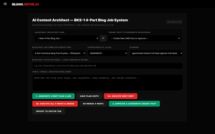
*_Figure 10: AI Architect and BKS-1 Tasking Tab in Page Editor V2_*


---

## REST API & HTTP Route Reference

BEJSON CMS exposes a clean REST API across its microservices:

### Content, Page Editor & Topical Links API (Port 5001 / 5003)

| Endpoint | Method | Payload / Parameters | Response | Purpose |
| :--- | :---: | :--- | :--- | :--- |
| `/api/get/<uuid>` | `GET` | — | JSON Page Payload | Retrieve full page metadata, HTML body, Markdown source, and `page_topical_links`. |
| `/api/save` | `POST` | JSON: `{uuid, title, slug, category, author, html_body, markdown_body, page_topical_links, ...}` | `{"status": "ok"}` | Save page metadata, content, and topical link UUIDs atomically. |
| `/api/topical_links` | `GET` | `?page_uuid=<uuid>` | `{"ok": true, "all_links": [...], "selected_uuids": [...]}` | Fetch all global `ExternalMedia` links and the active page's checked `extmedia_uuid` list. |
| `/api/topical_links` | `POST` | JSON: `{page_uuid, topical_links: ["<uuid>", ...]}` | `{"ok": true, "selected_uuids": [...]}` | Update `PageRecord.page_topical_links` for a specific page. |
| `/api/md2html` | `POST` | JSON: `{markdown: "## Source"}` | `{"html": "<h2>Source</h2>"}` | Convert Markdown text to semantic CMS HTML. |
| `/pages/delete/<uuid>` | `POST` | — | Redirect / Status | Delete page and remove its `pages_db` container. |
| `/pages/duplicate/<uuid>` | `POST` | — | Redirect | Clone existing page with a fresh UUID and `-copy` slug. |

### Media & Global External Links API (Port 5001 / 5003)

| Endpoint | Method | Payload / Parameters | Response | Purpose |
| :--- | :---: | :--- | :--- | :--- |
| `/assets/list.json` | `GET` | — | JSON Array of Assets | List all registered local media assets with hashes and sizes. |
| `/assets/upload` | `POST` | Multipart form data: `file` | `{"filename": "..."}` | Stream asset upload, compute hash, queue thumbnail. |
| `/assets/delete/<filename>`| `POST`| — | Redirect | Delete media asset and its corresponding thumbnail. |
| `/assets/replace/<filename>`| `POST`| Multipart form data: `file` | Redirect | Replace physical file while maintaining filename. |
| `/assets/rename/<filename>` | `POST`| Form data: `new_name` | Redirect | Rename asset record in database. |
| `/api/media/external_links` | `GET` | — | `{"ok": true, "links": [...]}` | List all global `ExternalMedia` links (`github`, `video`, `demo`, `doc`, `website`, `pdf`, `image`, `other`). |
| `/api/media/external/add` | `POST` | JSON / Form: `{name, type, url}` | `{"ok": true, "link": {...}}` | Create a new global `ExternalMedia` record in `externalmedia.bejson`. |

### Persona Editor & Profile Manager API (Port 5004)

| Endpoint | Method | Payload / Parameters | Response | Purpose |
| :--- | :---: | :--- | :--- | :--- |
| `/` or `/edit/<name>` | `GET` | — | HTML Studio | Render 5-tab Persona Editor workspace for the selected persona. |
| `/new` | `GET` | — | Redirect (`?is_new=1`) | Open a clean, unsaved draft persona template without writing to disk until saved. |
| `/save` | `POST` | Form data (24 `AI_Profile` fields + `AuthorProfile` fields) | Redirect | Validate enums/ranges, sanitize SVG avatars, cascade renames, and atomically sync `ai_profile.bejson` + `authorprofile.bejson`. |
| `/duplicate/<name>` | `POST` | — | Redirect | Clone an existing persona into `<name>_Copy`. |
| `/delete/<name>` | `POST` | — | Redirect | Delete persona from `AI_Profile` and `AuthorProfile` (`boehnenelton2024` is protected). |
| `/seed-defaults` | `POST` | — | Redirect | Seed canonical default personas (`boehnenelton2024`, `Academic_Researcher`, `Conversational_Guide`). |
| `/api/persona/<name>` | `GET` | — | JSON Persona Payload | Return 24-field `AI_Profile` record, `AuthorProfile` record, and assembled system instruction. |
| `/api/test-generate` | `POST` | JSON: `{persona_name, provider, model_id, prompt}` | `{"ok": true, "output": "..."}` | Dispatch a test prompt through `PersonaWriter.dispatch_ai()` (blocks inactive personas). |

### BKS-1 Job Studio API (Port 5001)

| Endpoint | Method | Payload / Parameters | Response | Purpose |
| :--- | :---: | :--- | :--- | :--- |
| `/api/bks/bootstrap` | `GET` | — | JSON Registry State | Retrieve book types, existing jobs, and template lists. |
| `/api/bks/create_plan` | `POST` | JSON: `{topic, title, template, target_uuid}` | `{"job_slug": "..."}` | Generate 4-part job plan and register job. |
| `/api/bks/execute_part` | `POST` | JSON: `{job_slug, part_index}` | `{"status": "ok"}` | Execute a single part of the 4-part plan. |
| `/api/bks/execute_all` | `POST` | JSON: `{job_slug}` | `{"status": "ok"}` | Run all four parts sequentially. |
| `/api/bks/merge` | `POST` | JSON: `{job_slug}` | `{"markdown": "...", "html": "..."}` | Merge all four parts into unified document. |
| `/api/bks/approve` | `POST` | JSON: `{job_slug, target_uuid, publish}` | `{"status": "ok"}` | Approve merged post and overwrite target page. |

### Static Publisher API (Port 5002)

| Endpoint | Method | Payload / Parameters | Response | Purpose |
| :--- | :---: | :--- | :--- | :--- |
| `/publish/build` | `POST` | — | `{"status": "success", "files": 42}` | Trigger complete static site compilation. |
| `/publish/log` | `GET` | — | Plaintext log stream | Read real-time build log output. |
| `/publish/server/start` | `POST` | — | `{"status": "running", "port": 8080}` | Start local static preview server. |
| `/publish/server/stop` | `POST` | — | `{"status": "stopped"}` | Stop local preview server. |


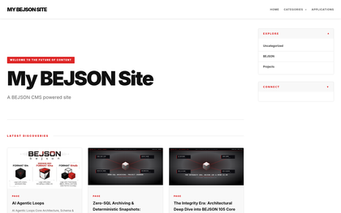
*_Figure 11: Playwright Audit Capture of Published Static Home Feed_*


---

## Command-Line Interface Reference (cms-manage.py)

The CLI toolkit `src/cms-manage.py` provides headless administration for automated environments:

```bash
python3 src/cms-manage.py <subcommand> [arguments]
```

### Complete Command Reference:

#### System Diagnostics & Backups
```bash
# Display manifest health, table paths, and record counts
python3 src/cms-manage.py status

# Create a full database and assets backup archive
python3 src/cms-manage.py backup --output ./storage/exports/site_backup.zip

# Restore system state from a backup archive
python3 src/cms-manage.py restore ./storage/exports/site_backup.zip

# Perform a complete factory reset to initial seed state
python3 src/cms-manage.py factory-reset
```

#### Page Management
```bash
# List all registered pages
python3 src/cms-manage.py page list

# Create a new article
python3 src/cms-manage.py page add   --title "System Architecture"   --category "Architecture"   --author "Elton Boehnen"   --body "<h2>Core Components</h2><p>Content...</p>"   --featured-video "https://www.youtube.com/watch?v=dQw4w9WgXcQ"

# Update an existing page
python3 src/cms-manage.py page update <PAGE_UUID> --title "Updated Title"

# Delete a page
python3 src/cms-manage.py page delete <PAGE_UUID>

# Import Markdown file or batch-import directory
python3 src/cms-manage.py page md-import --category "Guides" --publish ./article.md
```

#### Categories, Authors & Links
```bash
# Category commands
python3 src/cms-manage.py category list
python3 src/cms-manage.py category add "Engineering"
python3 src/cms-manage.py category delete "engineering"

# Author commands
python3 src/cms-manage.py author list
python3 src/cms-manage.py author add "Jane Doe" --bio "Senior Engineer" --email "jane@example.com"
python3 src/cms-manage.py author delete <AUTHOR_ID>

# Navigation link commands
python3 src/cms-manage.py navlink list
python3 src/cms-manage.py navlink add "Documentation" "/docs/" 10
python3 src/cms-manage.py navlink delete <NAV_ID>
```

#### Media & Applications
```bash
# Add a media asset
python3 src/cms-manage.py asset add ./images/diagram.png

# Optimize PNG assets to WebP
python3 src/cms-manage.py asset optimize

# Register a global external link (github, video, demo, doc, website, pdf, image, other)
python3 src/cms-manage.py asset add-external "Reference Whitepaper" "pdf" "https://example.com/paper.pdf"

# Install a standalone web application
python3 src/cms-manage.py app add --name "Calculator" --slug "calculator" --zip ./calc.zip
```


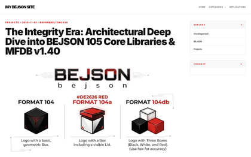
*_Figure 12: Playwright Desktop Viewport Audit Capture of Published Article_*


---

## TUI Supervisor Reference (advanced_launcher.py)

The TUI supervisor provides an operational control surface for multi-service environments:

```
┌─────────────────────────────────────────────────────────┐
│              BEJSON CMS TUI SUPERVISOR v2               │
├────┬───────┬───────┬──────┬─────────┬───────────────────┤
│ ID │ STATE │  PID  │ PORT │ UPTIME  │ SERVICE           │
├────┼───────┼───────┼──────┼─────────┼───────────────────┤
│ 1  │  RUN  │ 28140 │ 5001 │ 01h 14m │ Admin Suite       │
│ 2  │  RUN  │ 28145 │ 5002 │ 01h 14m │ Static Publisher  │
│ 3  │  RUN  │ 28150 │ 5003 │ 01h 14m │ Page Editor       │
│ 4  │  RUN  │ 28155 │ 5004 │ 01h 14m │ Profile Manager   │
├────┴───────┴───────┴──────┴─────────┴───────────────────┤
│ COMMANDS: [1-4] Toggle | [S]tart All | [Z] Stop All     │
│ [r1-r4] Restart | [k1-k4] Kill | [l1-l4] Logs           │
│ [P]robe Ports | [C]onfig Ports | [Q]uit | [X] Exit All   │
└─────────────────────────────────────────────────────────┘
```

### Key Commands:
- **`1`–`4`**: Toggle active services on or off (`1` Admin Suite, `2` Static Publisher, `3` Primary Page Editor, `4` Persona Editor / Profile Manager).
- **`r1`–`r4`**: Restart a specific service cleanly.
- **`k1`–`k4`**: Send an immediate `SIGKILL` to clear hung sockets.
- **`l1`–`l4`**: View the last 30 lines of service logs.
- **`P`**: Probe active ports with TCP socket connections to verify responsiveness.
- **`C`**: Interactive port configuration editor.
- **`Q`**: Quit the supervisor interface while leaving background services running.
- **`X`**: Stop all running services and exit.


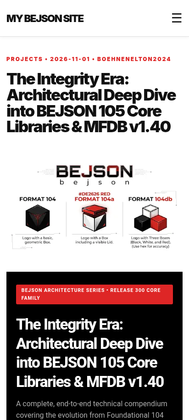
*_Figure 13: Playwright Mobile Viewport Audit Capture (Zero Overflow Confirmed)_*


---

## Directory Architecture & Repository Map

```
BEJSON_CMS/
├── README.md                        # Master documentation and reference guide
├── AGENTS.md                        # Workspace architectural & deprecation rules
├── CHANGELOG.md                     # Human-readable release version notes
├── LICENSE                          # PolyForm Noncommercial 1.0.0 license terms
├── SECURITY.md                      # Security model and vulnerability disclosure
├── CONTRIBUTING.md                  # Development guidelines and code standards
├── bejson_project.json              # Canonical project metadata and version tracker
├── config.json                      # Runtime configuration (BEJSON 104a)
├── advanced_launcher.py             # 57-column TUI multi-service supervisor
├── cms_launcher.sh                  # Single-service isolated shell launcher
├── pydroid_start.py                 # Mobile quick-start entry point
│
├── dev/                             # Development tracking and archived components
│   └── archive/
│       └── BEJSON_CMS_PageEditorV2_Archived.zip # Archived deprecated PageEditor V2
│
├── images/                          # Documentation screenshots and audit captures (420p constraint)
│   ├── 01_admin_dashboard.png       # Resized 420p UI captures
│   ├── 02_pages_manager.png
│   ├── 03_media_library.png
│   ├── 04_page_editor_v2.png
│   ├── 05_profile_manager.png
│   ├── 06_static_publisher.png
│   ├── 01_published_home_desktop.png
│   ├── 02_published_home_mobile.png
│   ├── 03_published_article_1.png
│   ├── 04_published_article_2.png
│   ├── 05_published_apps_feed.png
│   ├── 06_published_category_feed.png
│   └── audit_captures/              # High-DPI Playwright verification captures
│       ├── 01_playwright_admin_dashboard.png
│       ├── 02_playwright_bks_jobs_studio.png
│       ├── 03_playwright_page_editor_v2.png
│       ├── 04_playwright_editor_ai_architect_tab.png
│       ├── 05_playwright_published_home.png
│       ├── 06_playwright_published_article_desktop.png
│       ├── 07_playwright_published_article_mobile.png
│       ├── category_projects_desktop.png
│       ├── home_feed_desktop.png
│       ├── persona_hub_desktop_initial.png      # Persona Editor desktop with 3D canvas cube avatar
│       ├── persona_hub_desktop_tab_preview.png  # Persona Editor live assembled prompt preview tab
│       ├── persona_hub_mobile_catalog.png       # Persona Editor mobile touch catalog drawer
│       ├── persona_hub_mobile_editor.png        # Persona Editor mobile form view
│       ├── persona_hub_mobile_initial.png       # Persona Editor mobile initial viewport
│       ├── post_105_desktop_full.png
│       └── post_105_mobile_hero.png
│
├── resources/                       # Static templates, styles, and seed assets
│   ├── default_brand_assets/        # Seed brand images for factory resets
│   ├── styles/                      # CSS themes (dark.css, light.css with .topical-links-grid)
│   └── templates/                   # HTML skeletons (Global_Skeleton.html, Article_Skeleton.html, etc.)
│
├── src/                             # Core application source code
│   ├── cms-manage.py                # Headless CLI management tool
│   ├── lib/                         # Persistence, domain, AI, and utility libraries
│   │   ├── lib_bejson_Core_bejson_core.py       # Positional matrix reader & atomic writer
│   │   ├── lib_bejson_Core_bejson_validator.py  # BEJSON 104/104a/104db structural validator
│   │   ├── lib_bejson_Core_bejson_path_guard.py # Safe path resolution & traversal guards
│   │   ├── lib_bejson_Core_svg_sanitizer.py     # XML/SVG sanitizer stripping <script> & on* handlers
│   │   ├── lib_bejson_Core_mfdb_core.py         # Multi-File Database manifest orchestrator
│   │   ├── lib_bejson_Core_mfdb_validator.py    # Manifest and entity referential validator
│   │   ├── lib_bejson_CMS_cms_core.py           # High-level CMS entity operations wrapper
│   │   ├── lib_bejson_CMS_cms_mfdb.py           # CLI database abstraction layer
│   │   ├── lib_bejson_CMS_md2html.py            # CommonMark to semantic HTML converter
│   │   ├── lib_bejson_CMS_bks_blog_jobs.py      # BKS-1 4-part blog post job engine
│   │   ├── lib_bejson_CMS_cms_ports.py          # Port configuration resolver
│   │   ├── lib_bejson_CMS_taxonomy.py           # Field prefix and 13-entity taxonomies
│   │   └── lib_cms_persona_writer.py            # PersonaWriter v2.0 (24-field prompt compiler & AI gate)
│   │
│   └── web/                         # Flask microservice applications
│       ├── BEJSON_CMS_Admin.py                  # Main administrative suite entry point (:5001)
│       ├── BEJSON_CMS_Content.py                # Content & BKS-1 AI Writer blueprint
│       ├── BEJSON_CMS_Media.py                  # Local media & global ExternalMedia link blueprint
│       ├── BEJSON_CMS_Interface.py              # Navigation, social & ads blueprint
│       ├── BEJSON_CMS_System.py                 # System telemetry, backup & factory-reset blueprint
│       ├── BEJSON_CMS_Publisher.py              # Static site generator & preview host (:5002)
│       ├── BEJSON_CMS_PageEditor.py             # Primary Page Editor with Topical Links modal (:5003)
│       ├── BEJSON_CMS_ProfileManager.py         # Persona Editor v1.5 (5-tab studio, 3D cube canvas) (:5004)
│       ├── BEJSON_CMS_FileBrowser.py            # Media file browser modal provider
│       ├── BEJSON_CMS_Renderers.py              # Polymorphic static page renderers
│       └── BEJSON_CMS_Shared.py                 # Shared auth guards and asset middleware
│
├── storage/                         # Live runtime data and generated output
│   ├── builds/                      # Compiled static website output
│   ├── exports/                     # Database and asset backup archives
│   ├── logs/                        # Application and supervisor log files
│   ├── mfdb/                        # Active Multi-File Database
│   │   ├── site_master/             # Master manifest and 13 relational entity files (including ai_profile.bejson & externalmedia.bejson)
│   │   ├── pages_db/                # Individual 104db page content files
│   │   ├── assets/                  # Uploaded media assets and thumbnails
│   │   ├── bks_jobs/                # BKS-1 job plans, drafts, and templates
│   │   └── standalone_apps/         # Extracted containerized web applications
│   └── tmp/                         # Runtime state and temporary upload staging
│
├── tests/                           # Automated verification test suite (82 tests across 7 files)
│   ├── test_bejson_cms_admin_auth.py
│   ├── test_bejson_cms_app_uuid_validation.py
│   ├── test_bejson_cms_filebrowser.py
│   ├── test_bejson_cms_profile_manager.py
│   ├── test_lib_bejson_CMS_cms_core.py
│   ├── test_lib_bejson_Core_bejson_path_guard.py
│   └── test_lib_bejson_Core_mfdb_validator.py
│
└── tools/                           # Maintenance and taxonomy migration scripts
```


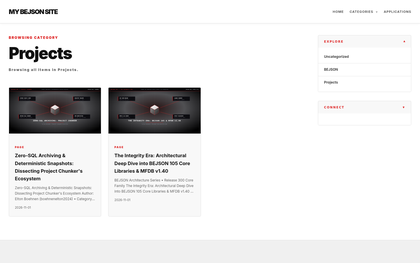
*_Figure 14: Published Category Feed Viewport Audit Capture_*


---

## Security, Concurrency & Data Integrity Architecture

### 1. Boundary-Checked Path Resolution (`bejson_safe_join`)
Path traversal attacks (`../../etc/passwd`) are blocked using strict boundary checks:
```python
def bejson_safe_join(base_directory: Path, untrusted_relative_path: str) -> Path:
    target_candidate = (base_directory / untrusted_relative_path).resolve()
    if not target_candidate.is_relative_to(base_directory.resolve()):
        raise PermissionError(f"Directory traversal detected: '{untrusted_relative_path}' escapes base root.")
    return target_candidate
```
This check is enforced across every file-serving route, asset upload handler, image thumbnail streamer, and ZIP extraction routine.

### 2. Atomic POSIX File Replacement
All data modifications use atomic write-and-replace patterns to prevent partial writes during unexpected process termination:
1. Data is written to a unique hidden temporary file in the target directory (`.bejson_<pid>_<random>.tmp`).
2. Data is explicitly flushed to disk via `flush()` and `os.fsync()`.
3. The temporary file replaces the target file atomically via `os.replace()`.
4. If an exception occurs, the temporary file is unlinked, leaving the original file intact.

### 3. Thread & Process Concurrency Serialization
Write operations across the Multi-File Database are synchronized using per-manifest reentrant locks (`threading.RLock`) inside `lib_bejson_Core_mfdb_core.py`. Multiple worker threads can read concurrently while write mutations are queued serially.

### 4. Zip-Bomb & Malicious Archive Defenses
Standalone web applications and ZIP backup archives are audited before decompression:
- **Uncompressed Size Limit**: Rejects archives expanding beyond 300MB.
- **Compression Ratio Check**: Detects recursive compression bombs.
- **Traversal Guard**: Inspects all archive member paths before extraction to ensure no files escape the target destination directory.

### 5. Centralized HTTP Basic Authentication, Same-Origin CSRF & SVG Sanitization
- **HTTP Basic Auth**: Enforced globally via `BEJSON_CMS_Shared.register_auth_guard(app)`; requests without valid credentials receive an immediate `401 Unauthorized` response.
- **Same-Origin CSRF Verification**: All state-changing POST endpoints in `BEJSON_CMS_ProfileManager.py` verify `Origin` and `Referer` headers against `request.host` (`_verify_same_origin_on_state_change`), returning `403 Forbidden` on cross-origin tampering.
- **SVG & Data URI Sanitization**: Custom SVG markup (`Avatar_Data`) and `data:image/svg+xml` URLs (`Avatar_sourceUrl`) are parsed and sanitized through `lib_bejson_Core_svg_sanitizer.py` to strip `<script>`, `<foreignObject>`, and inline `on*` event attributes before storage.


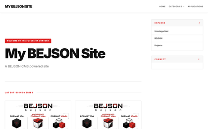
*_Figure 15: Clean 8-Lane Responsive Grid Layout of Published Home Feed_*


---

## Testing, Auditing & Verification Suite

BEJSON CMS includes an 82-test automated verification suite covering path security, schema validation, authentication, file browser boundaries, Persona Editor CRUD/CSRF/SVG sanitization/prompt parity, and responsive browser layout rendering:

```bash
# 1. Run the full 82-test pytest suite
python3 -m pytest tests/ -v

# 2. Syntax-check all Python source files
python3 -m compileall -q src/ tools/ tests/

# 3. Audit README documentation compliance
python3 ~/.gemini/config/skills/readme-visual-enhancer/scripts/readme_auditor.py   --readme ./README.md

# 4. Run Playwright multi-viewport responsive layout audit
python3 storage/tmp/playwright_cms_verify.py
```

### Playwright Viewport Verification Targets:
- **Desktop (1280x800)**: Verifies full navigation layout, sidebar rendering, 2-column `.topical-links-grid`, 1-to-1 Persona Editor prompt preview parity, and horizontal overflow bounds (`scrollWidth == clientWidth`).
- **Tablet (768x1024)**: Validates responsive grid collapsing from multi-column to dual-column layouts.
- **Mobile (375x812)**: Confirms mobile menu drawer behavior, 1-column `.topical-links-grid` stacking, and zero horizontal overflow on small screens.


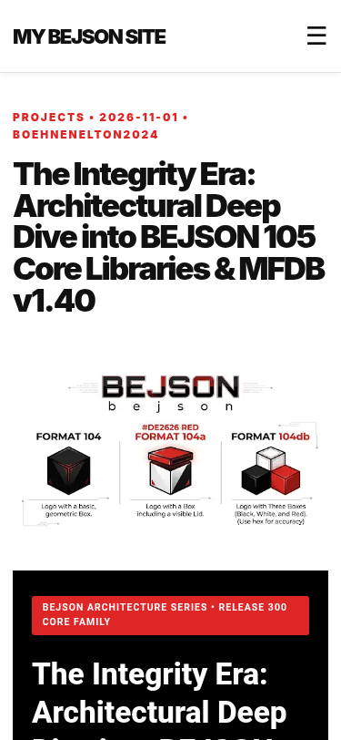
*_Figure 16: Mobile Viewport Render of Hero Banner (Zero Horizontal Overflow)_*

<br>


*_Figure 17: Desktop Viewport Render of BEJSON 105 Architecture Deep Dive_*


---

## Troubleshooting & Diagnostic Handbook

### Common Issues & Solutions:

#### 1. Port Collision on Startup (`Address already in use`)
- **Cause**: A previous CMS service process did not release its socket cleanly.
- **Solution**:
  ```bash
  # Check active ports using the TUI launcher
  python3 advanced_launcher.py
  # Press 'P' to probe ports, or 'k1'-'k5' to force-kill hung services

  # Alternatively, clear ports via terminal command:
  fuser -k 5001/tcp 5002/tcp 5003/tcp 5004/tcp 5005/tcp
  ```

#### 2. Manifest Record Count Mismatch
- **Cause**: Manual editing of entity files on disk without updating `104a.mfdb.bejson`.
- **Solution**:
  ```bash
  python3 src/cms-manage.py status
  # The status command automatically detects and reconciles record count discrepancies
  ```

#### 3. Uploaded Image Thumbnail Missing
- **Cause**: The background thumbnail worker queue is processing a large file or Pillow encountered an unsupported color profile.
- **Solution**:
  ```bash
  # Check application logs
  cat storage/logs/launcher_admin.log | grep -i "thumb"

  # Re-run asset optimization to regenerate WebP variants
  python3 src/cms-manage.py asset optimize
  ```

#### 4. Static Site Build Fails
- **Cause**: Missing referenced asset or corrupted page JSON document.
- **Solution**:
  ```bash
  # Check build logs
  curl -u admin:changeme http://127.0.0.1:5002/publish/log

  # Verify all page storage documents validate cleanly
  python3 -c "
  from pathlib import Path
  import json
  for p in Path('storage/mfdb/pages_db').glob('*.json'):
      data = json.loads(p.read_text())
      assert data['Format'] == 'BEJSON'
  print('All page documents are valid.')
  "
  ```

---

## License & Project Metadata

**BEJSON CMS** is designed and maintained by **Elton Boehnen**.

- **Author**: Elton Boehnen
- **Email**: boehnenelton2024@gmail.com
- **Website**: [boehnenelton2024.pages.dev](https://boehnenelton2024.pages.dev)
- **Repository**: [github.com/boehnenelton/BEJSON_CMS](https://github.com/boehnenelton/BEJSON_CMS)
- **License**: PolyForm Noncommercial License 1.0.0 (See [LICENSE](LICENSE) for full terms)

---

*BEJSON CMS — High-Performance Zero-SQL Content Management for Independent Systems.*
