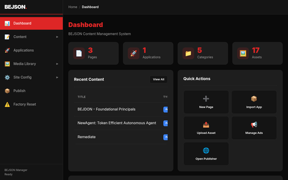
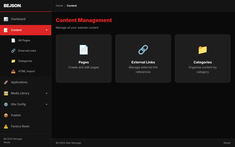
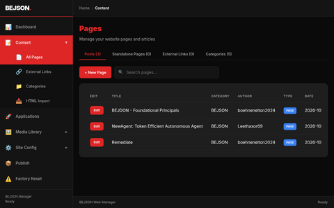
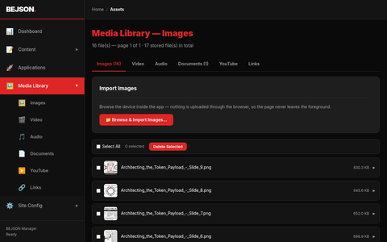
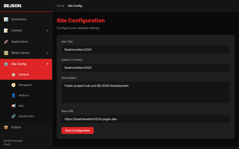

# BEJSON CMS — Zero-SQL Multi-Service Publishing System

> **A personal, self-hosted Content Management System and static site publisher engineered around dense BEJSON 104 tabular stores and Multi-File Database (MFDB) federation instead of heavyweight SQL database engines.**

[](https://python.org/)
[](LICENSE)
[](docs/architecture.md)
[](docs/usage-guide.md)

---

## Table of Contents
- [1. Executive Architectural Overview](#1-executive-architectural-overview)
- [2. System Architecture & Zero-SQL Storage](#2-system-architecture--zero-sql-storage)
- [3. Core Feature Matrix](#3-core-feature-matrix)
- [4. Service Fleet & Port Topology](#4-service-fleet--port-topology)
- [5. Installation & Prerequisites](#5-installation--prerequisites)
- [6. Launching & Operating Modes](#6-launching--operating-modes)
- [7. In-App File Browser Subsystem](#7-in-app-file-browser-subsystem)
- [8. Repository & Storage Layout](#8-repository--storage-layout)
- [9. Security, Auth & Environment Configuration](#9-security-auth--environment-configuration)
- [10. Testing & Verification Suite](#10-testing--verification-suite)
- [11. Authorship, Policy & License](#11-authorship-policy--license)

---

## 1. Executive Architectural Overview

Traditional content management systems (such as WordPress or Ghost) rely heavily on daemonized relational database servers (MySQL, PostgreSQL) or embedded SQLite binary files that complicate version control, mobile runtime environments, and transparent data auditing.

**BEJSON CMS** was created specifically to dismantle that complexity. Designed for local execution on resource-constrained environments—including native Android smartphones running Termux or Pydroid3 as well as standard Linux/macOS/Windows workstations—every single content record, asset pointer, navigation menu, author profile, and advertisement zone exists as human-readable, schema-strict rows inside a **BEJSON 104 Multi-File Database (MFDB)**.

### Architectural Hallmarks:
- **Zero Daemon Overhead**: No MySQL, Redis, or SQLite processes running in the background.
- **Portability First**: Every script self-locates its root via `SCRIPT_PATH`; no absolute machine paths are baked into data records.
- **Decoupled Architecture**: Six specialized Flask services handle administration, page editing, persona prompting, and static publishing without cross-module lockups.
- **Pure Static Delivery**: The static publisher generates fully baked, dependency-free, zero-JavaScript-required HTML feeds and article pages ready for instant deployment to GitHub Pages, Cloudflare Pages, or static web servers.


*_Figure 1: BEJSON CMS Administration Dashboard & Overview_*

---

## 2. System Architecture & Zero-SQL Storage

At the heart of BEJSON CMS is the central Multi-File Database manifest:
`storage/mfdb/site_master/104a.mfdb.bejson`

The central manifest federates 10 independent tabular entity files (`.104.bejson`), each owning its respective data domain:

| Entity Table | Primary Key | Prefix Tag | Description |
| :--- | :--- | :--- | :--- |
| `pages.104.bejson` | `page_uuid` | `page_` | Core article metadata, slugs, publish dates, and status |
| `categories.104.bejson` | `cat_uuid` | `cat_` | Editorial categories and feed classification mappings |
| `authors.104.bejson` | `author_uuid` | `author_` | Public-facing author bios, social links, and avatars |
| `media_assets.104.bejson` | `asset_uuid` | `asset_` | Local media asset catalogue, MIME types, and file hashes |
| `external_media.104.bejson`| `extmedia_uuid` | `extmedia_` | External embedded assets (YouTube, Vimeo, external CDNs) |
| `site_config.104.bejson` | `sys_uuid` | `sys_` | Global site identity, branding tokens, and metadata defaults |
| `navigation.104.bejson` | `nav_uuid` | `nav_` | Primary header menu, drawer hierarchy, and sub-links |
| `advertisements.104.bejson` | `ad_uuid` | `ad_` | Sponsored banners, CTA cards, and monetization zones |
| `social_links.104.bejson` | `social_uuid` | `social_` | Social media profiles and outbound syndicate endpoints |
| `standalone_apps.104.bejson`| `app_uuid` | `app_` | Embedded web applications and interactive HTML5 tools |

### Field Map Caching (Policy §6.2)
All reads and writes across the MFDB runtime utilize `$ADMIN_LIBRARIES_104` with mandatory `_FieldMap` index lookups, guaranteeing $O(1)$ property access and eliminating brittle positional index offsets.

---

## 3. Core Feature Matrix

### 3.1 Blueprint Admin Application (`src/web/BEJSON_CMS_Admin.py`)
A consolidated control center split into four decoupled Flask Blueprints:
- **System Blueprint** (`BEJSON_CMS_System.py`): Controls global settings, database backup/export, and factory reset routines.
- **Content Blueprint** (`BEJSON_CMS_Content.py`): Manages articles, categories, standalone apps, and author records.
- **Media Blueprint** (`BEJSON_CMS_Media.py`): High-efficiency media gallery with hash-deduplicated uploads, image preview lightbox, and external link cataloging.
- **Interface Blueprint** (`BEJSON_CMS_Interface.py`): Visual customization of navigation menus, social links, ad zones, and publisher triggering.


*_Figure 2: Centralized Content Hub & Entity Management_*

### 3.2 Dual Page Editors (V1 & V2)
- **Page Editor V1** (`BEJSON_CMS_PageEditor.py`): Robust, battle-tested visual and source editor with deep Markdown support and direct HTML injection.
- **Page Editor V2** (`BEJSON_CMS_PageEditorV2.py`): Next-generation API-driven editor featuring live spatial card previews and real-time schema synchronization.

### 3.3 AI Persona Hub (`BEJSON_CMS_ProfileManager.py`)
Separates internal generative instructions from public author biographies. Maintains isolated `AI_Profile` configurations that dynamically shape prompt directives for integrated LLM authoring assistants.

### 3.4 Polymorphic Static Site Publisher (`BEJSON_CMS_Publisher.py`)
Renders the dense MFDB database into production-ready static HTML within `storage/builds/`. Implements strategy renderers (`BEJSON_CMS_Renderers.py`) supporting:
- **Standard Editorial Articles**: Responsive typography with dual Dark/Light mode theme switching.
- **Video Embed Presentations**: Optimized media framing with lazy-loaded players.
- **Structured Technical Documents**: Publication-grade tables, syntax highlighting, and widget shelves.

---

## 4. Service Fleet & Port Topology

BEJSON CMS divides functionality into independent, focused web services. Ports are dynamically managed via `config.json` and `lib_bejson_CMS_cms_ports.py` with automated collision mitigation:

| Service | Script File | Default Port | Environment Variable Override |
| :--- | :--- | :---: | :--- |
| **Admin Hub** | `BEJSON_CMS_Admin.py` | `5001` | `CMS_ADMIN_PORT` |
| **Page Editor (V1)** | `BEJSON_CMS_PageEditor.py` | `5003` | `CMS_PAGEEDITOR_PORT` |
| **Page Editor (V2)** | `BEJSON_CMS_PageEditorV2.py` | `5010` | `CMS_PAGEEDITORV2_PORT` |
| **Persona Hub** | `BEJSON_CMS_ProfileManager.py` | `5004` | `CMS_PROFILES_PORT` |
| **Static Publisher** | `BEJSON_CMS_Publisher.py` | `5001` *(Auto +10)* | `CMS_PUBLISHER_PORT` |

> [!NOTE]
> When the Admin Hub and Static Publisher are launched concurrently, the advanced launcher automatically bumps the publisher port by `+10` (to `5011`) to prevent socket binding collisions.

---

## 5. Installation & Prerequisites

BEJSON CMS requires only Python 3.10+ and Flask. No external database servers, C-compilers, or package bundling steps are needed.

```bash
# 1. Install runtime dependencies
pip install flask --break-system-packages

# 2. Clone or navigate to repository root
cd /storage/emulated/0/Admin/Dev/Python/Development/BEJSON_CMS
```

---

## 6. Launching & Operating Modes

### Option A: Advanced Multi-Process Launcher (Recommended)
`advanced_launcher.py` provides an interactive TUI menu with background process monitoring, thread watching, and on-disk PID tracking:

```bash
python3 advanced_launcher.py
```
- Spawns requested services via independent `subprocess.Popen` threads.
- Tracks process IDs in an on-disk registry, enabling cross-session force close.
- Preserves battery and prevents terminal locking.

### Option B: Single-Service Launcher (Resource Constrained)
`cms_launcher.sh` strictly enforces single-process execution by terminating any other running CMS instance before launching the target service:

```bash
./cms_launcher.sh admin       # Admin Dashboard (:5001)
./cms_launcher.sh editor      # Page Editor V1   (:5003)
./cms_launcher.sh editorv2    # Page Editor V2   (:5010)
./cms_launcher.sh publisher   # Static Publisher (:5001/5011)
./cms_launcher.sh profiles    # Persona Hub      (:5004)
```

### Option C: Mobile Pydroid / Termux Quickstart
```bash
python3 pydroid_start.py
```


*_Figure 3: Pages Management, Status Tracking & Editorial Filters_*

---

## 7. In-App File Browser Subsystem

Android OS routinely suspends or kills backgrounded terminal applications when native system file choosers (`SAF / ACTION_GET_CONTENT`) are invoked. 

To solve this, BEJSON CMS incorporates a built-in, server-side visual file browser (`src/web/BEJSON_CMS_FileBrowser.py`). It enables users to browse device storage, select images, import HTML documents, and stage media assets directly inside the web browser UI without ever triggering an Android system activity switch or background process purge.

---

## 8. Repository & Storage Layout

```text
BEJSON_CMS/
├── src/
│   ├── web/                     # Six core Flask applications & blueprints
│   │   ├── BEJSON_CMS_Admin.py         # Main admin gateway & blueprint registry
│   │   ├── BEJSON_CMS_System.py        # System config & database backup blueprint
│   │   ├── BEJSON_CMS_Content.py       # Page, category & app content blueprint
│   │   ├── BEJSON_CMS_Media.py         # Media gallery & asset upload blueprint
│   │   ├── BEJSON_CMS_Interface.py     # Navigation, ad & social config blueprint
│   │   ├── BEJSON_CMS_FileBrowser.py   # In-app server-side file picker
│   │   ├── BEJSON_CMS_PageEditor.py    # Visual page editor V1
│   │   ├── BEJSON_CMS_PageEditorV2.py  # Visual page editor V2
│   │   ├── BEJSON_CMS_Publisher.py     # Static site generator
│   │   └── BEJSON_CMS_ProfileManager.py# AI persona instruction manager
│   └── lib/                     # Port managers & low-level BEJSON libraries
├── storage/
│   ├── mfdb/                    # Live database (manifest & 10 entity tables)
│   │   └── site_master/         # 104a.mfdb.bejson + *.104.bejson files
│   ├── builds/                  # Generated static HTML websites (publish output)
│   └── tmp/                     # Temporary staging buffers and service logs
├── resources/                   # Base HTML scaffolds, templates & CSS stylesheets
├── images/                      # Dashboard UI screenshots & visual documentation
├── docs/                        # In-depth architectural & security audit reports
├── tests/                       # Pytest verification suites
├── config.json                  # ScriptConfig port and environment mappings
├── advanced_launcher.py         # Persistent multi-process interactive launcher
└── cms_launcher.sh              # Single-service memory-conserving launcher
```


*_Figure 4: Hash-Deduplicated Media Library & Assets Gallery_*

---

## 9. Security, Auth & Environment Configuration

### Unified HTTP Basic Authentication
Authentication is enforced globally at the application root (`_enforce_auth_everywhere()`), guaranteeing that zero routes or API endpoints can be accessed without valid credentials.

Configure custom credentials via environment variables prior to launch:
```bash
export CMS_USER="admin"
export CMS_PASSWORD="your_secure_password_here"
export CMS_SECRET_KEY="generate_a_random_32_byte_hex_key"
```

> [!WARNING]
> If `CMS_PASSWORD` is omitted, the server runs with default fallback credentials (`admin` / `changeme`) and outputs a prominent startup warning.


*_Figure 5: Global Site Settings & Brand Token Configuration_*

---

## 10. Testing & Verification Suite

The codebase includes automated tests validating path isolation, manifest integrity, and data layer contracts:

```bash
# Execute pytest suite across all modules
pytest tests/ -v
```

---

## 11. Authorship, Policy & License

- **Author**: Elton Boehnen
- **Email**: boehnenelton2024@gmail.com
- **Website**: [boehnenelton2024.pages.dev](https://boehnenelton2024.pages.dev)
- **GitHub**: [github.com/boehnenelton](https://github.com/boehnenelton)
- **Standard**: Consolidated Master Policy — Schema v1.7.0 (September 1, 2026)
- **License**: PolyForm Noncommercial License 1.0.0 (Free for personal, non-commercial, and educational use).
