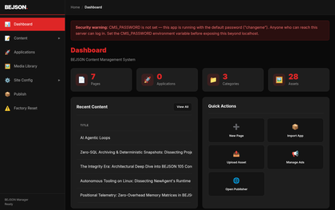
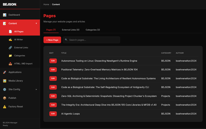
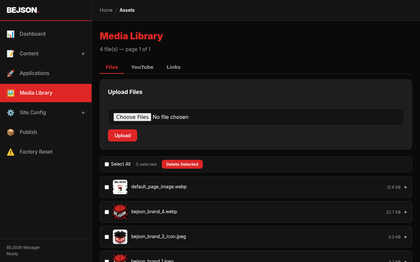
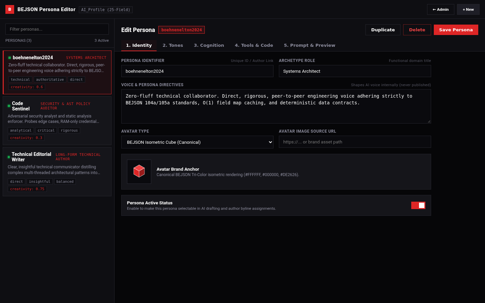
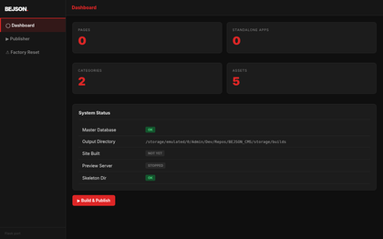

# BEJSON CMS

**BEJSON CMS** is a lightweight, high-performance, self-hosted Content Management System and Static Site Generator engineered to operate entirely without SQL or external database servers. Every piece of site data—articles, categories, author profiles, media asset metadata, external media embeds, advertisement zones, navigation hierarchies, site settings, social links, and standalone web applications—is persisted as positional matrix records inside **BEJSON** (Binary/Structured JSON) entity files governed by a master **MFDB** (Multi-File Database) manifest (`storage/mfdb/site_master/104a.mfdb.bejson`).

**Author:** Elton Boehnen  
**Contact:** [boehnenelton2024@gmail.com](mailto:boehnenelton2024@gmail.com) · [boehnenelton2024.pages.dev](https://boehnenelton2024.pages.dev) · [github.com/boehnenelton](https://github.com/boehnenelton)  
**License:** PolyForm Noncommercial 1.0.0  
**Version:** V18.29 (PKG130)

---

## Table of Contents
- [Prerequisites & Environment Setup](#prerequisites--environment-setup)
- [Installation & Service Launchers](#installation--service-launchers)
- [Core Features & Usage Workflows](#core-features--usage-workflows)
- [Visual Interface Tour](#visual-interface-tour)
- [Static Publishing & Deployment Workflow](#static-publishing--deployment-workflow)
- [System Architecture & Microservice Topology](#system-architecture--microservice-topology)
- [Technical Specifications & Schemas](#technical-specifications--schemas)
- [Core Libraries Reference](#core-libraries-reference)
- [Command-Line Reference (`cms-manage.py`)](#command-line-reference-cms-managepy)
- [Directory Structure & Complete File Map](#directory-structure--complete-file-map)
- [Security & Concurrency Architecture](#security--concurrency-architecture)
- [Testing & Verification](#testing--verification)
- [Author & License](#author--license)

---

## Prerequisites & Environment Setup

### System Requirements
- **Python**: Version 3.10 or higher.
- **Operating Systems**: Android Termux (ARM64), Pydroid 3, Linux, or macOS.
- **Dependencies**: Minimal runtime footprint requiring `flask` and `Pillow` (with `requests` optional for remote API integrations and `pytest` for running the verification test suite).

```bash
# Install runtime and testing dependencies
pip install flask Pillow requests pytest
```

### Environment Variables & Port Configuration

Configuration settings are stored in `config.json` (`104a` format) at the project root and can be overridden at runtime using environment variables:

```bash
# Configure authentication credentials and session key before exposing beyond localhost
export CMS_USER="admin"
export CMS_PASSWORD="your-strong-password"
export CMS_SECRET_KEY="$(python3 -c 'import os; print(os.urandom(24).hex())')"

# Optional: Override default service ports
export CMS_ADMIN_PORT="5001"
export CMS_PUBLISHER_PORT="5002"
export CMS_PAGEEDITOR_PORT="5003"
export CMS_PROFILES_PORT="5004"
export CMS_PAGEEDITORV2_PORT="5005"

# Optional: Override data storage root for CLI operations
export CMS_DATA_ROOT="./storage/mfdb"
```

| Environment Variable | Default | `config.json` Key | Description |
| :--- | :--- | :--- | :--- |
| `CMS_USER` | `admin` | — | HTTP Basic Authentication username across all 5 web services. |
| `CMS_PASSWORD` | `changeme` | — | HTTP Basic Authentication password across all 5 web services. |
| `CMS_SECRET_KEY` | *Random 24-byte hex* | — | Flask session signing key. Set a fixed secret in production. |
| `CMS_ADMIN_PORT` | `5001` | `admin_port` | Port allocated for `BEJSON_CMS_Admin.py`. |
| `CMS_PUBLISHER_PORT` | `5002` | `publisher_port` | Port allocated for `BEJSON_CMS_Publisher.py`. |
| `CMS_PAGEEDITOR_PORT` | `5003` | `pageeditor_port` | Port allocated for `BEJSON_CMS_PageEditor.py` (V1). |
| `CMS_PROFILES_PORT` | `5004` | `profiles_port` | Port allocated for `BEJSON_CMS_ProfileManager.py`. |
| `CMS_PAGEEDITORV2_PORT` | `5005` | `pageeditorv2_port` | Port allocated for `BEJSON_CMS_PageEditorV2.py` (V2). |



*_Figure: 01 Admin Dashboard_*

---

## Installation & Service Launchers

Clone or extract the repository and choose one of the three service launchers depending on your hardware environment:

### 1. Advanced Multi-Service TUI Supervisor (`advanced_launcher.py`)
A high-density 57-column terminal user interface (TUI) and process supervisor capable of launching, monitoring, probing, and managing all five Flask microservices concurrently:

```bash
python3 advanced_launcher.py
```

#### TUI Supervisor Capabilities & Command Grammar
- **5-Row Positional Service Table**: Displays `ID`, `STATE` (`RUN`/`OFF`), `PID`, `PORT`, `UPTIME`, and `SERVICE_NAME` in real time.
- **Persistent State Tracking**: Writes active service PIDs, start timestamps, and port bindings atomically to `storage/tmp/launcher_registry.104a.bejson`.
- **Direct Single-Key & Compound Commands**:
  - `1`–`5`: Toggle individual services on or off (`1` Admin, `2` Publisher, `3` Editor V1, `4` Profiles, `5` Editor V2).
  - `r1`–`r5` (or `R`): Restart a specific service or prompt for a target ID.
  - `k1`–`k5` (or `K`): Force-kill (`SIGKILL`) a specific service.
  - `l1`–`l5` (or `L`): View the last 30 lines of `storage/logs/launcher_<service>.log`.
  - `o1`–`o5` (or `O`): Open the running service URL in the system browser.
  - `S`: Start all 5 services sequentially.
  - `Z`: Stop all running services cleanly.
  - `P`: Run a live TCP socket health probe across all 5 configured ports.
  - `C`: Interactive port configuration editor (persists changes to `config.json` and restarts affected services).
  - `E`: Inspect environment variable overrides (`CMS_*_PORT`, `CMS_PASSWORD`, `CMS_SECRET_KEY`).
  - `Q`: Quit the TUI while leaving background services running.
  - `X`: Stop all services and exit cleanly.

### 2. Single-Service Isolated Launcher (`cms_launcher.sh`)
Designed for low-memory mobile environments. Automatically terminates any previously running CMS service before spawning the selected target service:

```bash
./cms_launcher.sh admin       # BEJSON_CMS_Admin.py          :5001
./cms_launcher.sh publisher   # BEJSON_CMS_Publisher.py      :5002
./cms_launcher.sh editor      # BEJSON_CMS_PageEditor.py     :5003
./cms_launcher.sh profiles    # BEJSON_CMS_ProfileManager.py :5004
./cms_launcher.sh editorv2    # BEJSON_CMS_PageEditorV2.py   :5005
```

### 3. Mobile Quick-Start Script (`pydroid_start.py`)
Optimized for one-tap execution in mobile Python IDEs:

```bash
python3 pydroid_start.py
```
Starts the main Admin Suite on `http://127.0.0.1:5001`.

---

## Core Features & Usage Workflows

- **Zero-SQL Matrix Storage Architecture**: All records are stored in human-readable, deterministic positional BEJSON files (`104`, `104a`, and `104db`) with O(1) Field Map Cache column resolution.
- **Modular Admin Suite (`:5001`)**: Four Flask Blueprints (`System`, `Content`, `Media`, `Interface`) handle dashboard telemetry, page CRUD, bulk HTML/ZIP imports, standalone web app hosting, author profiles, category management, navigation links, social links, and ad units.
- **Dual Cross-Compatible Page Editors (`:5003` & `:5005`)**:
  - **Page Editor V1 (`:5003`)**: Server-rendered code editor with side-by-side live preview, template scaffolding, and one-click modals for inserting images, YouTube embeds, PDF viewports, and multi-file code archives.
  - **Page Editor V2 (`:5005`)**: API-driven workspace with category filtering, draft creation, Featured Video radio selection, Media/PDF/YouTube modals, reference context file attachment, and persona-driven content drafting.
- **Hash-Deduplicated Media Pipeline**: Streams uploaded files directly to disk in 64KB chunks, computes SHA-256 digests to prevent duplicate storage, and processes image thumbnails asynchronously on a serial background worker queue (`_asset_process_queue`) with explicit garbage collection (`gc.collect()`) between jobs.
- **Standalone Web Application Container**: Upload a `.zip` archive containing an HTML/JS/CSS application under **Applications**; the CMS validates uncompressed archive size (300MB zip-bomb guard), extracts files via `safe_extract_zip()`, and serves the live app at `/apps/play/<app_uuid>/`.
- **Polymorphic Static Site Publisher (`:5002`)**: Compiles all MFDB tables, page documents, themes (`dark.css` / `light.css`), category feeds, standalone apps, and `sitemap.xml` into zero-dependency static HTML files inside `storage/builds/`.

---

## Visual Interface Tour

The five web applications share a unified dark-surface tri-color design language (`#000000`, `#FFFFFF`, `#DE2626`) and connect to the same live MFDB data store:

1. **Admin Suite Dashboard (`:5001/`)**: Displays live entity counts (`Pages`, `Applications`, `Categories`, `Assets`), recent content activity, and quick-action shortcuts.
2. **Content & Pages Manager (`:5001/pages`)**: Provides tabbed navigation across Pages, External Links, Categories, and the bulk HTML Import wizard, with search filtering and one-click page duplication.
3. **Media Library (`:5001/assets`)**: Separates local uploaded files, YouTube video cards (with automatic thumbnail extraction), and external document links into dedicated tabs with bulk selection, inline display-name renaming, and in-place file replacement.
4. **Page Editor V2 (`:5005/`)**: Offers category-filtered page loading, template selection, author and category assignment, Featured Video binding, and modal pickers for media assets, PDFs, and YouTube embeds.
5. **Persona Profile Manager (`:5004/`)**: Manages internal `AI_Profile` records defining voice, archetype, and system instructions for automated drafting workflows.
6. **Static Site Publisher (`:5002/`)**: Displays database mount health, output directory paths, build logs, local preview server controls, and one-click static site compilation.



*_Figure: 02 Pages Manager_*

---

## Static Publishing & Deployment Workflow

BEJSON CMS decouples content management from static site generation so the published output can be hosted on any static web server or CDN with zero runtime dependencies.

### Build Pipeline Stages
1. **Entity & Content Harvesting**: Reads `PageRecord`, `Category`, `AuthorProfile`, `MediaAsset`, `ExternalMedia`, `AdUnit`, `NavLink`, `SiteConfig`, and `SocialLink` records from `storage/mfdb/site_master/104a.mfdb.bejson`.
2. **Polymorphic Strategy Rendering (`BEJSON_CMS_Renderers.py`)**:
   - `StandardPageRenderer`: Renders article HTML bodies, injects capped 800px responsive Featured Video headers when `page_featured_video_url` is set, and auto-generates 30-word plain-text feed excerpts.
   - `VideoPageRenderer`: Wraps `PageVideoMetadata` records into responsive 16:9 video players with metadata badges.
   - `DocumentPageRenderer`: Renders inline `<object type="application/pdf">` viewports with download fallbacks.
3. **Skeleton & Theme Assembly**: Injects rendered content into `resources/templates/*.html` and copies the active theme (`resources/styles/dark.css` or `light.css`) to `storage/builds/style.css`.
4. **Asset & App Synchronization**: Copies referenced media files and standalone application directories into the build output tree and generates `sitemap.xml` and `robots.txt`.

### Triggering a Build & Deploying

```bash
# Trigger a build from the Publisher web UI (:5002) or via HTTP POST
curl -u admin:changeme -X POST http://127.0.0.1:5002/api/build

# Deploy generated static files in storage/builds/ to Cloudflare Pages
npx wrangler pages deploy storage/builds --project-name my-bejson-site
```

---

## System Architecture & Microservice Topology

BEJSON CMS is organized into five Flask applications backed by shared authentication, asset-serving middleware, and the `CMSCore` / `MFDBCore` persistence layer:

```
                             ┌────────────────────────────┐
                             │    Admin Suite (:5001)     │
                             │  Blueprints: System,       │
                             │  Content, Media, Interface │
                             └─────────────┬──────────────┘
                                           │
 ┌────────────────────────┐                │                ┌────────────────────────┐
 │   Editor V1 (:5003)    ├────────────────┼────────────────┤   Editor V2 (:5005)    │
 │  (Classic Code View)   │                │                │ (API-Driven Workspace) │
 └────────────────────────┘                │                └────────────────────────┘
                                           │
 ┌────────────────────────┐                │                ┌────────────────────────┐
 │  Persona Hub (:5004)   ├────────────────┼────────────────┤  Publisher App (:5002) │
 │ (Profile Management)   │                │                │ (Static HTML Exporter) │
 └────────────────────────┘                │                └────────────────────────┘
                                           │
                               ┌───────────▼────────────┐
                               │ BEJSON_CMS_Shared.py   │
                               │ Auth Guard & Asset I/O │
                               └───────────┬────────────┘
                                           │
                               ┌───────────▼────────────┐
                               │  CMSCore & MFDBCore    │
                               │ 104a Manifest + 104 DB │
                               └────────────────────────┘
```

### Shared Web Infrastructure (`src/web/BEJSON_CMS_Shared.py`)
- **`register_auth_guard(flask_app)`**: Registers `enforce_auth_everywhere()` as a `@app.before_request` hook across all five Flask applications, enforcing HTTP Basic Authentication on every route from a single shared implementation.
- **`serve_shared_asset(filename)` & `serve_shared_thumb(filename)`**: Shared route handlers bound by both `BEJSON_CMS_Media.py` and `BEJSON_CMS_PageEditorV2.py` to serve files from `storage/mfdb/assets/` and `storage/mfdb/assets/_thumbs/` through `bejson_safe_join()` path-traversal protection.
- **`R(content, breadcrumbs, active_section)`**: Renders the responsive admin shell (`BASE_TEMPLATE`) with sidebar navigation, breadcrumb trails, and flash message alerts.

---

## Technical Specifications & Schemas

### BEJSON Format Variants Used in BEJSON CMS



*_Figure: 03 Media Library_*

1. **BEJSON 104 (Flat Entity Table)**: Used for relational entity tables (`storage/mfdb/site_master/data/*.bejson`). Declares `Fields` once and stores records as positional row arrays in `Values`, linked back to the manifest via `"Parent_Hierarchy": "../104a.mfdb.bejson"`.
2. **BEJSON 104a (Primitive Configuration & Manifest Spec)**: Restricts fields to scalar primitives (`string`, `integer`, `number`, `boolean`). Used for `config.json`, `storage/mfdb/site_master/104a.mfdb.bejson`, and `storage/tmp/launcher_registry.104a.bejson`.
3. **BEJSON 104db (Multi-Record Content Document)**: Includes `Record_Type_Parent` at column index `0` to store heterogeneous `PageMeta` and `Content` rows (`html_body`, `markdown_body`, `source_code`) inside per-page files (`storage/mfdb/pages_db/<page_uuid>.json`).

#### Sample Entity File (`storage/mfdb/site_master/data/category.bejson`)
```json
{
  "Format": "BEJSON",
  "Format_Version": "104",
  "Format_Creator": "Elton Boehnen",
  "Parent_Hierarchy": "../104a.mfdb.bejson",
  "Records_Type": ["Category"],
  "Fields": [
    {"name": "cat_name", "type": "string"},
    {"name": "cat_slug", "type": "string"}
  ],
  "Values": [
    ["BEJSON", "bejson"],
    ["Uncategorized", "uncategorized"]
  ]
}
```

### Canonical Entity Taxonomy

All 12 entity tables registered in `storage/mfdb/site_master/104a.mfdb.bejson` enforce entity-prefixed `snake_case` column names and O(1) Field Map Cache lookups (`bejson_core_get_field_map()`):

| Entity | Primary Key | Canonical Fields | Backing File |
| :--- | :--- | :--- | :--- |
| **PageRecord** | `page_uuid` | `page_uuid`, `page_title`, `page_slug`, `page_cat_name`, `page_type`, `page_created_at`, `page_external_url`, `page_author_name`, `page_featured_img`, `page_template_key`, `page_featured_video_url` | `data/pagerecord.bejson` |
| **Category** | `cat_slug` | `cat_name`, `cat_slug` | `data/category.bejson` |
| **AuthorProfile** | `author_id` | `author_id`, `author_display_name`, `author_bio`, `author_avatar_url`, `author_email`, `author_website_url`, `author_social_links` | `data/authorprofile.bejson` |
| **MediaAsset** | `asset_filename` | `asset_filename`, `asset_original_name`, `asset_file_hash`, `asset_file_size`, `asset_mime_type`, `asset_uploaded_at` | `data/mediaasset.bejson` |
| **ExternalMedia** | `extmedia_uuid` | `extmedia_uuid`, `extmedia_name`, `extmedia_type`, `extmedia_url`, `extmedia_created_at` | `data/externalmedia.bejson` |
| **AdUnit** | `ad_uuid` | `ad_uuid`, `ad_name`, `ad_zone`, `ad_image_filename`, `ad_target_url`, `ad_alt_text`, `ad_enabled` | `data/adunit.bejson` |
| **StandaloneApp** | `app_uuid` | `app_uuid`, `app_name`, `app_slug`, `app_description`, `app_entry_file`, `app_featured_img` | `data/standaloneapp.bejson` |
| **NavLink** | `nav_id` | `nav_id`, `nav_display_label`, `nav_target_url`, `nav_sort_order` | `data/navlink.bejson` |
| **SiteConfig** | `sys_key` | `sys_key`, `sys_value` | `data/siteconfig.bejson` |
| **SocialLink** | `social_platform_name` | `social_platform_name`, `social_target_url` | `data/sociallink.bejson` |
| **PageVideoMetadata** | `video_page_uuid` | `video_page_uuid`, `video_source_url`, `video_duration`, `video_resolution`, `video_transcript` | `data/pagevideometadata.bejson` |
| **PageDocumentMetadata** | `doc_page_uuid` | `doc_page_uuid`, `doc_asset_filename`, `doc_page_count`, `doc_file_size`, `doc_download_rules` | `data/pagedocumentmetadata.bejson` |

---

## Core Libraries Reference

All database drivers, validators, and CMS domain modules reside in `src/lib/`:

- **`lib_bejson_Core_bejson_core.py`**: Core BEJSON 104/104a/104db reader, writer, atomic file replacer (`bejson_core_atomic_write()`), and O(1) Field Map Cache builder (`bejson_core_get_field_map()`).
- **`lib_bejson_Core_bejson_path_guard.py`**: Boundary validation and path-traversal protection (`bejson_safe_join()`, `safe_extract_zip()`, `_bejson_mfdb_escapes_root()`).
- **`lib_bejson_Core_bejson_validator.py`**: Structural and field-type conformance validator for `104`, `104a`, and `104db` documents.
- **`lib_bejson_Core_bejson_env.py`**: Environment variable and `{INTERNAL_STORAGE}` placeholder resolver.
- **`lib_bejson_Core_bejson_errors.py`**: Canonical error code registry (`E01`–`E38`).
- **`lib_bejson_Core_mfdb_core.py`**: Multi-File Database orchestrator (`MFDBCore`) with per-manifest `threading.RLock` serialization, record count synchronization, and audit event logging.
- **`lib_bejson_Core_mfdb_validator.py`**: Cross-file manifest and entity table integrity verifier.
- **`lib_bejson_CMS_cms_core.py`**: High-level `CMSCore` wrapper providing `get_records()`, `add_record()`, `update_record()`, `delete_record()`, and `sync_manifest_count()`.
- **`lib_bejson_CMS_cms_mfdb.py`**: CLI database manager (`CMSDatabase`) used by `src/cms-manage.py`.
- **`lib_bejson_CMS_cms_ports.py`**: Port configuration reader/writer resolving environment overrides and `config.json` via Field Map Cache lookups.
- **`lib_bejson_CMS_taxonomy.py`**: Canonical entity and field-prefix taxonomy definitions.
- **`lib_mfdb_chunker_v6.py`**: Single-file `Chunked-104a` database snapshot packager and restoration engine.

---

## Command-Line Reference (`cms-manage.py`)

`src/cms-manage.py` provides full headless CRUD, diagnostics, backup/restore, and server control from the terminal:

```bash
python3 src/cms-manage.py <subcommand> [options]
```


*_Figure: 04 Page Editor V2_*

### Diagnostics, Backup & Restore
```bash
# Show manifest status and entity row counts
python3 src/cms-manage.py status

# Run full structural and referential health audit
python3 src/cms-manage.py doctor

# Create or restore a ZIP database backup
python3 src/cms-manage.py backup --output ./storage/exports/backup.zip
python3 src/cms-manage.py restore ./storage/exports/backup.zip
```

### Page & Content Operations
```bash
# List, create, update, or delete pages
python3 src/cms-manage.py page list
python3 src/cms-manage.py page add --title "Architecture Guide" \
    --category "BEJSON" \
    --author "boehnenelton2024" \
    --body "<h2>Overview</h2><p>Content body.</p>" \
    --featured-video "https://www.youtube.com/watch?v=dQw4w9WgXcQ"
python3 src/cms-manage.py page update <PAGE_UUID> --title "Updated Title"
python3 src/cms-manage.py page delete <PAGE_UUID>
```

### Category, Author & Media Operations
```bash
# Categories
python3 src/cms-manage.py category list
python3 src/cms-manage.py category add "Tutorials"
python3 src/cms-manage.py category delete "tutorials"

# Authors
python3 src/cms-manage.py author list
python3 src/cms-manage.py author add "Elton Boehnen" --bio "Systems Architect"

# Media Assets & External Links
python3 src/cms-manage.py asset list
python3 src/cms-manage.py asset add ./resources/default_brand_assets/bejson_brand_4.webp
python3 src/cms-manage.py extmedia list
python3 src/cms-manage.py extmedia add --name "Demo Video" --type "video" --url "https://www.youtube.com/watch?v=dQw4w9WgXcQ"
```

---

## Directory Structure & Complete File Map

```
BEJSON_CMS/
├── .bejson_project.json             # Project metadata & release changelog registry
├── CHANGELOG.md                     # Human-readable release history summary
├── CONTRIBUTING.md                  # Contribution & code standards guide
├── LICENSE                          # PolyForm Noncommercial 1.0.0 license terms
├── README.md                        # Master project documentation
├── SECURITY.md                      # Security architecture & reporting guide
├── advanced_launcher.py             # 57-column TUI multi-service supervisor (v2)
├── cms_launcher.sh                  # Single-service mobile process launcher
├── config.json                      # BEJSON 104a port & runtime configuration
├── pydroid_start.py                 # Mobile quick-start entry point
├── dev/                             # Development maintenance logs
│   └── dead_code.md                 # Dead code & consolidation audit log
├── docs/                            # Extended architectural & schema notes
├── images/                          # 420p Playwright interface screenshots
│   ├── 01_admin_dashboard.png
│   ├── 02_pages_manager.png
│   ├── 03_media_library.png
│   ├── 04_page_editor_v2.png
│   ├── 05_profile_manager.png
│   └── 06_static_publisher.png
├── resources/                       # Static templates, themes & seed brand assets
│   ├── default_brand_assets/        # Factory-reset seed images
│   ├── styles/                      # Static site themes (dark.css, light.css)
│   └── templates/                   # HTML skeleton templates
├── src/                             # Application source tree
│   ├── cms-manage.py                # Headless CLI management toolkit
│   ├── lib/                         # BEJSON Core & CMS domain libraries
│   └── web/                         # Flask microservices & blueprints
├── storage/                         # Persistent MFDB data, assets, logs & builds
│   ├── builds/                      # Generated static website output
│   ├── exports/                     # Database & asset ZIP exports
│   ├── logs/                        # Application & supervisor logs
│   ├── mfdb/                        # Live MFDB manifest, entity tables & assets
│   └── tmp/                         # Runtime state & temporary upload staging
├── tests/                           # Automated pytest verification suite
│   ├── test_lib_bejson_Core_bejson_path_guard.py
│   └── test_lib_bejson_Core_mfdb_validator.py
└── tools/                           # Schema taxonomy audit & migration utilities
```



*_Figure: 05 Profile Manager_*

---

## Security & Concurrency Architecture

1. **Boundary-Checked Path Resolution (`bejson_safe_join`)**: Every file serve, upload, delete, and ZIP extraction operation resolves candidate paths via `Path.resolve()` and verifies containment with `Path.is_relative_to()`, blocking both `../` traversal and sibling-directory prefix attacks.
2. **UUID Route Validation**: Standalone application routes (`/apps/play/<app_uuid>`, `/apps/delete/<app_uuid>`) validate UUIDv4 structure before touching the filesystem.
3. **Thread & Process Concurrency**: In-process writes to `104a.mfdb.bejson` and entity files are serialized per manifest path via `threading.RLock` inside `lib_bejson_Core_mfdb_core.py`, and all file updates use atomic write-and-replace (`bejson_core_atomic_write()`).
4. **Centralized Basic Authentication**: `BEJSON_CMS_Shared.register_auth_guard(app)` enforces HTTP Basic Authentication before every request across all five Flask web services.
5. **DOM Event Delegation**: Dynamic entity names and URLs in admin tables and media pickers use HTML-escaped `data-*` attributes paired with delegated event listeners instead of inline JavaScript string interpolation.

---

## Testing & Verification

Run the automated test suite and syntax verification from the repository root:

```bash
# Execute the full pytest suite (21 test cases covering path guard & MFDB validation)
pytest tests/ -v

# Compile-check all Python modules across src/, tools/, and tests/
python3 -m compileall -q .
```

---

## Author & License

**BEJSON CMS** is designed and maintained by **Elton Boehnen**.

- **Author**: Elton Boehnen
- **Email**: [boehnenelton2024@gmail.com](mailto:boehnenelton2024@gmail.com)
- **Web**: [boehnenelton2024.pages.dev](https://boehnenelton2024.pages.dev)
- **GitHub**: [github.com/boehnenelton](https://github.com/boehnenelton)

Licensed under the **PolyForm Noncommercial License 1.0.0**. See [LICENSE](LICENSE) for full terms.


*_Figure: 06 Static Publisher_*

