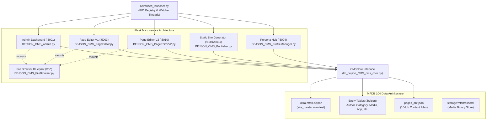
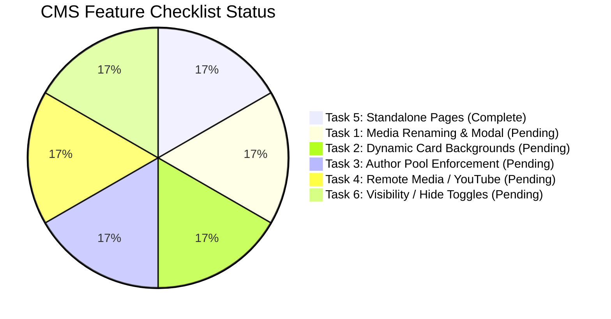

# BEJSON CMS: Forensic Architecture, Security & Policy Audit Report

**Target Repository:** `/storage/emulated/0/Admin/Dev/Python/Development/BEJSON_CMS`  
**Current Baseline Version:** `V18.29-PKG144`  
**Audit Date:** `2026-10-19`  
**Auditor:** Antigravity System Assistant  
**Author / Project Lead:** Elton Boehnen · boehnenelton2024@gmail.com · boehnenelton2024.pages.dev · github.com/boehnenelton  

---

## Executive Summary

A comprehensive, forensic audit of the **BEJSON_CMS** codebase (`/storage/emulated/0/Admin/Dev/Python/Development/BEJSON_CMS`) was conducted. This project is a specialized Content Management System and Static Site Generator engineered for resource-constrained environments (Termux / Android / Pydroid3) utilizing the Foundational Era **BEJSON 104 / 104a / 104db** format and **MFDB** (Multi-File Database) architecture.

### Key Audit Findings
1. **Import Freeze Root Cause & Remediation (pkg144):** The historical Android freeze during file/image import was caused by the browser's native file chooser (`<input type="file">`, `FileReader`, `showOpenFilePicker`) backgrounding the host browser process, triggering Android OS low-memory killer (OOM) termination. The in-app server-side file browser (`BEJSON_CMS_FileBrowser.py`) cleanly resolves this by conducting filesystem traversal inside the Flask process.
2. **Security Posture:** Authentication is globally enforced via an `@app.before_request` Basic Auth hook across all Flask microservices (`BEJSON_CMS_Admin.py`, `BEJSON_CMS_PageEditor.py`, `BEJSON_CMS_PageEditorV2.py`, `BEJSON_CMS_Publisher.py`, `BEJSON_CMS_ProfileManager.py`). Path traversal safeguards (`bejson_safe_join`, `resolve_pick`, `safe_extract_zip`) and SVG XSS defenses (`lib_bejson_Core_svg_sanitizer.py` + CSP sandbox headers) are rigorously implemented.
3. **Media Renaming / Selector Disconnect Identified (Checklist Task 1):** The user's observation that renamed media assets continue displaying original names in Page Editors and App Importer was forensically verified: `assets_rename()` updates `asset_original_name` in MFDB, but `BEJSON_CMS_Shared.get_image_assets()` returns only a flat list of `asset_filename` strings, which editor `<select>` templates render as both value and label.
4. **Policy §7.3 & §6.2 Gaps:** 181 `print()` logging calls exist in `src/cms-manage.py` and 4 in `src/lib/lib_bejson_CMS_cms_core.py`; 15 instances of positional row indexing (`row[0]`, `row[1]`) persist where dynamic Field Map Cache lookups are required. One hardcoded library path exists in `src/cms-manage.py:154`.
5. **Test Harness:** 73 total pytest cases; 71 passed, 2 skipped solely due to missing optional `PIL` in the active CLI environment. All tests execute strictly in temporary mock fixtures (`tmp_path`), protecting live database integrity.

---

## 1. Architectural Architecture & Process Topology



### 1.1 Process & Port Distribution
The application avoids monolithic bundling by running isolated, lightweight Flask services orchestrated by `advanced_launcher.py`:
- **Admin Dashboard (`BEJSON_CMS_Admin.py`):** Runs on default port `5001`. Registers `System`, `Content`, `Media`, `Interface`, and `FileBrowser` blueprints.
- **Page Editor V1 (`BEJSON_CMS_PageEditor.py`):** Runs on port `5003`. Form-based editor with AI generation capabilities.
- **Page Editor V2 (`BEJSON_CMS_PageEditorV2.py`):** Runs on port `5010`. API-driven asynchronous editor with live drafting.
- **Publisher (`BEJSON_CMS_Publisher.py`):** Runs on port `5001` (or `5011` when Admin is running concurrently; dynamic auto-bump handled by `advanced_launcher.py`). Reads MFDB records and generates static HTML into `storage/builds/`.
- **Persona Hub (`BEJSON_CMS_ProfileManager.py`):** Runs on port `5004`. Manages `AI_Profile` system personas.

### 1.2 In-App File Browser Architecture (`BEJSON_CMS_FileBrowser.py`)
- **Android Process Kill Invariant:** Opening native file choosers (`<input type="file">`, `showOpenFilePicker`) in Chrome/Firefox on Android causes the browser OS process to lose foreground status, prompting Android's Low Memory Killer (LMK) to terminate the web process.
- **Remediation Topology:** The file browser runs entirely in-app via REST endpoints (`/fb/api/roots`, `/fb/api/list`, `/fb/api/thumb`). The frontend client requests directory listings via JSON, presents a modal UI (`becss-filepicker.js`), and returns absolute server paths directly to backend endpoints (`/assets/import_server`, `/import/html_server`, etc.).
- **Zero-RAM Streaming:** Selected files are copied via `copy_file_chunked()` in 1MB buffers rather than loaded into memory.

### 1.3 The Two-Part Page Write Contract
A CMS page is structurally split into two parts:
1. **Manifest Row:** A row in `storage/mfdb/site_master/pagerecord.bejson` containing metadata (`page_uuid`, `page_title`, `page_slug`, `page_cat_name`, `page_created_at`, `page_author_name`, `page_is_standalone_flag`, `page_is_hidden_flag`, etc.).
2. **Page Content Document:** A dedicated 104db content file at `storage/mfdb/pages_db/<page_uuid>.json`.
*Invariant:* Both must be written atomically using temp files (`os.replace`). Creating one without the other results in orphaned database rows or 404 errors.

---

## 2. Security & Vulnerability Analysis

| Vulnerability Class | Location | Status | Technical Detail & Remediation |
|---|---|---|---|
| **Authentication Coverage** | Web Tier (`src/web/*.py`) | **SECURED** | All 5 Flask entry points enforce HTTP Basic Auth via `@app.before_request`. Covered by automated integration tests in `test_bejson_cms_admin_auth.py`. |
| **Credential Comparison** | `src/web/BEJSON_CMS_Shared.py:53` | **MEDIUM RISK** | `_check_auth` uses standard `==` string equality (`username == _CMS_USER and password == _CMS_PASS`). Vulnerable to timing attacks. Remediate with `hmac.compare_digest`. |
| **Default Password** | `src/web/BEJSON_CMS_Shared.py:50` | **MEDIUM RISK** | Defaults to `changeme` if `CMS_PASSWORD` is unset. Mitigated by runtime warning and loopback binding (`127.0.0.1`), but risks unauthorized access if bound to `0.0.0.0`. |
| **Filesystem Containment** | `BEJSON_CMS_FileBrowser.py` | **SECURED** | Paths are resolved via `os.path.realpath` and checked against allowed browse roots. `..` escapes and symlink targets outside roots are rejected (tested in `test_bejson_cms_filebrowser.py`). |
| **Secrets Directory Exposure** | `BEJSON_CMS_FileBrowser.py:270` | **SECURED** | Any path resolving under `.env/secure` is denied with `PickError`, except when explicitly requested with `kind="keys"`. |
| **Cross-Site Request Forgery / Origin Guard** | `BEJSON_CMS_FileBrowser.py:166` | **SECURED** | `assert_request_allowed()` enforces loopback client (`127.0.0.1`, `::1`) and rejects `Sec-Fetch-Site: cross-site`. |
| **Wildcard CORS Exposure** | `BEJSON_CMS_PageEditorV2.py:75` | **MEDIUM RISK** | Sends `Access-Control-Allow-Origin: *` on all routes. While `/fb/*` blocks cross-site requests, other PageEditorV2 routes (`/api/save`, `/api/delete`) lack `Sec-Fetch-Site` checks, allowing cross-site manipulation if default credentials are used. |
| **Stored XSS via SVG** | `BEJSON_CMS_Media.py`, `PageEditorV2.py` | **SECURED** | SVGs pass through `lib_bejson_Core_svg_sanitizer.py` (stripping `<script>`, `onload`, SMIL, XXE). Served with `Content-Security-Policy: script-src 'none'; sandbox;`. |
| **Path Traversal in App Deletion** | `BEJSON_CMS_Content.py:app_delete` | **SECURED** | `app_uuid` is validated against strict UUID regex before calling `shutil.rmtree` (tested in `test_bejson_cms_app_uuid_validation.py`). |
| **Dead Context Upload Route** | `BEJSON_CMS_PageEditorV2.py:210` | **LOW RISK** | `/api/context/upload` still utilizes `request.files.get("file")` (multipart upload), which bypasses the server-side file picker if invoked directly. |

---

## 3. Forensic Root-Cause Analysis: Media Renaming & Dropdown Desync (Checklist Task 1)

### 3.1 The Bug Phenomenon
In `dev/updates.md`, the user recorded:
> *"When you rename a file in the media gallery it might change its file name I'm not sure because when you're in the page editor or the app importer and you click the combo box to attach me to the page, still shows the original names... so it either did not rename it or the combo box is referencing a database entry that doesn't reflect its current file."*

### 3.2 Code Verification & Trace
Inspection of `src/web/BEJSON_CMS_Media.py:assets_rename()`:
```python
def assets_rename(filename):
    """Renames the display name only — the physical stored filename never
    changes, so any page content already referencing /assets/<filename>
    keeps working."""
    ...
    ok = db.update_record("MediaAsset", "asset_filename", filename, {"asset_original_name": new_name})
```
- `assets_rename()` intentionally mutates **`asset_original_name`**, leaving `asset_filename` fixed so image URLs in published articles do not break.
- However, inspection of `src/web/BEJSON_CMS_Shared.py:get_image_assets()` reveals:
```python
def get_image_assets():
    ...
    assets = db.get_records("MediaAsset")
    assets.sort(key=lambda a: a.get('asset_uploaded_at') or '', reverse=True)
    return [a['asset_filename'] for a in assets if (a.get('asset_mime_type') or '').startswith('image/')]
```
- `get_image_assets()` returns a list of **`asset_filename` strings**, discarding `asset_original_name`.
- In `src/web/BEJSON_CMS_PageEditor.py` and `BEJSON_CMS_Content.py` (App Importer and Editor combo boxes):
```html
<select name="featured_image">
    
    <option value="{{ a }}">{{ a }}</option>
    
</select>
```
The `<option>` tag sets both `value` and user-facing text to `a` (which is `asset_filename`). Even after a user renames an asset to "Hero Banner", the dropdown continues displaying `a1b2c3d4_hash.png`.

### 3.3 Solution Blueprint
1. **Dropdown Label Fix:** Update `get_image_assets()` or provide `get_image_asset_tuples()` returning `(filename, original_name)`. Render `<option value="{{ a.asset_filename }}">{{ a.asset_original_name or a.asset_filename }}</option>`.
2. **Reusable Modal Media Selector:** Build a unified `CMSMediaSelector` component (mirroring `CMSFilePicker`) that queries `/assets/api/list` and presents a visual grid thumbnail picker instead of flat combo boxes.

---

## 4. Policy Compliance Audit (Antigravity Policy)

### 4.1 Policy §7.3 — Zero `print()` for Logging
> *"❌ NEVER print() for logging — use the logging module."*

- **`src/cms-manage.py`**: Contains **181 `print()` calls**. As a CLI tool, output directed to the user (`stdout`) is standard, but debug and error traces should utilize `LOGGER.info` / `LOGGER.error`.
- **`src/lib/lib_bejson_CMS_cms_core.py`**: Lines 72, 137, 180, 192 call `print(f"[CMSCore] ... Error: {e}")` despite `import logging` present at line 32.
- **`src/web/BEJSON_CMS_Admin.py` & `BEJSON_CMS_Publisher.py`**: Multiple `print()` statements in server startup routines.

### 4.2 Policy §6.2 — Mandatory Field Map Cache Compliance
> *"Field Map Cache is mandatory across all BEJSON operations. Positional lookups, hardcoded indices, and fixed field offsets are strictly prohibited."*

15 positional row indexing instances were detected in active source files:
1. `src/lib/lib_bejson_CMS_cms_ports.py:95, 97, 111, 113`: Accesses `row[0]` and `row[1]` directly when reading `config.json` instead of dynamically mapping `setting_name` and `setting_value`.
2. `src/lib/lib_bejson_Core_bejson_env.py:49-50`: Accesses `row[0]` and `row[1]` positionally for env configuration rows.
3. `src/web/BEJSON_CMS_PageEditorV2.py:184, 193, 199, 238`: Reads `row[0]`, `row[1]`, `row[2]` positionally from storage config (`config.get("Values", [])`).
4. `src/web/BEJSON_CMS_Publisher.py:111`: Dict comprehension `CF_KEYS = {row[0]: row[1] for row in cf_data["Values"]}` assumes fixed indices.
5. `src/web/BEJSON_CMS_System.py:566, 692`: Direct row index lookups on manifest entity values.

### 4.3 Policy §4.3 & §4.5 — Path Hardcoding Prohibition
> *"Never hardcode environment paths in runtime logic. Embed defaults in a 104a configuration file inside a config/ directory."*

- **Violation:** `src/cms-manage.py:154`:
  ```python
  MASTER_LIB = Path("/storage/emulated/0/Admin/libraries")
  ```
  Must resolve dynamically via `os.environ.get("ADMIN_LIBRARIES")` or fallback to relative `SCRIPT_PATH.parent / "lib"`.

### 4.4 Policy §10.1 & §10.2 — Taxonomy & Schema Registry
- The canonical taxonomy registry `src/lib/lib_bejson_CMS_taxonomy.py` defines prefixes (`page_`, `cat_`, `author_`, `asset_`, `extmedia_`, `ad_`, `nav_`, `sys_`, `social_`, `app_`, `persona_`) and UUID primary keys for all 11 entities.
- Running `tools/audit_taxonomy.py` confirms that the live database has **0 fields to rename** and **0 missing UUIDs**. All live records are 100% compliant with canonical taxonomy standards.

### 4.5 Policy §8.1 — Visual Branding Palette
- Colors across `fb_assets/becss-filepicker.css`, `resources/styles/dark.css`, and inline admin templates strictly adhere to:
  - Background: `#000000` / `#0a0a0a`
  - Text: `#FFFFFF` / `#f0f0f0`
  - Active / Hover Accent: `#DE2626` (Red)

---

## 5. Status of Active Feature Checklist (`dev/checklist-20261014-145500.md`)

Per `AGENTS.md`, active development tasks must only be executed strictly one at a time upon explicit user direction.



- **Task 1: Media Renaming Synchronization & Reusable Modal Media Selector**
  - *Status:* **PENDING**. Root cause identified in `get_image_assets()` and lack of modal selector component.
- **Task 2: Generic Background Card Images with Dynamic Title Overlay**
  - *Status:* **PENDING**. Requires PIL-based title renderer fallback when `featured_image` is absent.
- **Task 3: Author Pool Enforcement**
  - *Status:* **PENDING**. Form text fields for authors must be converted to strict `<select>` dropdowns backed by `CMSCore.get_records("AuthorProfile")`.
- **Task 4: Remote Media Assets (YouTube & Video Links)**
  - *Status:* **PENDING**. `ExternalMedia` entity exists; requires modal integration and responsive `<iframe>` injection into publisher templates.
- **Task 5: Actual Standalone Category-less Pages**
  - *Status:* **COMPLETE (2026-10-14)**. `page_is_standalone_flag` implemented; pages route to `pages/<slug>/index.html` and populate `{{standalone_nav_links}}` / `{{sidebar_standalone_pages}}` without clogging feed loops.
- **Task 6: Feed & Category Visibility Controls (Hide Functionality)**
  - *Status:* **PENDING**. Schemas in `BEJSON_CMS_System.py` already declare `cat_is_hidden_flag` and `page_is_hidden_flag`; UI toggles and Publisher feed-filtering queries need implementation.

---

## 6. Test Suite & Verification Matrix

Automated verification of the test harness (`tests/`) yielded:
- **Total Tests:** 73
- **Passed:** 71
- **Skipped:** 2 (`tests/test_bejson_cms_filebrowser.py::test_thumbnail_generated_and_cached`, `test_corrupt_image_thumbnail_does_not_500` skipped due to `pytest.importorskip("PIL.Image")` in headless environment).
- **Execution Time:** ~2.76s

### Test Coverage Highlights
- `test_bejson_cms_admin_auth.py` (5 cases): Verifies unauthenticated GET/POST requests receive HTTP 401 across all blueprints.
- `test_bejson_cms_app_uuid_validation.py` (5 cases): Verifies path traversal attacks like `..` or URL-encoded slashes in app deletion cannot escape `storage/mfdb/standalone_apps/`.
- `test_bejson_cms_filebrowser.py` (33 cases): Validates root resolution, symlink escape rejections, `.env/secure` secret denial, local-only loopback gates, and extension allowlists.
- `test_lib_bejson_CMS_cms_core.py` (8 cases): Validates CRUD round-trips against isolated temp databases.
- `test_lib_bejson_Core_bejson_path_guard.py` (13 cases): Verifies `bejson_safe_join` containment and storage path resolution.
- `test_lib_bejson_Core_mfdb_validator.py` (8 cases): Validates schema integrity and manifest consistency.

---

## 7. Prioritized Remediation Roadmap

### Phase 1: Security Hardening & Safe Defaults (Immediate)
1. **Constant-Time Auth Check:** Update `_check_auth()` in `src/web/BEJSON_CMS_Shared.py` to use `hmac.compare_digest(_CMS_USER, username)` and `hmac.compare_digest(_CMS_PASS, password)`.
2. **PageEditorV2 CORS Lockdown:** Restrict `Access-Control-Allow-Origin` in `BEJSON_CMS_PageEditorV2.py` from `*` to specific localhost origin or enforce `Sec-Fetch-Site` checks on mutative routes (`/api/save`, `/api/delete`).
3. **Dead Context Upload Cleanup:** Replace `/api/context/upload` in `BEJSON_CMS_PageEditorV2.py` with an in-app server pick route (`resolve_pick(kind='document')`), eliminating the last remaining browser-native upload handler.

### Phase 2: Policy Compliance & Code Hygiene
1. **Logging Refactor:** Replace `print()` logging in `src/lib/lib_bejson_CMS_cms_core.py` and `src/cms-manage.py` with structured `logging.getLogger(...)` calls per Policy §7.3.
2. **Field Map Cache Enforcement:** Refactor the 15 positional indexing sites (`lib_bejson_CMS_cms_ports.py`, `BEJSON_CMS_Publisher.py`, `BEJSON_CMS_PageEditorV2.py`) to build and query dynamic `field_map` dictionaries per Policy §6.2.
3. **Master Lib Path Decoupling:** Change `src/cms-manage.py:154` from hardcoded `/storage/emulated/0/Admin/libraries` to `os.environ.get("ADMIN_LIBRARIES")`.

### Phase 3: Active Feature Checklist Execution (Upon User Instruction)
When instructed, execute tasks from `dev/checklist-20261014-145500.md` strictly one by one:
1. **Task 1:** Resolve Media Renaming desync in `get_image_assets()` and introduce reusable modal `CMSMediaSelector`.
2. **Task 2:** Dynamic title-overlaid card background generation.
3. **Task 3:** Author pool `<select>` enforcement.
4. **Task 4:** Remote video / YouTube link embedding.
5. **Task 6:** Category and Page feed visibility toggles (`cat_is_hidden_flag`, `page_is_hidden_flag`).
