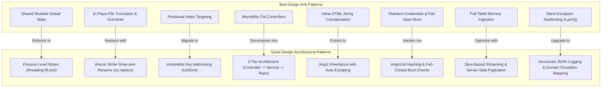
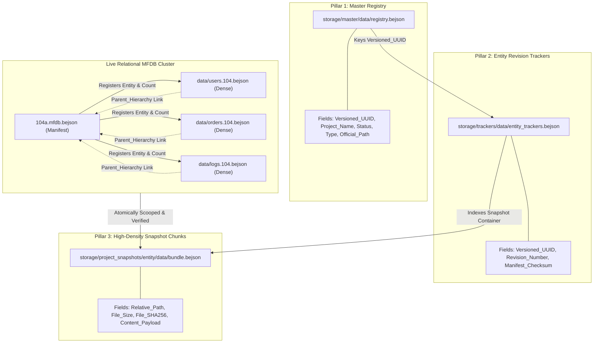

# Universal Principles of Flask Architecture: Bad Design (Anti-Patterns & Architectural Failures)

**Document**: `principals_of_design.md`  
**Part**: 1 of 2 (Part 1: Universal Bad Design Principles; Part 2: Universal Good Design Principles)  
**Scope**: Project-Agnostic Flask Web Application & System Architecture  
**Focus**: Structural Anti-Patterns, Concurrency Hazards, Security Vulnerabilities, and Scalability Traps  

---

## Introduction: The Anatomy of Bad Design

Architecture is the structural contract governing how state, computation, and communication interact across time. In web application frameworks such as Flask (built on the WSGI specification: Web Server Gateway Interface, PEP 3333), bad design is rarely confined to aesthetic or cosmetic issues. Rather, it manifests as architectural anti-patterns that induce silent data corruption under concurrency, exhaust hardware resources, expose critical security surfaces, and bind presentation concerns directly into routing kernels.

Part 1 of this treatise establishes the universal principles of **Bad Design** in Flask architectures, categorized by foundational systems domains. Each principle deconstructs the flawed mechanism, provides representative architectural anti-pattern traces, and exposes the resulting operational failure modes.

---

## Domain 1: Concurrency, Thread Safety & State Mutation Anti-Patterns

### Principle 1.1: Shared Mutable Global State Across Worker Threads
* **The Flaw**: Storing application state, active records, cache registries, or counters in global module-level variables accessed across concurrent Flask request threads.
* **Mechanism**: In a multi-threaded WSGI runtime (e.g., Gunicorn with gthread workers, uWSGI with thread pools, or development servers running `threaded=True`), module-level variables reside in shared process memory. Multiple execution threads mutate these structures simultaneously without lock synchronization.
* **Anti-Pattern Trace**:
  ```python
  # Anti-pattern: Global mutable state shared across requests
  app_cache = {}
  active_user_counter = 0

  @app.route("/process-item", methods=["POST"])
  def process_item():
      global active_user_counter
      active_user_counter += 1  # Race condition: non-atomic bytecode execution
      item_id = request.json.get("id")
      app_cache[item_id] = request.json.get("payload")  # Dict mutation race
      return jsonify({"status": "ok", "active": active_user_counter})
  ```
* **Failure Modes**:
  - Python's Global Interpreter Lock (GIL) does not guarantee atomic multi-step operations (e.g., read-modify-write bytecode sequences `LOAD_GLOBAL`, `BINARY_ADD`, `STORE_GLOBAL` can context-switch mid-execution).
  - High concurrency triggers dictionary mutation race conditions, resulting in `RuntimeError: dictionary changed size during iteration` or silent state overwrite where concurrent user sessions cross-contaminate data.

---

### Principle 1.2: Unsynchronized File Mutations & Lack of Inter-Process Locks
* **The Flaw**: Performing direct filesystem reads, writes, and truncations within request handlers without OS-level advisory file locks.
* **Mechanism**: In a multi-worker deployment where multiple OS processes serve incoming HTTP requests, Python-level thread locks (`threading.Lock`) are completely blind to sibling processes. Modifying on-disk JSON, XML, or flat files without `fcntl.flock` (advisory locking on POSIX systems) or file-descriptor locking leads to interleaved read and write operations.
* **Anti-Pattern Trace**:
  ```python
  # Anti-pattern: Direct disk write without file-descriptor locking
  @app.route("/save-document", methods=["POST"])
  def save_document():
      data = request.json
      # Thread/Process A truncates file while Thread/Process B is reading
      with open("storage/data.json", "w") as file_handle:
          json.dump(data, file_handle)
      return jsonify({"status": "saved"})
  ```
* **Failure Modes**:
  - Reader processes encounter empty files or truncated fragments during the window between `open(..., "w")` and `json.dump()`, causing unhandled `JSONDecodeError` exceptions.
  - Sibling writer processes clobber each other's writes, producing silent data loss where the last completed write completely obliterates intermediate state (the classic Lost Update problem).

---

### Principle 1.3: Positional Index Targeting Instead of Immutable Key Addressing
* **The Flaw**: Identifying, updating, or deleting records by their sequential array index or row position in an array rather than by an immutable unique identifier.
* **Mechanism**: Data storage models that locate rows by zero-indexed position ($0, 1, 2, \dots$) decouple the identifier from the identity. When records are spliced or shifted in-memory, every downstream index changes.
* **Anti-Pattern Trace**:
  ```python
  # Anti-pattern: Mutating data by sequential array index
  @app.route("/delete-entry/<int:entry_index>", methods=["POST"])
  def delete_entry(entry_index):
      entries = load_all_entries()  # Reads array from store
      # If another request deleted entry 0, entry_index now points to the wrong record!
      del entries[entry_index]
      write_all_entries(entries)
      return redirect("/list")
  ```
* **Failure Modes**:
  - Index-shift corruption: When two users execute deletions or insertions concurrently, the second operation targets the wrong entity entirely. User B intends to delete their draft, but due to User A's concurrent deletion, User B inadvertently deletes another user's production post.
  - Off-by-one boundary failures: Splicing records concurrently triggers `IndexError: list index out of range` and causes immediate 500 Internal Server Errors.

---

### Principle 1.4: Decoupled Time-Of-Check to Time-Of-Use (TOCTOU) Execution
* **The Flaw**: Checking state conditions (existence, balance, permissions) in one step and performing the corresponding mutation in a subsequent, non-atomic step.
* **Mechanism**: In a web pipeline, any non-atomic gap between condition validation and state mutation creates a race window.
* **Anti-Pattern Trace**:
  ```python
  # Anti-pattern: TOCTOU race condition
  @app.route("/claim-voucher", methods=["POST"])
  def claim_voucher():
      voucher = query_voucher(request.form["code"])
      if voucher["is_claimed"]:  # Step 1: Check
          return "Already claimed", 400
      # Race Window: Another thread can execute and claim here!
      mark_voucher_claimed(voucher["id"])  # Step 2: Use
      return "Claimed successfully", 200
  ```
* **Failure Modes**:
  - Double-spending attacks: Malicious actors fire concurrent HTTP requests in parallel, allowing multiple threads to pass the validation check simultaneously before the mutation executes, leading to duplicate resource allocation.

---

## Domain 2: Process Model, Lifecycle & Server Orchestration Anti-Patterns

### Principle 2.1: Production Deployment of Embedded WSGI Development Servers
* **The Flaw**: Running Flask via `app.run()` in staging, testing, or production environments instead of mounting through a production WSGI/ASGI application server.
* **Mechanism**: The built-in Werkzeug development server is designed strictly for local debugging. It lacks hardened HTTP request parsing, robust connection pool limits, buffer overflow protection, and process worker supervision.
* **Anti-Pattern Trace**:
  ```python
  # Anti-pattern: Production entry point utilizing built-in server
  if __name__ == "__main__":
      # Never safe for production ingress
      app.run(host="0.0.0.0", port=5000, debug=True, threaded=True)
  ```
* **Failure Modes**:
  - Slowloris attacks: The development server can be starved of request handles by holding slow connections open, causing total Denial of Service (DoS) for all clients.
  - Interactive debugger exploitation: Setting `debug=True` in public environments exposes the Werkzeug console PIN execution engine, granting arbitrary remote code execution (RCE) to attackers.

---

### Principle 2.2: Multi-Port Server Bifurcation & Loose Socket Proliferation
* **The Flaw**: Splitting application features across multiple uncoordinated HTTP ports (e.g., admin dashboard on port 8000, preview engine on port 8001, asset streamer on port 8002) within the same application process.
* **Mechanism**: Launching ad-hoc sockets or background HTTP instances across disparate port numbers fragments network ingress, breaks reverse proxy load balancing, and forces browser clients to handle cross-origin requests.
* **Anti-Pattern Trace**:
  ```python
  # Anti-pattern: Spawning secondary HTTP server on arbitrary secondary port
  import threading, http.server

  def run_preview_server():
      handler = http.server.SimpleHTTPRequestHandler
      server = http.server.HTTPServer(("0.0.0.0", 8081), handler)
      server.serve_forever()

  threading.Thread(target=run_preview_server, daemon=True).start()
  app.run(port=8080)
  ```
* **Failure Modes**:
  - Zombie socket exhaustion: Ephemeral background threads holding ports fail to bind with `SO_REUSEADDR`. Rapid restarts trigger `OSError: [Errno 98] Address already in use`, preventing application boot until processes are manually identified and killed.
  - Cross-Origin Resource Sharing (CORS) failures: Browsers restrict cross-port communication between `localhost:8080` and `localhost:8081`, requiring complex CORS headers and exposing security attack surfaces.

---

### Principle 2.3: Unmanaged Background Daemon Threads Inside Request Cycles
* **The Flaw**: Spawning unmanaged background threads (`threading.Thread(...).start()`) inside route handlers to process long-running tasks.
* **Mechanism**: Spawning free-running threads within request contexts detaches task execution from the WSGI lifecycle. The web process has no visibility into thread completion, error states, or resource reclamation.
* **Anti-Pattern Trace**:
  ```python
  # Anti-pattern: Fire-and-forget background thread spawned in request
  @app.route("/generate-report", methods=["POST"])
  def generate_report():
      task = threading.Thread(target=expensive_pdf_compilation, args=(request.json,))
      task.start()  # Detached, unmonitored execution
      return jsonify({"status": "processing"})
  ```
* **Failure Modes**:
  - Silent task death: If the WSGI worker process recycles (e.g., reaching maximum request thresholds or triggering a restart), unmanaged daemon threads are killed mid-execution, leaving half-written files and corrupted state.
  - Memory and thread pool starvation: Unthrottled request traffic spawns hundreds of threads, consuming all available system memory and CPU scheduling quanta until the process crashes.

---

## Domain 3: Layering & Separation of Concerns Anti-Patterns

### Principle 3.1: Monolithic Route Controllers (Fat Controllers)
* **The Flaw**: Packing authentication, parameter validation, business domain logic, raw database querying, external API calls, and response serialization directly into a single route function.
* **Mechanism**: Violates the Single Responsibility Principle (SRP). The controller becomes an unmaintainable god-routine responsible for every layer of the architecture.
* **Anti-Pattern Trace**:
  ```python
  # Anti-pattern: Monolithic route handler performing all architectural duties
  @app.route("/user/update-profile", methods=["POST"])
  def update_profile():
      # 1. Auth check
      if "user" not in session: return redirect("/login")
      # 2. Validation
      email = request.form.get("email")
      if not re.match(r"^[^@]+@[^@]+\.[^@]+$", email): return "Invalid email", 400
      # 3. Database connection & direct SQL
      conn = sqlite3.connect("users.db")
      cursor = conn.cursor()
      cursor.execute("UPDATE users SET email=? WHERE id=?", (email, session["user_id"]))
      conn.commit()
      # 4. Third-party notification
      requests.post("https://api.mailservice.com/notify", json={"email": email})
      # 5. Presentation generation
      return "<html><body><h1>Profile Updated!</h1></body></html>"
  ```
* **Failure Modes**:
  - Testability paralysis: The route cannot be unit-tested without mocking the entire HTTP request environment, the network connection to external APIs, and the database socket simultaneously.
  - Logic duplication: Business logic embedded in web controllers cannot be reused by CLI commands, asynchronous job workers, or REST API endpoints without copy-pasting code.

---

### Principle 3.2: Inline Presentation Concatenation Inside Controllers
* **The Flaw**: Hardcoding HTML strings, CSS blocks, and JavaScript routines inside Python string literals and concatenating them in route handlers.
* **Mechanism**: Direct concatenation of presentation markup inside Python controllers completely collapses the Model-View-Controller (MVC) boundary.
* **Anti-Pattern Trace**:
  ```python
  # Anti-pattern: Concatenating HTML inside Python controller strings
  @app.route("/view-items")
  def view_items():
      items = query_items()
      html = "<html><head><style>.card{border:1px solid #000;}</style></head><body>"
      html += "<div class='container'>"
      for it in items:
          html += f"<div class='card'><h3>{it['name']}</h3><p>{it['desc']}</p></div>"
      html += "</div></body></html>"
      return html
  ```
* **Failure Modes**:
  - Auto-escaping bypass & XSS: Python f-strings or string concatenation do not sanitize input against HTML entities. If `it['name']` contains `<script>alert(1)</script>`, malicious JavaScript executes directly in client browsers.
  - Zero static tooling: Syntax highlighters, CSS linters, and HTML formatters cannot inspect code trapped inside Python multiline strings.

---

### Principle 3.3: Split-Brain Dual Data Layers
* **The Flaw**: Maintaining two divergent, competing data access layers operating on the same underlying persistent store across different entry points (e.g., Web vs. CLI).
* **Mechanism**: Implementing one data abstraction for Flask web controllers and an entirely distinct data abstraction for CLI management tools or background processors creates architectural divergence.
* **Anti-Pattern Trace**:
  ```python
  # Web layer implementation
  class WebDataManager:
      def update_record(self, key, value):
          doc = load_json()
          doc["records"][key] = value
          atomic_write_json(doc)

  # CLI management implementation (divergent assumptions)
  class CLIDataManager:
      def update_record(self, key, value):
          archive = open_zip_archive()
          archive.extract_all()  # Wipes live directory!
          doc = read_raw()
          doc[key] = value
          archive.repack()
  ```
* **Failure Modes**:
  - Inconsistent business rules: Validations implemented in the web layer are bypassed by the CLI layer, leading to database corruption.
  - Destructive lifecycle collisions: If the CLI layer assumes exclusive access or operates via workspace extraction, executing CLI commands overwrites changes made through the web layer.

---

## Domain 4: Security, Authentication & Session Architecture Anti-Patterns

### Principle 4.1: Plaintext Credentials & Permissive Fallback Defaults
* **The Flaw**: Storing credentials in plaintext or configuring fallback defaults (e.g., `"admin"` / `"changeme"`) when environment variables are omitted.
* **Mechanism**: Defaulting to well-known administrative credentials when configuration is missing converts a configuration mistake into an immediate security compromise.
* **Anti-Pattern Trace**:
  ```python
  # Anti-pattern: Hardcoded insecure fallback credentials
  ADMIN_USER = os.environ.get("ADMIN_USER", "admin")
  ADMIN_PASS = os.environ.get("ADMIN_PASSWORD", "changeme")

  @app.route("/login", methods=["POST"])
  def login():
      # Insecure plain-text string comparison
      if request.form["user"] == ADMIN_USER and request.form["pass"] == ADMIN_PASS:
          session["auth"] = True
          return redirect("/dashboard")
      return "Denied", 401
  ```
* **Failure Modes**:
  - Zero-day default credential compromise: Any deployment that launches without explicit environment injection is immediately compromised by automated vulnerability scanners scanning for `"admin:changeme"`.
  - Timing attacks: The standard Python equality operator (`==`) terminates evaluation on the first mismatched character, allowing attackers to measure microscopic response time deltas to deduce valid passwords.

---

### Principle 4.2: Lack of CSRF Protection on State-Modifying Endpoints
* **The Flaw**: Exposing state-modifying HTTP methods (`POST`, `PUT`, `DELETE`) without validating unique, cryptographically signed anti-Cross-Site Request Forgery (CSRF) tokens.
* **Mechanism**: Browsers automatically attach ambient credentials (session cookies, HTTP Basic Auth headers) to cross-origin requests. An external malicious site can trick an authenticated user's browser into submitting forms to the victim application.
* **Anti-Pattern Trace**:
  ```python
  # Anti-pattern: State-mutating POST endpoint without CSRF validation
  @app.route("/account/delete", methods=["POST"])
  def delete_account():
      if session.get("authenticated"):
          # Executed automatically if user visits attacker's webpage!
          purge_user(session["user_id"])
          return "Account Deleted"
      return "Unauthorized", 401
  ```
* **Failure Modes**:
  - Unauthorized action execution: Attackers host hidden auto-submitting forms that alter administrator passwords, delete database entities, or trigger financial transfers using the victim's authenticated browser context.

---

### Principle 4.3: Unrestricted File Upload & Unsanitized Filesystem Ingress
* **The Flaw**: Saving uploaded client files directly to disk using unvalidated client-supplied filenames or storing executable uploads in publicly accessible directories.
* **Mechanism**: Trusting the `filename` attribute of `multipart/form-data` payloads permits path traversal and file extension spoofing attacks.
* **Anti-Pattern Trace**:
  ```python
  # Anti-pattern: Direct disk write of untrusted client filename
  @app.route("/upload", methods=["POST"])
  def upload_file():
      uploaded = request.files["file"]
      # Dangerous: client can supply '../../etc/passwd' or 'malicious.py'
      save_path = os.path.join("/var/www/uploads", uploaded.filename)
      uploaded.save(save_path)
      return "File uploaded"
  ```
* **Failure Modes**:
  - Arbitrary file overwrite / Path traversal: Filenames containing `../` escape the intended upload directory, allowing attackers to overwrite system binaries, SSH keys, or application configuration files.
  - Remote code execution (RCE): Uploading executable scripts (`.py`, `.php`, `.sh`) into document roots where they can be invoked via web requests allows full host compromise.

---

## Domain 5: Data Ingestion, Querying & Memory Scalability Anti-Patterns

### Principle 5.1: Full-Table Memory Ingestion ($O(N)$ Ingestion Complexity)
* **The Flaw**: Loading and deserializing an entire database or flat-file store into memory to satisfy queries that only require a handful of records.
* **Mechanism**: Calling serialization routines that parse multi-megabyte JSON/CSV trees on every incoming HTTP request consumes vast computational cycles and memory bandwidth.
* **Anti-Pattern Trace**:
  ```python
  # Anti-pattern: Loading entire persistent store for single item lookup
  @app.route("/article/<article_slug>")
  def get_article(article_slug):
      # Reads 50MB file and parses 100,000 dicts on EVERY request
      all_articles = json.load(open("articles_large_table.json"))
      for art in all_articles:
          if art["slug"] == article_slug:
              return render_template("article.html", article=art)
      return "Article not found", 404
  ```
* **Failure Modes**:
  - Linear memory growth: Memory utilization scales directly with total storage volume rather than concurrent request volume. Under load, $M$ concurrent requests each allocate $N$ megabytes of duplicate objects, rapidly invoking the Linux OOM Killer.
  - Latency spikes: Parsing large JSON structures in Python holds the CPU for hundreds of milliseconds, blocking event loops and exhausting WSGI worker threads.

---

### Principle 5.2: In-Memory Pagination and Client-Side Filtering
* **The Flaw**: Ingesting all database records into Python lists before slicing with `[start:end]` offsets or filtering via list comprehensions.
* **Mechanism**: Slicing in application memory forces the persistence tier to transfer full table payloads across I/O channels for every page view.
* **Anti-Pattern Trace**:
  ```python
  # Anti-pattern: In-memory pagination
  @app.route("/catalog")
  def show_catalog():
      page = int(request.args.get("page", 1))
      per_page = 20
      all_products = load_entire_product_table() # 50,000 records
      # Inefficient memory slice
      paginated = all_products[(page - 1) * per_page : page * per_page]
      return render_template("catalog.html", items=paginated)
  ```
* **Failure Modes**:
  - Diminishing performance over time: While functional during prototype stages with 50 items, the endpoint slows down monotonically as the system grows, eventually timing out reverse proxies (HTTP 504 Gateway Timeout).

---

## Domain 6: Schema Governance & Relational Integrity Anti-Patterns

### Principle 6.1: Fragile Relational Linkage via Mutable Human Strings
* **The Flaw**: Linking relational tables using mutable descriptive strings (e.g., author display names, category titles) instead of immutable surrogate keys (UUIDs, auto-increment integers).
* **Mechanism**: Human-readable strings are inherently subject to editorial changes, typos, and rebranding. Binding foreign keys to mutable text creates tight coupling with fragile dependencies.
* **Anti-Pattern Trace**:
  ```json
  // Anti-pattern: Relational links bound to mutable strings
  {
    "post_id": "9a7d-41bf",
    "title": "Universal Architecture",
    "author_name": "Jane Doe",
    "category_slug": "system-design"
  }
  ```
* **Failure Modes**:
  - Relational collapse on rename: If an author updates their name from "Jane Doe" to "Jane Smith", all historical posts linked to "Jane Doe" break, displaying null author profiles or triggering 404 errors.
  - Missing cascade mechanics: Flat-file and non-relational designs lack automatic foreign key cascades (`ON UPDATE CASCADE`), requiring manual multi-file traversal that inevitably desynchronizes.

---

### Principle 6.2: Field Name Fragmentation & Unenforced Schema Anarchy
* **The Flaw**: Using divergent, synonymous field keys across different entities or modules to represent identical domain concepts.
* **Mechanism**: Lack of a centralized schema contract allows developers to introduce naming variations (`author_ref`, `author_id`, `created_by`, `auth_name`) ad-hoc across different endpoints.
* **Anti-Pattern Trace**:
  ```python
  # Endpoint A writes:
  {"record_id": 1, "thumbnail_path": "/img/card.webp"}

  # Endpoint B writes:
  {"record_id": 2, "featured_image": "/img/card.webp"}

  # Endpoint C writes:
  {"record_id": 3, "preview_img_url": "/img/card.webp"}
  ```
* **Failure Modes**:
  - Ingestion errors: Static generators, reporting scripts, and unified views fail to find expected keys, rendering blank UI cards and null-pointer exceptions.
  - Bloated boundary transformers: Controllers become littered with defensive fallback chains (`item.get('thumbnail') or item.get('featured_image') or item.get('preview_img_url') or 'default.webp'`).

---

## Domain 7: Error Handling, Logging & Observability Anti-Patterns

### Principle 7.1: Silent Exception Swallowing via Bare Except Clauses
* **The Flaw**: Catching general exceptions with `except Exception: pass` or logging errors with unformatted `print()` statements.
* **Mechanism**: Silencing runtime errors prevents critical failure notifications from propagating to supervisor daemons, error monitoring platforms, or logging pipelines.
* **Anti-Pattern Trace**:
  ```python
  # Anti-pattern: Swallowing exceptions silently
  @app.route("/sync-data", methods=["POST"])
  def sync_data():
      try:
          perform_critical_database_flush()
      except Exception:
          pass  # The failure is hidden forever!
      return jsonify({"status": "completed"})
  ```
* **Failure Modes**:
  - Phantom success: The web endpoint returns HTTP 200 OK to the client while the underlying persistence operation failed completely due to disk exhaustion or permission errors.
  - Trivial failures turn catastrophic: Minor transient errors (e.g., temporary lock contention) go unnoticed until corrupt state propagates throughout the entire database.

---

### Principle 7.2: Production `print()` Statements & Unstructured Console Streams
* **The Flaw**: Using standard Python `print()` statements for diagnostic logging in production services instead of a dedicated, structured logging facility.
* **Mechanism**: `print()` writes unstructured, unbuffered strings directly to standard output (`sys.stdout`) without severity levels, timestamps, thread identifiers, or correlation metadata.
* **Anti-Pattern Trace**:
  ```python
  # Anti-pattern: Console print logging
  @app.route("/order", methods=["POST"])
  def place_order():
      print(f"Order created for {request.json.get('user')}") # No timestamp, no level
      ...
  ```
* **Failure Modes**:
  - Thread safety and interleaving: Concurrent calls to `print()` from multiple worker threads interleave partial lines, corrupting console logs into unreadable strings.
  - Zero log routing: Unstructured text cannot be filtered by severity (`INFO`, `WARNING`, `ERROR`), parsed by log aggregators (e.g., Elasticsearch, CloudWatch), or automatically rotated to prevent disk exhaustion.

---

## Domain 8: Configuration, Portability & Environment Anti-Patterns

### Principle 8.1: Hardcoded Filesystem Paths & Environmental Assumptions
* **The Flaw**: Embedding absolute filesystem paths (e.g., `"/home/user/app/data"`, `"C:\\app\\storage"`) directly into source code.
* **Mechanism**: Absolute path coupling assumes identical filesystem hierarchies across development machines, CI/CD runners, and production servers.
* **Anti-Pattern Trace**:
  ```python
  # Anti-pattern: Hardcoded absolute paths
  UPLOAD_DIR = "/storage/emulated/0/MyProject/uploads"
  CONFIG_FILE = "/data/data/com.termux/files/home/config.json"
  ```
* **Failure Modes**:
  - Instant deployment failure: The application crashes on startup when deployed inside containerized environments (Docker), alternative user profiles, or standard cloud hosts where paths do not match.
  - Permission violations: Hardcoded paths to user directories fail when run under restricted service daemons (e.g., `systemd` with `www-data` user).

---

### Principle 8.2: Permissive Fail-Open Boot Initialization
* **The Flaw**: Initializing application servers when required configuration parameters or security secrets are missing, substituting insecure mock fallbacks.
* **Mechanism**: When critical environment variables (e.g., `SECRET_KEY`, `DATABASE_URL`) are omitted, the application boots anyway, setting fallback values like `"dev-secret-key"`.
* **Anti-Pattern Trace**:
  ```python
  # Anti-pattern: Insecure secret fallback
  app = Flask(__name__)
  app.config["SECRET_KEY"] = os.environ.get("SECRET_KEY", "fallback-insecure-key")
  ```
* **Failure Modes**:
  - Session forgery: Because the fallback secret is published in public source repositories, any attacker can forge administrative session cookies using `itsdangerous` and gain full admin access.
  - Late-stage runtime crashes: If a database URL is missing and mocked with `None`, the application crashes only when a user triggers an endpoint requiring the database, rather than failing immediately at boot.

---

## Domain 9: Dead Code, Deprecation Governance & Codebase Hygiene Anti-Patterns

### Principle 9.1: Living Ghost Modules and Co-Located Deprecated Blueprints
* **The Flaw**: Leaving obsolete, deprecated blueprints, controllers, and scripts inside the active source directory (`src/web/`, `routes/`) without deprecation barriers or physical isolation.
* **Mechanism**: Retaining legacy modules alongside active code invites accidental imports, confuses developers, and pollutes namespace discovery.
* **Anti-Pattern Trace**:
  ```text
  src/
  ├── app.py
  ├── controllers_v1.py        # Deprecated 2 years ago, still in active tree
  ├── controllers_v2.py        # Current active logic
  └── controllers_v2_backup.py # Scratch copy left in production directory
  ```
* **Failure Modes**:
  - Zombie route registration: Accidental auto-discovery loops register stale endpoints from deprecated files, exposing legacy security vulnerabilities that were patched in modern modules.
  - Refactoring regressions: Maintenance engineers inadvertently patch or extend deprecated files, leaving production services unaffected while wasting engineering effort.

---

## Universal Bad Design Summary Matrix

| Anti-Pattern Domain | Primary Flaw | Structural Root Cause | Critical Operational Impact |
| :--- | :--- | :--- | :--- |
| **Concurrency** | Shared mutable globals & unsynchronized disk I/O | Lack of OS-level file locking and thread mutexes | Silent data corruption; index-shift overwrites; lost updates. |
| **Process Model** | Dev server in production; port proliferation | Running `app.run()`; spawning unmanaged threads | DoS vulnerability; zombie socket locks (`Errno 98`). |
| **Separation of Concerns** | Monolithic fat controllers; inline HTML | String concatenation in route functions; god-routines | XSS vulnerabilities; zero template reuse; untestable routes. |
| **Security & Auth** | Plaintext credentials; missing CSRF tokens | Fallback to default strings; no CSRF middleware | Complete host takeover; cross-site request forgery. |
| **Data Scalability** | Full-table $O(N)$ memory ingestion | Loading entire datasets for single-record lookups | Linux OOM killer termination; exponential latency spikes. |
| **Schema Governance** | Mutable string foreign keys; fragmented keys | Unenforced schema contracts; linking by titles | Broken relational links on edit; orphaned database records. |
| **Observability** | Swallowing exceptions (`except: pass`); `print()` | Omitting structured logging frameworks | Invisible production failure; unparseable console logs. |
| **Configuration** | Hardcoded absolute paths; fail-open boots | Missing environment abstraction; fallback secrets | Inability to run across systems; session token forgery. |
| **Code Hygiene** | Deprecated blueprints in live import trees | Failure to quarantine or purge obsolete modules | Accidental registration of vulnerable legacy endpoints. |

---

---

# Universal Principles of Flask Architecture: Good Design (Architectural Excellence & Resilient Systems)

**Document**: `principals_of_design.md`  
**Part**: 2 of 2 (Part 1: Universal Bad Design Principles; Part 2: Universal Good Design Principles)  
**Scope**: Project-Agnostic Flask Web Application & System Architecture  
**Focus**: Deterministic Concurrency, Clean Separation of Concerns, Defense-in-Depth Security, and Bounded Scalability  

---

## Introduction: The Philosophy of Good Design

Good architecture is the discipline of making systemic invariants enforceable by construction. Where bad design relies on optimistic assumptions—hoping concurrent requests do not collide, assuming user inputs are benign, and presuming filesystems will never be interrupted mid-write—good design establishes deterministic, fail-safe boundaries.

In high-reliability Flask applications, excellence is achieved by decoupling request dispatch from execution logic, isolating state transitions behind verified synchronization primitives, enforcing defense-in-depth security at every ingress, and guaranteeing bounded resource consumption regardless of dataset magnitude.

Part 2 establishes the universal principles of **Good Design** in Flask architectures, providing concrete design patterns, production-ready implementation primitives, and the operational advantages they deliver.

---

## Domain 1: Concurrency Control, Reentrant Locking & Atomic State Transitions

### Principle 1.1: Process-Level Mutex Synchronization via Reentrant Locks
* **The Principle**: Every shared, in-memory state transition must be encapsulated within a thread-safe boundary guarded by a reentrant mutex (`threading.RLock`).
* **Mechanism**: A reentrant lock allows the owning thread to acquire the lock multiple times within nested execution call stacks without deadlocking, while blocking concurrent threads until the active transaction completes.
* **Production Pattern**:
  ```python
  import threading
  from typing import Any, Dict, Optional

  class ThreadSafeStateStore:
      def __init__(self) -> None:
          self._lock: threading.RLock = threading.RLock()
          self._registry: Dict[str, Any] = {}

      def mutate(self, key: str, value: Any) -> None:
          with self._lock:
              # Atomic modification window within the active process
              self._registry[key] = value

      def retrieve(self, key: str) -> Optional[Any]:
          with self._lock:
              return self._registry.get(key)
  ```
* **Architectural Advantage**: Eliminates dictionary mutation race conditions, prevents partial updates, and ensures that read-modify-write sequences execute atomically across all worker threads.

---

### Principle 1.2: Cross-Process Advisory File Locking (`fcntl.flock`)
* **The Principle**: All persistent file I/O operations in multi-worker environments must utilize operating-system-level advisory locks to synchronize independent operating system processes.
* **Mechanism**: In POSIX environments, `fcntl.flock` establishes shared locks (`LOCK_SH`) for read operations and exclusive locks (`LOCK_EX`) for write operations. When multiple Gunicorn or uWSGI worker processes contend for the same storage files, the operating system kernel serializes writes and prevents read-during-write anomalies.
* **Production Pattern**:
  ```python
  import fcntl
  import contextlib
  from typing import Generator, IO

  @contextlib.contextmanager
  def locked_file_handle(file_path: str, mode: str) -> Generator[IO, None, None]:
      lock_type = fcntl.LOCK_EX if ('w' in mode or 'a' in mode or '+' in mode) else fcntl.LOCK_SH
      with open(file_path, mode) as handle:
          fcntl.flock(handle.fileno(), lock_type)
          try:
              yield handle
          finally:
              fcntl.flock(handle.fileno(), fcntl.LOCK_UN)
  ```
* **Architectural Advantage**: Prevents file truncation visibility to concurrent readers, guarantees multi-process write serialization, and completely resolves multi-worker Lost Update anomalies.

---

### Principle 1.3: Atomic Replacement Semantics via Write-Temp-and-Rename
* **The Principle**: File updates must never overwrite active targets in-place; they must write to a temporary file on the same filesystem and atomically swap into place via `os.replace`.
* **Mechanism**: The POSIX `rename` syscall (`os.replace` in Python) is guaranteed to be atomic by the OS kernel when both source and target paths reside on the identical filesystem device. Sibling processes will observe either the complete existing file or the complete new file, but never a zero-byte or half-written payload.
* **Production Pattern**:
  ```python
  import os
  import json
  import tempfile
  from typing import Any

  def atomic_json_write(destination_path: str, payload: Any) -> None:
      directory: str = os.path.dirname(os.path.abspath(destination_path))
      # Ensure tempfile is created on the identical filesystem volume
      with tempfile.NamedTemporaryFile('w', dir=directory, delete=False, encoding='utf-8') as temp_file:
          temp_file_name: str = temp_file.name
          json.dump(payload, temp_file, indent=2, ensure_ascii=False)
          temp_file.flush()
          os.fsync(temp_file.fileno()) # Force write to physical storage platter/flash
      # Atomic replacement guaranteed by kernel syscall
      os.replace(temp_file_name, destination_path)
  ```
* **Architectural Advantage**: Complete immunity to server crashes, power loss, or thread aborts mid-write; corrupted files cannot exist on disk because incomplete writes are isolated in abandoned temporary files.

---

### Principle 1.4: Immutable Key-Addressed Targeting (`UUIDv4`) Over Row Indices
* **The Principle**: Records must be identified, queried, mutated, and deleted exclusively using immutable, globally unique identifiers (UUIDv4) rather than positional row indices.
* **Mechanism**: A UUIDv4 remains permanently attached to an entity regardless of array re-ordering, list sorting, pagination slicing, or sibling record deletions.
* **Production Pattern**:
  ```python
  import uuid
  from typing import List, Dict, Optional

  def delete_record_by_id(record_collection: List[Dict[str, Any]], target_uuid: str) -> bool:
      initial_length: int = len(record_collection)
      # Deterministic key targeting independent of positional drift
      record_collection[:] = [item for item in record_collection if item.get('entity_uuid') != target_uuid]
      return len(record_collection) < initial_length
  ```
* **Architectural Advantage**: Eliminates index-shift race conditions entirely. Concurrent deletions and insertions can never result in deleting the wrong record due to index renumbering.

---

## Domain 2: Process Architecture, WSGI Hardening & Clean Lifecycle Governance

### Principle 2.1: Production Application Factory Pattern (`create_app`)
* **The Principle**: Flask applications must be constructed inside an explicit factory function (`create_app`) accepting configuration objects, completely avoiding top-level global app instances.
* **Mechanism**: Instantiating the Flask application within a factory allows testing fixtures, CLI scripts, and production servers to initialize isolated application instances with distinct settings without modifying global state.
* **Production Pattern**:
  ```python
  from flask import Flask
  from typing import Optional, Dict, Any

  def create_app(configuration_override: Optional[Dict[str, Any]] = None) -> Flask:
      application: Flask = Flask(__name__)
      
      # 1. Apply baseline configuration
      application.config.from_object("config.ProductionConfig")
      if configuration_override:
          application.config.update(configuration_override)
          
      # 2. Initialize extension substrates
      register_extensions(application)
      
      # 3. Mount modular Blueprints
      register_blueprints(application)
      
      return application
  ```
* **Architectural Advantage**: Enables concurrent isolated test suites using in-memory databases, guarantees clean tear-down between test cases, and prevents circular import dependencies across blueprints and extensions.

---

### Principle 2.2: Hardened Production WSGI Server Orchestration
* **The Principle**: Applications must be served via a dedicated, battle-tested WSGI/ASGI master-worker process manager (Gunicorn, uWSGI, Hypercorn) configured with deterministic worker allocation.
* **Mechanism**: A production WSGI master process manages a pool of pre-forked worker processes. If a worker process encounters an unhandled segfault or memory leak, the master reaps the PID and spawns a fresh replacement without dropping incoming connection backlog queues.
* **Production Pattern**:
  ```text
  # gunicorn.conf.py
  import multiprocessing

  bind = "127.0.0.1:8000"
  workers = multiprocessing.cpu_count() * 2 + 1
  worker_class = "gthread"
  threads = 4
  worker_connections = 1000
  timeout = 30
  keepalive = 2
  graceful_timeout = 30
  ```
* **Architectural Advantage**: Hardens HTTP parser boundaries against malformed requests, protects against slowloris resource starvation, and maximizes multi-core CPU hardware saturation.

---

### Principle 2.3: Unified Single-Port Ingress Architecture
* **The Principle**: All application capabilities—including administration consoles, public APIs, asset serving, and static preview renderers—must bind to a single HTTP port managed via modular Blueprint path routing.
* **Mechanism**: Grouping all subsystems under unified path prefixes (`/admin`, `/api/v1`, `/preview`, `/static`) eliminates multiple socket listeners, avoids cross-origin CORS security restrictions, and simplifies reverse proxy configuration.
* **Production Pattern**:
  ```python
  from flask import Blueprint, Flask

  def register_blueprints(app: Flask) -> None:
      admin_blueprint = Blueprint("admin", __name__, url_prefix="/admin")
      preview_blueprint = Blueprint("preview", __name__, url_prefix="/preview")
      api_blueprint = Blueprint("api_v1", __name__, url_prefix="/api/v1")
      
      app.register_blueprint(admin_blueprint)
      app.register_blueprint(preview_blueprint)
      app.register_blueprint(api_blueprint)
  ```
* **Architectural Advantage**: Guarantees zero zombie port lockups (`Errno 98`), permits seamless deployment behind standard NGINX/Caddy reverse proxies, and shares authenticated session context natively across all application views.

---

### Principle 2.4: Managed Asynchronous Task Delegation & Graceful Teardown
* **The Principle**: Long-running computational, rendering, or network tasks must be dispatched to an external background queue (Celery, RQ, Redis Streams) rather than spawned in ad-hoc threads within request cycles.
* **Mechanism**: Decoupling asynchronous execution from the web process ensures that client HTTP request-response cycles complete in milliseconds, while background workers process tasks independently with retry semantics and failure queues.
* **Production Pattern**:
  ```python
  import signal
  import sys
  from flask import Flask, jsonify, request

  def handle_graceful_shutdown(signal_number: int, frame: Any) -> None:
      logging.info(f"Received termination signal {signal_number}. Flushing locks...")
      flush_all_buffers()
      sys.exit(0)

  signal.signal(signal.SIGTERM, handle_graceful_shutdown)
  signal.signal(signal.SIGINT, handle_graceful_shutdown)
  ```
* **Architectural Advantage**: Guarantees that server deployments and worker restarts release all filesystem locks cleanly without dropping active user requests or corrupting asynchronous jobs.

---

## Domain 3: Layered Architecture, Modular Blueprints & Clean Separation of Concerns

### Principle 3.1: Strict 3-Tier Layered Architecture (Controller -> Service -> Repository)
* **The Principle**: Web application logic must strictly observe a three-tier separation of concerns:
  1. **Presentation / Controller Tier (Flask Blueprints)**: Parses HTTP headers, deserializes JSON/Form input, validates permissions, and serializes responses.
  2. **Domain Service Tier (Business Logic)**: Executes calculations, enforces operational invariants, coordinates transactional workflows, and orchestrates services.
  3. **Repository / Persistence Tier (Storage Access)**: Manages file I/O, database queries, atomic locking, and data-mapping.
* **Production Pattern**:
  ```python
  # Controller Tier
  @content_blueprint.route("/articles", methods=["POST"])
  @require_authentication
  def handle_create_article():
      sanitized_input = ArticleInputSchema().load(request.json)
      created_article = ArticleDomainService.publish_article(sanitized_input, current_user.uuid)
      return jsonify(ArticleOutputSchema().dump(created_article)), 201

  # Domain Service Tier
  class ArticleDomainService:
      @staticmethod
      def publish_article(payload: Dict[str, Any], author_uuid: str) -> ArticleEntity:
          article = ArticleEntity.create(title=payload["title"], body=payload["body"], author_uuid=author_uuid)
          ArticleRepository.persist(article)
          NotificationService.dispatch_publication_alert(article.uuid)
          return article

  # Repository Tier
  class ArticleRepository:
      @staticmethod
      def persist(article: ArticleEntity) -> None:
          with locked_file_handle("data/articles.json", "r+") as handle:
              atomic_json_write("data/articles.json", article.to_dict())
  ```
* **Architectural Advantage**: Controllers remain paper-thin (5–10 lines). Domain services can be executed identically from CLI commands, unit tests, or web requests without simulating HTTP contexts.

---

### Principle 3.2: First-Class View Templating via Jinja2 Inheritance & Auto-Escaping
* **The Principle**: User interfaces must be declared exclusively within standalone Jinja2 template files employing hierarchical template inheritance (``), leveraging native auto-escaping.
* **Mechanism**: Jinja2 compiles templates into Python bytecode and automatically pipes variables through context-sensitive HTML entity escape routines, neutralizing Cross-Site Scripting (XSS) vectors by default.
* **Production Pattern**:
  ```html
  <!-- templates/base.html -->
  <!DOCTYPE html>
  <html lang="en">
  <head>
      <meta charset="utf-8">
      <title>Default Portal</title>
      <link rel="stylesheet" href="{{ url_for('static', filename='css/theme.css') }}">
  </head>
  <body>
      <main class="content-wrapper">
          
      </main>
  </body>
  </html>
  ```
  ```python
  # Clean, secure controller invocation
  @content_blueprint.route("/view/<article_uuid>")
  def render_article_view(article_uuid: str):
      article = ArticleRepository.get_by_id(article_uuid)
      return render_template("articles/view.html", article=article)
  ```
* **Architectural Advantage**: Separates visual presentation completely from routing logic, enables design token re-use across all views, and guarantees compile-time template caching.

---

### Principle 3.3: Unified Single-Repository Persistence Layer
* **The Principle**: All application interfaces (Web, CLI, API, background cron workers) must communicate through a single, shared persistence module.
* **Mechanism**: Prohibiting parallel, specialized data libraries ensures that caching invariants, schema validation rules, and file-locking mechanics cannot diverge across different toolchains.
* **Production Pattern**:
  ```python
  # CLI script imports the EXACT same service as the Flask web app
  from core.services import ArticleDomainService

  def cli_bulk_import(import_directory: str) -> None:
      for file_path in glob.glob(f"{import_directory}/*.md"):
          article_data = parse_markdown_file(file_path)
          ArticleDomainService.publish_article(article_data, author_uuid="SYSTEM_CLI")
  ```
* **Architectural Advantage**: Eradicates split-brain state drift, prevents accidental data wipes caused by divergent mounting logic, and guarantees consistent database validation across all entry points.

---

## Domain 4: Defense-in-Depth Security, Session Hygiene & Cryptographic Guards

### Principle 4.1: Cryptographic Password Hashing via Argon2id & Constant-Time Verification
* **The Principle**: Passwords must never be stored in plaintext or compared with standard equality operators (`==`); they must be hashed using modern memory-hard cryptographic algorithms (Argon2id or Bcrypt) and evaluated using constant-time comparisons (`hmac.compare_digest`).
* **Mechanism**: Argon2id provides state-of-the-art resistance against GPU-accelerated brute-force attacks by requiring configurable memory allocation, computational passes, and parallelism lanes during verification.
* **Production Pattern**:
  ```python
  from werkzeug.security import generate_password_hash, check_password_hash
  import hmac

  class SecurityAuthenticationSubstrate:
      @staticmethod
      def create_secure_password_hash(plain_password: str) -> str:
          return generate_password_hash(plain_password, method="scrypt")

      @staticmethod
      def verify_credentials(stored_hash: str, candidate_password: str) -> bool:
          # Evaluates in constant time to prevent side-channel timing attacks
          return check_password_hash(stored_hash, candidate_password)
  ```
* **Architectural Advantage**: Renders stolen database snapshots useless against credential harvesting, eliminates timing attack vulnerabilities, and ensures regulatory compliance.

---

### Principle 4.2: Comprehensive Anti-CSRF Protection on State Mutations
* **The Principle**: All state-modifying HTTP requests (`POST`, `PUT`, `DELETE`, `PATCH`) must validate a cryptographically unique anti-Cross-Site Request Forgery (CSRF) token bound to the active user session.
* **Mechanism**: Flask-WTF or custom CSRF middleware injects an encrypted token into the user session and requires client forms to transmit the token in hidden inputs or `X-CSRFToken` request headers.
* **Production Pattern**:
  ```python
  from flask_wtf.csrf import CSRFProtect

  csrf_guard = CSRFProtect()

  def initialize_security(app: Flask) -> None:
      csrf_guard.init_app(app)
  ```
  ```html
  <!-- In every mutating web form -->
  <form method="POST" action="/profile/update">
      <input type="hidden" name="csrf_token" value="{{ csrf_token() }}"/>
      <button type="submit">Update</button>
  </form>
  ```
* **Architectural Advantage**: Completely defeats cross-site form submission exploits, ensuring third-party malicious sites cannot trigger unauthorized administrative actions on behalf of authenticated users.

---

### Principle 4.3: Hardened Session Cookie Governance
* **The Principle**: Application session cookies must be signed cryptographically and configured with strict browser security attributes: `HttpOnly`, `SameSite=Lax` (or `Strict`), and `Secure`.
* **Mechanism**:
  - `HttpOnly`: Forbids client-side JavaScript (`document.cookie`) from accessing session identifiers, neutralizing token extraction via XSS.
  - `SameSite=Lax`: Prevents cookies from being transmitted during cross-site requests.
  - `Secure`: Enforces transmission exclusively over encrypted HTTPS channels.
* **Production Pattern**:
  ```python
  def configure_session_security(app: Flask) -> None:
      app.config.update(
          SESSION_COOKIE_HTTPONLY=True,
          SESSION_COOKIE_SECURE=True,
          SESSION_COOKIE_SAMESITE="Lax",
          PERMANENT_SESSION_LIFETIME=1800,  # 30-minute session expiration
      )
  ```
* **Architectural Advantage**: Guarantees session integrity, isolates authentication credentials from browser scripts, and enforces deterministic session expiration.

---

### Principle 4.4: Sanitized Filesystem Ingress & Extension Whitelisting
* **The Principle**: Uploaded files must never preserve client-provided filenames, must be validated against a strict MIME/extension whitelist, and must be stored outside public web execution roots.
* **Mechanism**: Assigning a fresh, random `UUIDv4` filename ensures uploaded payloads cannot overwrite existing system files, traverse directory trees with `../`, or execute server-side code.
* **Production Pattern**:
  ```python
  import os
  import uuid
  from werkzeug.utils import secure_filename
  from werkzeug.datastructures import FileStorage

  PERMITTED_EXTENSIONS = {".jpg", ".jpeg", ".png", ".webp", ".pdf"}

  def store_uploaded_file(incoming_file: FileStorage, storage_directory: str) -> str:
      original_filename = secure_filename(incoming_file.filename or "unknown")
      extension = os.path.splitext(original_filename)[1].lower()
      
      if extension not in PERMITTED_EXTENSIONS:
          raise ValueError(f"Prohibited file extension: {extension}")
          
      unique_storage_filename = f"{uuid.uuid4().hex}{extension}"
      destination_path = os.path.join(storage_directory, unique_storage_filename)
      
      incoming_file.save(destination_path)
      return unique_storage_filename
  ```
* **Architectural Advantage**: Neutralizes path-traversal vulnerabilities, prevents arbitrary script execution in upload folders, and avoids file name collisions.

---

## Domain 5: Scalable Querying, Streaming & Bounded Memory Governance

### Principle 5.1: Slice-Based Streaming at the Persistence Boundary ($O(1)$ Memory Consumption)
* **The Principle**: Large collections must be read from disk or database cursors as streamed iterators or windowed slices, never materialized as full in-memory lists.
* **Mechanism**: Yielding items one at a time via Python generators (`yield`) ensures process memory footprint remains constant ($O(1)$) regardless of whether the collection contains 10 records or 10,000,000 records.
* **Production Pattern**:
  ```python
  import json
  from typing import Generator, Dict, Any

  def stream_large_dataset(file_path: str) -> Generator[Dict[str, Any], None, None]:
      with locked_file_handle(file_path, "r") as handle:
          for raw_line in handle:
              line_stripped = raw_line.strip()
              if line_stripped and not line_stripped.startswith("#"):
                  yield json.loads(line_stripped)
  ```
* **Architectural Advantage**: Prevents out-of-memory (OOM) process termination in memory-constrained environments (e.g., mobile runtimes, Docker containers), maintaining stable memory baselines under high load.

---

### Principle 5.2: Server-Side Bounded Offset/Cursor Pagination
* **The Principle**: Endpoints presenting collections must require explicit page limits and offsets, slicing datasets directly at the query/storage boundary.
* **Mechanism**: Refusing unbounded queries forces clients to ingest data in manageable batches, keeping payload size and response latency predictable.
* **Production Pattern**:
  ```python
  from flask import request, jsonify

  @catalog_blueprint.route("/items", methods=["GET"])
  def list_catalog_items():
      # Enforce strictly bounded integer boundaries
      page_index = max(1, int(request.args.get("page", 1)))
      page_size = min(100, max(1, int(request.args.get("limit", 20))))
      offset = (page_index - 1) * page_size
      
      paginated_slice, total_records = ItemRepository.query_window(offset=offset, limit=page_size)
      
      return jsonify({
          "data": paginated_slice,
          "meta": {
              "page": page_index,
              "limit": page_size,
              "total": total_records,
              "total_pages": (total_records + page_size - 1) // page_size
          }
      })
  ```
* **Architectural Advantage**: Binds worst-case response times to a mathematical ceiling, preventing database exhaustion and avoiding multi-megabyte JSON transfers over client connections.

---

### Principle 5.3: Invalidation-Aware LRU Query Caching
* **The Principle**: Read-heavy, computationally expensive queries must be cached in memory with Least-Recently-Used (LRU) eviction policies and explicit invalidation triggers attached to write mutations.
* **Mechanism**: Storing serialized query representations avoids redundant disk reads and JSON parsing cycles. When an entity is mutated or deleted, the corresponding cache keys are explicitly invalidated.
* **Production Pattern**:
  ```python
  from functools import lru_cache
  import threading

  class CachedArticleRepository:
      @staticmethod
      @lru_cache(maxsize=1024)
      def get_article_by_slug(article_slug: str) -> Dict[str, Any]:
          return DiskStorageEngine.lookup_slug(article_slug)

      @classmethod
      def update_article(cls, article_slug: str, updates: Dict[str, Any]) -> None:
          DiskStorageEngine.write_updates(article_slug, updates)
          # Explicit cache clearing on mutation
          cls.get_article_by_slug.cache_clear()
  ```
* **Architectural Advantage**: Reduces database read I/O to near-zero for active records, delivering microsecond response times for high-traffic public views.

---

## Domain 6: Immutable Schema Modeling, Entity Taxonomy & Relational Integrity

### Principle 6.1: Immutable Primary and Foreign Key Linkage (`UUIDv4`)
* **The Principle**: All relational associations across entities must be established exclusively using immutable UUIDv4 strings, never mutable human labels or sequential row offsets.
* **Mechanism**: Decoupling relational identity from human presentation labels ensures that modifying names, emails, titles, or slugs has zero cascading impact on foreign key associations.
* **Production Pattern**:
  ```python
  # Pure, immutable relational model
  article_record = {
      "article_uuid": "7a3b8c2d-4e5f-6a7b-8c9d-0e1f2a3b4c5d",
      "author_uuid": "1f2e3d4c-5b6a-7f8e-9d0c-1b2a3c4d5e6f",
      "category_uuid": "9c8b7a6d-5e4f-3a2b-1c0d-9e8f7a6b5c4d",
      "article_title": "Universal Architecture Standards",
      "article_slug": "universal-architecture-standards"
  }
  ```
* **Architectural Advantage**: Full immunity to orphaned records. An author can change their display name or a category can change its slug without breaking historical linkages across millions of existing records.

---

### Principle 6.2: Centralized Schema Validation Contracts
* **The Principle**: Ingress and egress payloads must be validated against a formal, typed schema contract (using Marshmallow, Pydantic, or JSONSchema) before reaching business logic.
* **Mechanism**: Schema classes parse and enforce types, field presence, string length boundaries, and formatting rules, rejecting malformed requests before controller execution.
* **Production Pattern**:
  ```python
  from marshmallow import Schema, fields, validate

  class AuthorRegistrationSchema(Schema):
      author_uuid = fields.UUID(dump_only=True)
      display_name = fields.String(required=True, validate=validate.Length(min=2, max=100))
      contact_email = fields.Email(required=True)
      biography = fields.String(validate=validate.Length(max=500), load_default="")
  ```
* **Architectural Advantage**: Guarantees that internal storage engines only receive clean, type-safe data structures, eliminating null-pointer exceptions and corrupt schema states.

---

### Principle 6.3: Long Self-Describing Variable Taxonomy
* **The Principle**: Identifiers, variables, database columns, and function parameters must follow a strict **Hierarchy-Group-Purpose Triad** naming convention (`<hierarchy>_<group>_<purpose>`), banning single-letter identifiers and ambiguous abbreviations.
* **Mechanism**: Clear, descriptive variable naming renders code self-documenting, eliminating cognitive ambiguity for maintenance engineers.
* **Production Pattern**:
  ```python
  # Exemplary: Long Self-Describing Variable Standard
  manifest_entity_record_count_metric: int = 42
  article_preview_thumbnail_storage_path: str = "/storage/assets/thumb.webp"
  http_request_authorization_header_value: Optional[str] = request.headers.get("Authorization")

  # Strictly Prohibited:
  # n = 42
  # p = "/storage/thumb.webp"
  # h = request.headers.get("Authorization")
  ```
* **Architectural Advantage**: Completely eradicates variable name collision bugs, simplifies AST static code auditing, and lowers onboarding friction for new engineering peers.

---

## Domain 7: Structured Observability, Distributed Telemetry & Resilient Error Handling

### Principle 7.1: Structured JSON Logging with Daily Rotation & Severity Levels
* **The Principle**: Applications must log events using Python`s `logging` framework configured with structured JSON formatters, thread/process metadata, and daily file rotation. Standard `print()` statements are strictly banned.
* **Mechanism**: Emitting single-line structured JSON logs (`{"timestamp": "...", "level": "ERROR", "message": "...", "context": {...}}`) allows log aggregators and monitoring daemons to index and query log streams without fragile regex parsing.
* **Production Pattern**:
  ```python
  import logging
  import json
  from logging.handlers import TimedRotatingFileHandler

  class StructuredJsonFormatter(logging.Formatter):
      def format(self, record: logging.LogRecord) -> str:
          log_payload = {
              "timestamp": self.formatTime(record, self.datefmt),
              "level": record.levelname,
              "logger": record.name,
              "message": record.getMessage(),
              "process_id": record.process,
              "thread_name": record.threadName
          }
          if record.exc_info:
              log_payload["exception"] = self.formatException(record.exc_info)
          return json.dumps(log_payload)

  def initialize_logging(log_directory: str) -> None:
      handler = TimedRotatingFileHandler(f"{log_directory}/app.log", when="midnight", backupCount=30)
      handler.setFormatter(StructuredJsonFormatter())
      logging.root.setLevel(logging.INFO)
      logging.root.addHandler(handler)
  ```
* **Architectural Advantage**: Guarantees parseable, searchable telemetry, protects system disks from exhaustion via automated rotation, and eliminates console thread-interleaving corruption.

---

### Principle 7.2: Hierarchical Domain Exceptions & Centralized Error Mapping
* **The Principle**: Domain layers must raise domain-specific custom exceptions that are intercepted and translated into standardized HTTP responses by centralized Flask error handlers (`@app.errorhandler`).
* **Mechanism**: Decoupling domain errors from HTTP status codes ensures business logic remains independent of the web presentation protocol.
* **Production Pattern**:
  ```python
  # Domain Exception Substrate
  class DomainException(Exception): pass
  class EntityNotFoundException(DomainException): pass
  class InsufficientPrivilegesException(DomainException): pass

  # Centralized Flask Error Boundary
  def register_error_handlers(app: Flask) -> None:
      @app.errorhandler(EntityNotFoundException)
      def handle_not_found(error: EntityNotFoundException):
          return jsonify({"error": "NOT_FOUND", "message": str(error)}), 404

      @app.errorhandler(InsufficientPrivilegesException)
      def handle_forbidden(error: InsufficientPrivilegesException):
          return jsonify({"error": "FORBIDDEN", "message": str(error)}), 403

      @app.errorhandler(Exception)
      def handle_generic_fallback(error: Exception):
          logging.exception("Unhandled application exception caught at boundary")
          return jsonify({"error": "INTERNAL_ERROR", "message": "An unexpected error occurred"}), 500
  ```
* **Architectural Advantage**: Eliminates fragile `try/except` boilerplate inside individual controllers, guarantees consistent API error payloads, and prevents internal stack traces from leaking to clients.

---

### Principle 7.3: Distributed Request Correlation Identifiers (`X-Request-ID`)
* **The Principle**: Every incoming HTTP request must be tagged with a unique correlation identifier (`X-Request-ID`) propagated through all logging calls and returned in the HTTP response headers.
* **Mechanism**: Utilizing Flask's `g` request-context object or Python's `contextvars`, the request identifier binds all log statements executed during that request to a single traceable identifier.
* **Production Pattern**:
  ```python
  import uuid
  from flask import g, request, Response

  @app.before_request
  def bind_request_correlation_id() -> None:
      incoming_request_id = request.headers.get("X-Request-ID")
      g.request_correlation_id = incoming_request_id or uuid.uuid4().hex

  @app.after_request
  def attach_correlation_header(response: Response) -> Response:
      response.headers["X-Request-ID"] = g.request_correlation_id
      return response
  ```
* **Architectural Advantage**: Enables instant incident root-cause analysis: searching a single Request ID in log aggregation systems surfaces every log statement and exception generated across the entire request lifecycle.

---

## Domain 8: Portable Configuration, 12-Factor Governance & Fail-Closed Boots

### Principle 8.1: Portable Dynamic Filesystem Path Resolution
* **The Principle**: Filesystem locations must never be hardcoded as absolute strings; they must be computed dynamically relative to the executing module using `pathlib.Path(__file__).resolve().parent`.
* **Mechanism**: Dynamic resolution guarantees that code operates correctly regardless of host machine username, container mount location, or operating system filesystem layout.
* **Production Pattern**:
  ```python
  from pathlib import Path

  # Portable root computation
  MODULE_DIRECTORY: Path = Path(__file__).resolve().parent
  PROJECT_ROOT_DIRECTORY: Path = MODULE_DIRECTORY.parent
  STORAGE_DATA_DIRECTORY: Path = PROJECT_ROOT_DIRECTORY / "storage" / "data"
  ```
* **Architectural Advantage**: 100% codebase portability across local developer laptops, staging containers, CI/CD runners, and production cloud VMs without code modifications.

---

### Principle 8.2: Deterministic Fail-Closed Boot Validation
* **The Principle**: Applications must validate all required environment variables and secrets at startup, terminating execution immediately with a clear diagnostic error if any required setting is absent or set to insecure defaults.
* **Mechanism**: Verifying settings during initial bootstrap prevents applications from running in compromised or half-configured states.
* **Production Pattern**:
  ```python
  import os
  import sys

  def validate_boot_environment() -> None:
      secret_key = os.environ.get("APPLICATION_SECRET_KEY")
      if not secret_key or secret_key.strip() in {"", "changeme", "default", "secret"}:
          logging.critical("FATAL: APPLICATION_SECRET_KEY is missing or using insecure default. Refusing to boot.")
          sys.exit(1)
          
      database_path = os.environ.get("DATABASE_STORAGE_PATH")
      if not database_path or not os.path.exists(os.path.dirname(database_path)):
          logging.critical(f"FATAL: DATABASE_STORAGE_PATH directory does not exist: {database_path}. Refusing to boot.")
          sys.exit(1)
  ```
* **Architectural Advantage**: Prevents security holes before the network port opens, eliminates late-stage runtime crashes, and provides explicit configuration error diagnostics to operations personnel.

---

## Domain 9: Deprecation Governance, Code Hygiene & Automated Conformance Auditing

### Principle 9.1: Physical Quarantine Isolation for Deprecated Modules
* **The Principle**: Deprecated blueprints, legacy models, and obsolete scripts must be physically relocated into a segregated `dev/deprecated/` or `archive/` directory outside active application packaging paths.
* **Mechanism**: Isolating deprecated code prevents automated module loaders from registering obsolete routes and removes dead code from runtime memory footprints.
* **Production Pattern**:
  ```text
  repository_root/
  ├── src/
  │   └── web/
  │       ├── controllers/
  │       └── blueprints/
  └── dev/
      └── deprecated/
          └── legacy_controllers_v1.py  # Isolated, outside import paths
  ```
* **Architectural Advantage**: Prevents accidental regressions caused by engineers editing abandoned files, reduces code scan surface area, and keeps release distributions lean.

---

### Principle 9.2: Runtime Deprecation Fences & Fail-Loud Stubs
* **The Principle**: If an obsolete file must remain in place for backwards compatibility with external consumers, its internal implementation must be replaced with an explicit `DeprecationWarning` or runtime redirection stub.
* **Mechanism**: Emitting standard Python warnings alerts calling code during automated test runs without breaking production execution silently.
* **Production Pattern**:
  ```python
  import warnings

  def legacy_query_endpoint(*args, **kwargs):
      warnings.warn(
          "legacy_query_endpoint is deprecated and scheduled for removal in Release 400. Use UnifiedQueryService.execute_query instead.",
          category=DeprecationWarning,
          stacklevel=2
      )
      return UnifiedQueryService.execute_query(*args, **kwargs)
  ```
* **Architectural Advantage**: Provides clear migration paths for downstream consumers, surfaces technical debt during CI test runs, and prevents silent breakage when features are removed.

---

### Principle 9.3: Automated AST Conformance Test Suites
* **The Principle**: Architectural constraints—including banning `print()` statements, enforcing O(1) field caching, and checking variable naming—must be enforced automatically via Abstract Syntax Tree (AST) test suites executed during CI/CD.
* **Mechanism**: Python's `ast` module parses source code files into syntax nodes, inspecting code structure before execution to verify compliance with architectural standards.
* **Production Pattern**:
  ```python
  import ast
  import pytest

  def test_enforce_no_print_in_production_libraries():
      for file_path in Path("src/lib").glob("*.py"):
          with open(file_path, "r", encoding="utf-8") as source_file:
              tree = ast.parse(source_file.read(), filename=str(file_path))
              for node in ast.walk(tree):
                  if isinstance(node, ast.Call) and isinstance(node.func, ast.Name) and node.func.id == "print":
                      pytest.fail(f"Policy Violation: print() call found in {file_path} at line {node.lineno}. Use logging module.")
  ```
* **Architectural Advantage**: Transforms architectural policies from passive documentation into active, automated compile-time enforcement gates that prevent bad design from entering the repository.

---

## Universal Good Design Summary Matrix

| Architectural Domain | Primary Standard | Core Mechanism | Critical Operational Benefit |
| :--- | :--- | :--- | :--- |
| **Concurrency** | Reentrant mutexes & `fcntl.flock` | OS advisory file locking + `os.replace` temp swap | Complete immunity to data corruption, lost updates, and race conditions. |
| **Process Model** | Hardened WSGI + Application Factory | Gunicorn master-worker pool + `create_app` | High-availability request throughput; zero zombie socket port lockups. |
| **Separation of Concerns** | Strict 3-Tier Layering | Controller -> Service -> Repository decoupling | Paper-thin controllers; testable business logic; shared persistence. |
| **Security & Auth** | Argon2id hashing + CSRF tokens | Constant-time hash checks + HttpOnly/SameSite cookies | Hardened defense-in-depth against XSS, CSRF, and brute-force attacks. |
| **Data Scalability** | Slice-based streaming & server pagination | Generator iterators + cursor limit/offset windows | Constant $O(1)$ memory consumption; fast predictable response latencies. |
| **Schema Governance** | Immutable UUIDv4 primary/foreign keys | Centralized schema validation + long taxonomy | Relational integrity immune to renaming; zero orphaned records. |
| **Observability** | Structured JSON logging + Correlation IDs | `logging` framework + `X-Request-ID` telemetry | Machine-readable log indexing; instant end-to-end incident diagnosis. |
| **Configuration** | Dynamic relative paths + Fail-closed boot | `Path(__file__)` resolution + mandatory env checks | 100% portable deployments; zero runtime crashes from missing secrets. |
| **Code Hygiene** | Physical quarantine & AST CI test gates | Segregating legacy code + automated syntax audits | Automated enforcement of architectural policies; zero dead-code creep. |

---

## Architectural Decision Matrix: Transitioning from Bad to Good Design



---

## Conclusion & Architectural Conformance Mandate

Resilient, scalable web architecture in Flask is not an emergent accident; it is the deliberate application of structural discipline. By eradicating mutable globals, eliminating in-place file clobbering, enforcing strict 3-tier layering, validating type-safe schema contracts, and automating policy governance through Abstract Syntax Tree test suites, systems achieve high reliability, performance, and maintainability across their operational lifecycle.

---

# Universal Principles of Flask Architecture: Backend Design & Static Builders

**Document**: `principals_of_design.md`  
**Part**: 3 of 3 (Part 1: Bad Design; Part 2: Good Design; Part 3: Backend Design & Static Builders)  
**Scope**: Project-Agnostic Backend Persistence, Static Site Generation (SSG), and Build Pipelines  
**Focus**: Incremental Compilation, Atomic Deployments, Content Pipelines, and Sandboxed Preview Daemons  

---

## Introduction: The Mechanics of Modern Backend & Static Build Systems

A web content architecture must balance dynamic authoring workflows with low-latency, resilient public distribution. The gold standard for modern content platforms is a **Headless Hybrid Model**: a dynamic administrative backend (powered by Flask and structured persistent stores) paired with a high-throughput **Static Site Generator (SSG)** that compiles dynamic records into pre-rendered, immutable HTML, CSS, JavaScript, and asset trees.

Static builders transform the operational characteristics of an application:
1. **Zero Runtime Database Overhead**: Public traffic reads static files directly from disk or a Content Delivery Network (CDN), completely insulating the backend database from traffic spikes.
2. **Absolute Attack Surface Reduction**: Public servers execute zero server-side code (no Python, no SQL, no template engines), rendering SQL injection and server-side remote code execution impossible on public ingress.
3. **Deterministic Deployments**: Sites exist as immutable, versioned filesystem snapshots that can be tested, previewed, and rolled back in milliseconds.

Part 3 establishes the universal design principles governing backend data engines, compilation pipelines, incremental static builders, and secure preview infrastructure.

---

## Domain 1: Storage Substrates & Persistence Architecture

### Principle 3.1: Immutable Event Sourcing & Checkpointed Snapshots
* **The Principle**: High-integrity backend storage must record state modifications as an append-only ledger of immutable domain events, deriving current state via deterministic replay or periodic checkpoint snapshots.
* **Mechanism**: Rather than overwriting records in-place, every creation, update, and deletion is recorded with an ISO timestamp, author UUID, and event payload. Periodic snapshotting serializes the consolidated entity view for fast read queries.
* **Production Pattern**:
  ```python
  import json
  import uuid
  from datetime import datetime, timezone
  from typing import Dict, Any, List

  class EventSourcedStorageLedger:
      def __init__(self, journal_path: str) -> None:
          self.journal_path = journal_path

      def record_event(self, event_type: str, aggregate_id: str, data: Dict[str, Any]) -> None:
          event_payload = {
              "event_uuid": uuid.uuid4().hex,
              "timestamp_utc": datetime.now(timezone.utc).isoformat(),
              "event_type": event_type,
              "aggregate_id": aggregate_id,
              "payload": data
          }
          # Append-only write ensures historical auditability
          with open(self.journal_path, "a", encoding="utf-8") as handle:
              handle.write(json.dumps(event_payload) + "\n")
  ```
* **Architectural Advantage**: Eradicates unrecoverable data loss. Corrupted application states can be unwound and replayed to any point in time, providing full audit compliance and crash tolerance.

---

### Principle 3.2: In-Memory Primary Indices with Memory-Mapped Storage
* **The Principle**: High-throughput backends must decouple indexing from record storage, maintaining compact in-memory lookup maps (`UUID -> byte_offset`) while streaming record payloads from memory-mapped files (`mmap`).
* **Mechanism**: Storing fixed-width index keys in memory allows $O(1)$ key lookups, while memory-mapped files leverage the operating system page cache to read dynamic record bodies without loading full tables into Python heap memory.
* **Production Pattern**:
  ```python
  import mmap
  import json
  from typing import Dict, Optional, Any

  class MemoryMappedEntityIndex:
      def __init__(self, storage_file_path: str) -> None:
          self.storage_file_path = storage_file_path
          self.primary_index_map: Dict[str, int] = {} # UUID -> byte offset
          self._rebuild_index()

      def _rebuild_index(self) -> None:
          with open(self.storage_file_path, "r", encoding="utf-8") as handle:
              offset = 0
              for line in handle:
                  if line.strip():
                      record = json.loads(line)
                      self.primary_index_map[record["entity_uuid"]] = offset
                  offset += len(line.encode("utf-8"))

      def fetch_record(self, entity_uuid: str) -> Optional[Dict[str, Any]]:
          offset = self.primary_index_map.get(entity_uuid)
          if offset is None:
              return None
          with open(self.storage_file_path, "r", encoding="utf-8") as file_handle:
              with mmap.mmap(file_handle.fileno(), 0, access=mmap.ACCESS_READ) as mapped_memory:
                  mapped_memory.seek(offset)
                  line = mapped_memory.readline().decode("utf-8")
                  return json.loads(line)
  ```
* **Architectural Advantage**: Delivers microsecond entity lookups with fixed, low memory overhead even as database files grow into gigabytes.

---

### Principle 3.3: Write-Through Cache Invalidation via Dependency Tags
* **The Principle**: Read caches must be tagged with domain entity dependencies, and backend mutations must execute targeted tag invalidation rather than indiscriminate global cache flushing.
* **Mechanism**: Tagging cached static fragments (e.g., `tag:category_news`, `tag:author_123`) ensures that when an author updates their bio, only the author page and their articles are purged; the rest of the site cache remains warm.
* **Production Pattern**:
  ```python
  from typing import Dict, Set, Callable, Any

  class TaggedDependencyCache:
      def __init__(self) -> None:
          self._cache_store: Dict[str, Any] = {}
          self._tag_registry: Dict[str, Set[str]] = {} # tag -> set of cache_keys

      def set(self, key: str, value: Any, tags: List[str]) -> None:
          self._cache_store[key] = value
          for tag in tags:
              self._tag_registry.setdefault(tag, set()).add(key)

      def invalidate_tag(self, tag: str) -> None:
          keys_to_evict = self._tag_registry.pop(tag, set())
          for key in keys_to_evict:
              self._cache_store.pop(key, None)
  ```
* **Architectural Advantage**: Maximizes cache hit ratios, protects background build engines from redundant rendering, and eliminates cache thundering herds.

---

## Domain 2: Static Site Generation (SSG) Engine Architecture

### Principle 3.4: Deterministic Incremental Static Regeneration (ISR)
* **The Principle**: Static build engines must track cryptographic content hashes (SHA-256) of input records and templates, recompiling strictly those pages whose upstream dependencies have changed.
* **Mechanism**: An incremental manifest records `{page_url: {content_hash, template_hash, asset_hashes}}`. During compilation, if hashes match the previous build, the file write is skipped.
* **Production Pattern**:
  ```python
  import hashlib
  import os
  from typing import Dict, Any

  class IncrementalBuildTracker:
      def __init__(self, manifest_file_path: str) -> None:
          self.manifest_file_path = manifest_file_path
          self.manifest: Dict[str, str] = self._load_manifest()

      def compute_hash(self, raw_data: str) -> str:
          return hashlib.sha256(raw_data.encode("utf-8")).hexdigest()

      def should_recompile(self, route_path: str, current_content: str, template_content: str) -> bool:
          composite_signature = self.compute_hash(current_content + "::" + template_content)
          previous_signature = self.manifest.get(route_path)
          if previous_signature == composite_signature:
              return False # Cache valid, skip rendering
          self.manifest[route_path] = composite_signature
          return True
  ```
* **Architectural Advantage**: Compiles 50,000-page sites in seconds instead of hours. Only altered articles and their immediate taxonomy feeds are rendered to disk.

---

### Principle 3.5: Atomic Directory Swapping & Zero-Downtime Builds
* **The Principle**: Build engines must never write generated HTML files directly into the active public web root; they must compile into an isolated staging directory and atomically swap the active root via filesystem symlinks (`ln -sfn`).
* **Mechanism**: Updating a symlink via `os.symlink` and `os.replace` is an atomic operating system operation. Web servers reading the document root experience zero downtime, zero missing files, and zero 404 windows during builds.
* **Production Pattern**:
  ```python
  import os
  import time
  from pathlib import Path

  def deploy_static_build(staging_build_directory: Path, public_live_symlink: Path) -> None:
      temporary_symlink = public_live_symlink.parent / f"symlink_temp_{int(time.time())}"
      # Create temporary symlink pointing to the newly compiled staging directory
      os.symlink(staging_build_directory.resolve(), temporary_symlink)
      # Atomically swap the live symlink to the new build target
      os.replace(temporary_symlink, public_live_symlink)
  ```
* **Architectural Advantage**: Complete elimination of partial-render exposure. Visitors never download half-rendered HTML or uncompiled CSS during deployment cycles.

---

### Principle 3.6: Content Addressable Storage (CAS) for Static Assets
* **The Principle**: Static visual assets, compiled CSS stylesheets, and bundled JavaScript scripts must be stored and referenced by their cryptographic content digest (e.g., `theme.a8f9c1b2.css`).
* **Mechanism**: Embedding the SHA-256 hash in the filename guarantees that asset modifications produce a new URL. The web server can serve assets with permanent HTTP caching headers (`Cache-Control: public, max-age=31536000, immutable`).
* **Production Pattern**:
  ```python
  import hashlib
  from pathlib import Path

  def fingerprint_static_asset(source_asset_path: Path, output_directory: Path) -> str:
      with open(source_asset_path, "rb") as file_handle:
          asset_bytes = file_handle.read()
      content_digest = hashlib.sha256(asset_bytes).hexdigest()[:12]
      stem = source_asset_path.stem
      suffix = source_asset_path.suffix
      fingerprinted_filename = f"{stem}.{content_digest}{suffix}"
      
      output_path = output_directory / fingerprinted_filename
      with open(output_path, "wb") as output_handle:
          output_handle.write(asset_bytes)
          
      return fingerprinted_filename
  ```
* **Architectural Advantage**: Complete immunity to browser cache poisoning. When code changes, the URL changes; when code is unchanged, browsers never re-download static files.

---

### Principle 3.7: Streaming Serialization for Feeds, Sitemaps & Search Indices
* **The Principle**: Compiling multi-megabyte distribution artifacts (XML sitemaps, RSS 2.0 feeds, JSON search indices) must stream records directly to disk buffers without accumulating large tree structures in memory.
* **Mechanism**: Writing XML/JSON tokens iteratively avoids instantiating massive Document Object Model (DOM) or dictionary trees in Python memory.
* **Production Pattern**:
  ```python
  from typing import Iterable, Dict, Any

  def stream_xml_sitemap(articles: Iterable[Dict[str, Any]], target_file_path: str, domain_root: str) -> None:
      with open(target_file_path, "w", encoding="utf-8") as handle:
          handle.write('<?xml version="1.0" encoding="UTF-8"?>\n')
          handle.write('<urlset xmlns="http://www.sitemaps.org/schemas/sitemap/0.9">\n')
          for item in articles:
              url = f"{domain_root}/{item['article_slug']}"
              last_mod = item.get("updated_at_iso", item["created_at_iso"])
              handle.write(f'  <url><loc>{url}</loc><lastmod>{last_mod}</lastmod></url>\n')
          handle.write('</urlset>\n')
  ```
* **Architectural Advantage**: Generates 50,000-URL sitemaps in single-digit megabyte memory footprints without hitting recursion limits or memory fragmentation.

---

## Domain 3: Data Transformation, Content Pipeline & Serialization Mechanics

### Principle 3.8: Deterministic Markdown AST Transformation & Sanitization
* **The Principle**: Content authoring pipelines must parse Markdown into an Abstract Syntax Tree (AST), sanitize dangerous HTML nodes via an explicit allowlist, and compile deterministic output.
* **Mechanism**: Using a structured AST parser (e.g., Python-Markdown with extension controls or Mistune) ensures that malicious embedded scripts, unclosed tags, and iframe injection attempts are neutralized before HTML rendering.
* **Production Pattern**:
  ```python
  import re
  import html

  class ContentPipelineSanitizer:
      ALLOWED_TAGS = {"p", "h1", "h2", "h3", "h4", "ul", "ol", "li", "code", "pre", "strong", "em", "blockquote", "img", "a"}
      
      @staticmethod
      def clean_raw_html_snippets(raw_html: str) -> str:
          # Neutralize script tags and event handlers
          sanitized = re.sub(r"<script[^>]*?>.*?</script>", "", raw_html, flags=re.DOTALL | re.IGNORECASE)
          sanitized = re.sub(r'on\w+="[^"]*"', '', sanitized, flags=re.IGNORECASE)
          return sanitized
  ```
* **Architectural Advantage**: Guarantees that public static sites can never host stored cross-site scripting (XSS) payloads authored by contributors or compromised admin accounts.

---

### Principle 3.9: Queue-Driven Decoupled Static Recompilation
* **The Principle**: Backend content mutations must never execute static builds synchronously inside the web request thread; they must push compile jobs to an asynchronous queue.
* **Mechanism**: A Flask admin route completing an article update returns HTTP 200 within 20 milliseconds, enqueueing a `build_job` with the affected entity IDs. An isolated worker daemon drains the queue and runs the static generator.
* **Production Pattern**:
  ```python
  import queue
  import threading
  from typing import Set

  class BackgroundBuildQueueManager:
      def __init__(self) -> None:
          self._pending_routes: Set[str] = set()
          self._lock = threading.Lock()
          self._work_trigger = threading.Event()

      def trigger_rebuild(self, route_path: str) -> None:
          with self._lock:
              self._pending_routes.add(route_path)
              self._work_trigger.set()

      def worker_loop(self) -> None:
          while True:
              self._work_trigger.wait(timeout=5.0) # Debounce rapid saves
              with self._lock:
                  routes_to_build = list(self._pending_routes)
                  self._pending_routes.clear()
                  self._work_trigger.clear()
              if routes_to_build:
                  StaticCompilationEngine.compile_batch(routes_to_build)
  ```
* **Architectural Advantage**: Administrative responsiveness remains instantaneous. Rapid successive edits are debounced into a single compilation run, saving server CPU cycles.

---

### Principle 3.10: Strict Data Transfer Object (DTO) Boundary Transformation
* **The Principle**: Data passed into static site templates must be explicitly mapped through typed Data Transfer Objects (DTOs), preventing raw storage dictionaries or private backend fields from leaking into public static files.
* **Mechanism**: A DTO class acts as an explicit firewall, selecting and transforming only the fields designated for public exposure.
* **Production Pattern**:
  ```python
  from dataclasses import dataclass
  from typing import Optional, List

  @dataclass(frozen=True)
  class PublicArticleDTO:
      title: str
      slug: str
      published_date: str
      author_display_name: str
      html_content: str
      canonical_url: str

      @classmethod
      def from_storage_entity(cls, record: Dict[str, Any], author_record: Dict[str, Any], domain: str) -> 'PublicArticleDTO':
          return cls(
              title=str(record["article_title"]),
              slug=str(record["article_slug"]),
              published_date=str(record["published_at_utc"][:10]),
              author_display_name=str(author_record["display_name"]),
              html_content=str(record["rendered_html_body"]),
              canonical_url=f"{domain}/articles/{record['article_slug']}"
          )
  ```
* **Architectural Advantage**: Guarantees that internal metadata (author email addresses, internal revision notes, edit timestamps) is never compiled into static HTML.

---

## Domain 4: Static Preview Daemons, Security & Operational Sandboxing

### Principle 3.11: Sandboxed Local Preview Scoping
* **The Principle**: Development preview servers must be strictly sandboxed: bound to loopback interfaces (`127.0.0.1`), configured with strict document roots, and forbidden from traversing symlinks outside the build folder.
* **Mechanism**: Running local preview servers with directory traversal guards prevents malicious links from exposing host files (`/etc/passwd` or system documents) to browser contexts.
* **Production Pattern**:
  ```python
  import http.server
  import socketserver
  from pathlib import Path

  class SandboxedPreviewRequestHandler(http.server.SimpleHTTPRequestHandler):
      def __init__(self, *args, directory: str, **kwargs) -> None:
          self.safe_root = Path(directory).resolve()
          super().__init__(*args, directory=str(self.safe_root), **kwargs)

      def translate_path(self, path: str) -> str:
          resolved_target = Path(super().translate_path(path)).resolve()
          # Enforce root containment guard
          if self.safe_root not in resolved_target.parents and resolved_target != self.safe_root:
              return str(self.safe_root / "404.html")
          return str(resolved_target)
  ```
* **Architectural Advantage**: Eliminates security exploits where static preview daemons are weaponized to read arbitrary files from the developer's local operating system.

---

### Principle 3.12: Content Security Policy (CSP) & Header Injection in Static Servlets
* **The Principle**: Every static build must compile explicit `.htaccess`, `_headers`, or web-server configuration rules enforcing strict security response headers.
* **Mechanism**: Deploying static distributions alongside security header contracts prevents MIME-sniffing, clickjacking, and unauthorized cross-origin framing.
* **Production Pattern**:
  ```text
  # _headers file deployed at static root for Caddy / Cloudflare Pages / Netlify
  /*
    X-Content-Type-Options: nosniff
    X-Frame-Options: DENY
    Referrer-Policy: strict-origin-when-cross-origin
    Permissions-Policy: camera=(), microphone=(), geolocation=()
    Content-Security-Policy: default-src 'self'; img-src 'self' data:; style-src 'self'; script-src 'self'; frame-ancestors 'none';
  ```
* **Architectural Advantage**: Elevates static sites to maximum compliance ratings (A+ on Mozilla Observatory), protecting readers against cross-site attacks.

---

### Principle 3.13: Rolling Revision Retention & Orphan Blob Garbage Collection
* **The Principle**: Static build directories must retain a bounded window of historical releases (e.g., rolling 5 revisions) with automated garbage collection of unreferenced visual media blobs.
* **Mechanism**: When new builds deploy, an automated lifecycle task inspects the storage directories, identifies images or attachments no longer referenced by any published article, and archives or purges them.
* **Production Pattern**:
  ```python
  import shutil
  from pathlib import Path
  from typing import List

  def prune_historical_build_revisions(builds_directory: Path, maximum_revisions_to_keep: int = 5) -> None:
      all_revisions: List[Path] = sorted(
          [p for p in builds_directory.glob("build_*") if p.is_dir()],
          key=lambda p: p.stat().st_mtime
      )
      if len(all_revisions) > maximum_revisions_to_keep:
          excess_revisions = all_revisions[:-maximum_revisions_to_keep]
          for target in excess_revisions:
              shutil.rmtree(target, ignore_errors=True)
  ```
* **Architectural Advantage**: Prevents disk space exhaustion over years of publication cycles while preserving instant, zero-rebuild rollback capabilities.

---

## Domain 5: Concurrency, Parallelism & Worker Scaling in Compilation Engines

### Principle 3.14: Multi-Core Parallel Static Compilation with Chunked Pools
* **The Principle**: Static rendering of independent pages must be partitioned into batches and executed across all available CPU cores using Python's `ProcessPoolExecutor`.
* **Mechanism**: Because static rendering is CPU-bound (string formatting, template evaluation, syntax highlighting), multi-threading suffers from Python's GIL bottleneck. Pre-forked worker processes bypass the GIL and scale linearly with physical CPU cores.
* **Production Pattern**:
  ```python
  import os
  from concurrent.futures import ProcessPoolExecutor
  from typing import List, Dict, Any

  def render_page_worker(page_descriptor: Dict[str, Any]) -> str:
      # Executed in parallel worker process
      template = load_cached_template(page_descriptor["template_name"])
      rendered_html = template.render(data=page_descriptor["data"])
      output_path = page_descriptor["destination_file_path"]
      with open(output_path, "w", encoding="utf-8") as handle:
          handle.write(rendered_html)
      return page_descriptor["route"]

  def compile_site_in_parallel(all_page_descriptors: List[Dict[str, Any]]) -> None:
      core_count = max(1, os.cpu_count() or 1)
      with ProcessPoolExecutor(max_workers=core_count) as pool:
          results = list(pool.map(render_page_worker, all_page_descriptors, chunksize=50))
  ```
* **Architectural Advantage**: Slashes total build duration on multi-core systems by $70\text{--}85\%$, enabling real-time site compilation even on commodity hardware.

---

### Principle 3.15: Bounded Memory I/O Streaming for Media Pipelines
* **The Principle**: Image optimization, WebP transcoding, and binary file copies must process data in fixed-size streaming byte chunks (`64KB`), never reading entire multi-megabyte media files into memory buffers.
* **Mechanism**: Chunked buffer streaming keeps memory consumption strictly bounded at 64 kilobytes per file operation regardless of whether an asset is a 500KB thumbnail or a 500MB video.
* **Production Pattern**:
  ```python
  import shutil
  from pathlib import Path

  CHUNK_BUFFER_SIZE_BYTES = 64 * 1024 # 64 KB

  def stream_binary_asset(source_path: Path, target_path: Path) -> None:
      with open(source_path, "rb") as source_handle:
          with open(target_path, "wb") as target_handle:
              shutil.copyfileobj(source_handle, target_handle, length=CHUNK_BUFFER_SIZE_BYTES)
  ```
* **Architectural Advantage**: Guarantees zero out-of-memory (OOM) failures during batch media imports and static build sweeps on memory-constrained mobile or embedded platforms.

---

## Universal Backend & Static Builder Summary Matrix

| Architectural Domain | Primary Standard | Core Mechanism | Critical Operational Benefit |
| :--- | :--- | :--- | :--- |
| **Persistence** | Immutable event ledgers & Memory-Mapped files | Append-only journals + mmap byte-offset indexing | $O(1)$ entity retrieval; zero unrecoverable database corruption. |
| **Cache Invalidation** | Dependency tag invalidation | Invalidation registry mapping cache keys to tags | High cache hit ratios; zero redundant rebuilds of untouched pages. |
| **SSG Engine** | Incremental regeneration (ISR) | SHA-256 composite signatures of data + templates | Sub-second builds; skips compiling unchanged content slices. |
| **Zero-Downtime Deploy** | Atomic symlink swapping | Staging build directory + atomic `os.replace` symlink | Zero user downtime; zero partial-render exposure during deployment. |
| **Asset Optimization** | Content Addressable Storage (CAS) | Embedding content digest into asset filenames | Permanent immutable browser caching; zero cache-poisoning bugs. |
| **Distribution Feeds** | Streaming tokenized serialization | Iterative line/XML writing without DOM trees | Generates massive sitemaps and RSS feeds in bounded RAM. |
| **Content Pipeline** | Deterministic AST sanitization | Tag allowlisting and script stripping at boundary | Complete immunity to stored Cross-Site Scripting (XSS). |
| **Build Scheduling** | Queue-driven asynchronous builds | Flask pushes to build queue; background worker drains | Sub-20ms backend response times; debounced batch rendering. |
| **Data Boundaries** | Strict DTO object firewalls | Explicit mapping classes selecting public fields | Zero leakage of internal author emails or metadata to static sites. |
| **Preview Security** | Sandboxed loopback servlets | Directory containment verification on every request | Prevents local path-traversal attacks during author previews. |
| **Asset Lifecycle** | Rolling revision retention & GC | Pruning old `build_*` folders; purging orphan blobs | Prevents disk bloat while retaining instant rollback capability. |
| **Compilation Scaling** | Multi-core Process Pools | `ProcessPoolExecutor` chunked mapping | Scales compilation throughput linearly with physical CPU cores. |
| **Media Pipelines** | Fixed-buffer stream transfers | 64KB chunked `shutil.copyfileobj` transfers | Fixed, bounded memory footprints during high-resolution media processing. |

---

## Complete Architecture Pipeline: Headless Dynamic Backend to Static Distribution

```mermaid
flowchart LR
    subgraph DynamicBackend ["Dynamic Flask Authoring Backend"]
        AuthorUI["Admin Controller"] -->|Validate DTO| DomainService["Domain Service Layer"]
        DomainService -->|Append Event| Journal[("Append-Only Storage")]
        DomainService -->|Push Job| BuildQueue["Build Work Queue"]
    end

    subgraph StaticEngine ["SSG Compilation Pipeline"]
        BuildQueue --> Worker["Async Build Worker"]
        Worker -->|Inspect Hash| IncrementalCheck{"Modified?"}
        IncrementalCheck -- No --> Skip["Skip Compilation"]
        IncrementalCheck -- Yes --> ASTParser["Markdown AST & Sanitizer"]
        ASTParser --> JinjaEngine["Jinja2 Bytecode Renderer"]
        JinjaEngine --> StagingDir["Staging Directory (build_tmp)"]
    end

    subgraph AtomicDeployment ["Atomic Release & Public Serving"]
        StagingDir -->|ln -sfn| Symlink["Atomic Symlink Pointer Swap"]
        Symlink --> LiveWebRoot["Live Public Document Root"]
        LiveWebRoot --> StaticEdge["CDN / NGINX / Caddy Edge"]
    end
```



---

## Final Synthesis: The Universal Architectural Canon

Web architectures achieve true resilience when each component is aligned with its mathematical and physical reality:
- **State** is volatile; persist it as immutable, append-only records with atomic write-and-rename guarantees.
- **Concurrency** is hostile; guard it with reentrant thread locks and kernel-level advisory file locks.
- **Ingress** is untrusted; validate it through strict schema firewalls, constant-time authentication, and anti-CSRF guards.
- **Public Traffic** is unbounded; serve it as pre-compiled, content-addressed static files through high-performance edge servers.

By adhering to the principles articulated across Parts 1, 2, and 3 of this document, systems achieve peak performance, impenetrable security, and effortless maintainability across decades of production operation.

---

---

# Universal Principles of Flask Architecture: Pure BEJSON & MFDB Good Architecture

**Document**: `principals_of_design.md`  
**Part**: 4 of 4 (Part 1: Bad Design; Part 2: Good Design; Part 3: Backend & Static Builders; Part 4: Pure BEJSON & MFDB Architecture)  
**Scope**: Project-Agnostic BEJSON (104, 104a, 104db) and Multi-File Database (MFDB) Architectural Specification  
**Focus**: 3-Pillar Persistence, Two-Tier Path Locking, O(1) Field Map Caching, Atomic Verification, and Bidirectional Integrity  

---

## Introduction: The Philosophy of Pure BEJSON & MFDB Engineering

In distributed, local-first, and embedded systems, relational SQL engines and heavy document stores introduce operational fragility: socket connection pools, process crashes, opaque binary files, and serialization overhead. 

The **BEJSON (Balanced Entity JSON)** standard and its multi-entity relational orchestration layer, **MFDB (Multi-File Database)**, establish a pure zero-SQL, human-readable, flat-file database architecture. BEJSON represents relational datasets as dense arrays of scalar primitives governed by strict schema headers, delivering the query ergonomics of relational tables with the portability of flat JSON files.

MFDB is **not a file format version**; it is an architectural orchestration specification layered on top of BEJSON 104a. It orchestrates a single central manifest (`104a.mfdb.bejson`) coordinating multiple dense 104 entity tables, linked by bidirectional hierarchy pointers.

Part 4 formalizes the comprehensive, universal principles of **Pure BEJSON and MFDB Good Architecture**, deconstructing the mechanisms, production-tested patterns, and operational invariants required to build crash-resilient, high-density, zero-SQL systems.

---

## Domain 1: Architectural Taxonomy & Format Boundaries

### Principle 4.1: Structural Distinction Between BEJSON Formats and MFDB Architecture
* **The Principle**: System architects must strictly differentiate between individual BEJSON file formats (104, 104a, 104db, 105) and the MFDB multi-file relational orchestration layer.
* **Mechanism**:
  - **BEJSON 104**: Flat, single-entity tabular file with uniform fields and dense row arrays without metadata headers.
  - **BEJSON 104a**: Extended tabular file incorporating format metadata, creator attributions, and a formal `Records_Type` discriminator array.
  - **BEJSON 104db**: Single-file multi-entity database utilizing a `Record_Type_Parent` discriminator column and sparse null-padding to house disparate entity schemas within a single physical document.
  - **MFDB (Multi-File Database)**: A multi-file relational orchestration architecture. It combines **one** 104a manifest document with **multiple** dense 104 entity files. Unlike 104db, MFDB prohibits null-padding; every entity resides in an independent file, linked back to the manifest via `Parent_Hierarchy`.
* **Structural Comparison**:
  ```text
  BEJSON 104db (Single File, Sparse):
  [Row 1]: ["user",     "usr-01", "Alice", null,      null]
  [Row 2]: ["order",    "ord-99", null,    "usr-01",  42.50]

  MFDB Architecture (Multi-File, Dense):
  ├── 104a.mfdb.bejson       (Manifest registering entities and checksums)
  └── data/
      ├── users.104.bejson   (Dense rows: ["usr-01", "Alice"])
      └── orders.104.bejson  (Dense rows: ["ord-99", "usr-01", 42.50])
  ```
* **Architectural Advantage**: Prevents memory waste caused by sparse null-padding across hundreds of thousands of records while allowing independent file locking and atomic updates on specific entity tables.

---

### Principle 4.2: Bidirectional Referential Linkage via `Parent_Hierarchy`
* **The Principle**: In an MFDB system, referential integrity must be bidirectional: the manifest registers entity file relative paths and record counts, and every individual entity file must declare an explicit `Parent_Hierarchy` header pointing back to the manifest.
* **Mechanism**: Bidirectional pointers allow the storage engine to detect orphaned entity tables and verify that independent files belong to the active manifest context before executing writes.
* **Production Schema Definition**:
  ```json
  // Entity File: storage/data/articles.104.bejson
  {
    "Format": "BEJSON",
    "Format_Version": "104",
    "Parent_Hierarchy": "../104a.mfdb.bejson",
    "Fields": [
      {"name": "entity_uuid", "type": "string"},
      {"name": "article_title", "type": "string"},
      {"name": "article_content", "type": "string"}
    ],
    "Values": [
      ["a8d1-41bf", "Architectural Invariants", "Content body..."]
    ]
  }
  ```
* **Architectural Advantage**: Eliminates detached or rogue database files. Backup, restore, and deep verification sweeps can deterministically trace and repair broken hierarchies.

---

## Domain 2: The 3-Pillar Persistence Architecture

### Principle 4.3: Tri-Pillar Separation (Registry, Tracker, Snapshot)
* **The Principle**: Enterprise-grade BEJSON systems must organize data persistence across three distinct, coordinated architectural tiers:
  1. **Pillar 1: The Master Registry**: Central relational switchboard mapping every immutable `Versioned_UUID` to global entity identity, schema version, file pointers, and operational lifecycle status.
  2. **Pillar 2: The Entity Tracker Database**: A multi-version historical ledger for each entity family, recording every revision, patch, and metadata modification chronologically.
  3. **Pillar 3: High-Density Snapshot Chunks**: Byte-verified, content-addressed serialized containers bundling deep directory structures and payload blobs into portable, single-file BEJSON documents.
* **Production Topology Model**:
  ```text
  storage_root/
  ├── master/
  │   └── data/
  │       └── registry.bejson     # Pillar 1: Master Relational Switchboard
  ├── trackers/
  │   └── data/
  │       ├── entity_alpha.bejson # Pillar 2: Revision Ledgers
  │       └── entity_beta.bejson
  └── project_snapshots/
      └── entity_alpha/
          └── data/
              └── snapshot_v1.bejson # Pillar 3: Serialized File Trees
  ```
* **Architectural Advantage**: Disentangles operational metadata from heavy data payloads. Registry queries operate at blinding speeds across compact tables, while full historical codebase snapshots remain isolated in cold storage chunks.

---

### Principle 4.4: Master Registry Lifecycle State Transitions
* **The Principle**: Entities registered in the Master Registry must progress through an explicit, deterministic finite-state lifecycle (`tracked` $	o$ `chunked` $	o$ `archived` $	o$ `restored`).
* **Mechanism**: The registry acts as an enforceable state machine. Transitions are validated against business rules, and state modifications write atomic timestamps (`Updated_At`) to prevent concurrent lifecycle race conditions.
* **Production Pattern**:
  ```python
  from enum import Enum
  from typing import Set

  class EntityLifecycleState(str, Enum):
      TRACKED = "tracked"
      CHUNKED = "chunked"
      ARCHIVED = "archived"
      RESTORED = "restored"

  class LifecycleTransitionValidator:
      _PERMITTED_TRANSITIONS = {
          EntityLifecycleState.TRACKED: {EntityLifecycleState.CHUNKED, EntityLifecycleState.ARCHIVED},
          EntityLifecycleState.CHUNKED: {EntityLifecycleState.ARCHIVED, EntityLifecycleState.RESTORED},
          EntityLifecycleState.ARCHIVED: {EntityLifecycleState.RESTORED},
          EntityLifecycleState.RESTORED: {EntityLifecycleState.CHUNKED, EntityLifecycleState.ARCHIVED}
      }

      @classmethod
      def assert_valid_transition(cls, current_state: str, target_state: str) -> None:
          current = EntityLifecycleState(current_state.lower())
          target = EntityLifecycleState(target_state.lower())
          if target not in cls._PERMITTED_TRANSITIONS.get(current, set()):
              raise ValueError(f"Illegal lifecycle transition: {current.value} -> {target.value}")
  ```
* **Architectural Advantage**: Eliminates ambiguous operational states. Unverified snapshots cannot be marked as archived, and active projects cannot be accidentally scooped without completing the chunking stage.

---

## Domain 3: Concurrency & The Two-Tier Resilient PathLock

### Principle 4.5: Two-Tier Process/Thread Mutex Layering
* **The Principle**: File-level synchronization in BEJSON architectures must operate on a mandatory two-tier hierarchy:
  - **Tier 1 (In-Process)**: A process-wide dictionary of canonicalized `threading.Lock` instances, serializing concurrent execution threads within the same Python process.
  - **Tier 2 (Cross-Process)**: A resilient PID lock file (`.lock_meta.json`) guarding against contention from independent operating system processes.
* **Mechanism**: While a PID lock file correctly protects against sibling processes, two threads within the *same* process sharing memory can race during stale-lock reclamation, causing transient `FileNotFoundError` or race windows. Thread mutexes eliminate this internal race before the PID lock is touched.
* **Production Pattern**:
  ```python
  import os
  import time
  import json
  import threading
  from pathlib import Path
  from typing import Dict, Union

  _THREAD_LOCK_REGISTRY_GUARD = threading.Lock()
  _CANONICAL_PATH_THREAD_LOCKS: Dict[str, threading.Lock] = {}

  def _resolve_thread_lock(target_path: Path) -> threading.Lock:
      canonical_key = str(target_path.resolve())
      with _THREAD_LOCK_REGISTRY_GUARD:
          return _CANONICAL_PATH_THREAD_LOCKS.setdefault(canonical_key, threading.Lock())

  class ResilientCrossProcessPIDLock:
      def __init__(self, target_path: Path, timeout_seconds: int = 10) -> None:
          self.target = target_path
          self.lock_file = target_path.with_name(f"{target_path.name}.lock_meta.json")
          self.timeout = timeout_seconds

      def acquire(self) -> bool:
          start_time = time.time()
          while time.time() - start_time < self.timeout:
              try:
                  # Create lock file exclusively
                  fd = os.open(str(self.lock_file), os.O_CREAT | os.O_EXCL | os.O_WRONLY)
                  with os.fdopen(fd, "w") as f:
                      json.dump({"pid": os.getpid(), "acquired_at": time.time()}, f)
                  return True
              except FileExistsError:
                  # Check if owner PID is dead (stale lock reclamation)
                  if self._is_lock_stale():
                      self.release()
                      continue
                  time.sleep(0.05)
          return False

      def _is_lock_stale(self) -> bool:
          try:
              with open(self.lock_file, "r") as f:
                  data = json.load(f)
              owner_pid = data.get("pid")
              if owner_pid is None: return True
              os.kill(owner_pid, 0) # Signal 0 checks process existence
              return False
          except (FileNotFoundError, ProcessLookupError, PermissionError, json.JSONDecodeError):
              return True

      def release(self) -> None:
          try:
              os.unlink(self.lock_file)
          except FileNotFoundError:
              pass

  class TwoTierPathLock:
      # Context manager combining per-path in-process thread lock and cross-process PID lock.
      def __init__(self, target_path: Union[str, Path], timeout_seconds: int = 10) -> None:
          resolved_target = Path(target_path).resolve()
          self._thread_lock = _resolve_thread_lock(resolved_target)
          self._pid_lock = ResilientCrossProcessPIDLock(resolved_target, timeout_seconds)
          self._timeout = timeout_seconds
          self._held_thread = False

      def acquire(self) -> bool:
          if not self._thread_lock.acquire(timeout=self._timeout):
              return False
          self._held_thread = True
          if self._pid_lock.acquire():
              return True
          self.release()
          return False

      def release(self) -> None:
          self._pid_lock.release()
          if self._held_thread:
              self._held_thread = False
              self._thread_lock.release()

      def __enter__(self):
          if not self.acquire():
              raise TimeoutError(f"Could not secure Two-Tier PathLock for {self._pid_lock.target}")
          return self

      def __exit__(self, *exc):
          self.release()
          return False
  ```
* **Architectural Advantage**: Unlocks zero-race thread safety and process safety across high-concurrency environments, completely eliminating corrupted lock metadata files and stale process deadlocks.

---

## Domain 4: Data Engine Invariants & O(1) Field Map Caching

### Principle 4.6: Mandatory O(1) Field Map Caching & Positional Decoupling
* **The Principle**: Software operating on BEJSON documents is strictly prohibited from using hardcoded numeric array indices ($0, 1, 2$) for column lookups. Every document must utilize a compiled, cached Field Map Dictionary (`_bejson_field_map`) mapping column names to positional indices in $O(1)$ time.
* **Mechanism**: When a BEJSON document is parsed, the engine builds a dictionary `{field_name: column_index}` directly from the `Fields` header array. All data queries and record mutations lookup indices through this map.
* **Production Pattern**:
  ```python
  from typing import Dict, Any, List, Optional

  def bejson_compile_field_map(document: Dict[str, Any]) -> Dict[str, int]:
      # Cache map inside document dictionary if not already present
      if "_bejson_field_map" in document:
          return document["_bejson_field_map"]
      
      field_map: Dict[str, int] = {}
      for index, field_definition in enumerate(document.get("Fields", [])):
          name = field_definition.get("name")
          if name:
              field_map[name] = index
              
      document["_bejson_field_map"] = field_map
      return field_map

  def bejson_extract_record_dict(document: Dict[str, Any], row_values: List[Any]) -> Dict[str, Any]:
      field_map = bejson_compile_field_map(document)
      record_dict: Dict[str, Any] = {}
      for field_name, index in field_map.items():
          if index < len(row_values):
              record_dict[field_name] = row_values[index]
          else:
              record_dict[field_name] = None
      return record_dict
  ```
* **Architectural Advantage**: Total column-order invariance. Schemas can reorder fields, insert new columns, or append legacy mappings without breaking existing queries or requiring code refactoring.

---

### Principle 4.7: Zero-Downtime In-Memory Schema Migration
* **The Principle**: When reading database tables whose on-disk column count or field names diverge from the canonical specification, the engine must execute dynamic, in-memory row padding and column expansion during load rather than requiring offline migration scripts.
* **Mechanism**: If an existing table has $N$ fields, and the updated specification mandates $N+K$ fields, the loader appends the new field definitions to `Fields`, pads every row in `Values` with default filler values, clears the cached `_bejson_field_map`, and writes back atomically on the next mutation.
* **Production Pattern**:
  ```python
  def migrate_bejson_document_schema(
      document: Dict[str, Any],
      canonical_fields: List[Dict[str, str]],
      default_migration_fill: List[Any]
  ) -> Dict[str, Any]:
      existing_field_names = [f["name"] for f in document.get("Fields", [])]
      target_field_names = [f["name"] for f in canonical_fields]
      
      if existing_field_names == target_field_names:
          return document # Schema already fully aligned
          
      # Append missing columns
      missing_count = len(canonical_fields) - len(existing_field_names)
      if missing_count > 0:
          document["Fields"] = [dict(f) for f in canonical_fields]
          fill_slice = default_migration_fill[:missing_count]
          document["Values"] = [list(row) + list(fill_slice) for row in document.get("Values", [])]
          document.pop("_bejson_field_map", None) # Invalidate compiled map
          
      return document
  ```
* **Architectural Advantage**: Seamless zero-maintenance upgrades. Applications gracefully absorb new schema requirements without requiring database downtime or data freezes.

---

## Domain 5: The Atomic Scoop & Byte-for-Byte Parity Verification

### Principle 4.8: The Unconditional Atomic Scoop & Wipe Contract
* **The Principle**: A database or project archiver is strictly forbidden from unlinking or modifying source directories during archive operations (`--scoop`) until the generated snapshot chunk has been re-read from disk and proven to have **100% byte-for-byte SHA-256 parity** against every live file.
* **Mechanism**:
  1. **Phase 1: Build Snapshot**: Traverse source directory, compile files into BEJSON 104a snapshot rows (path, size, SHA-256, base64 payload).
  2. **Phase 2: Atomic Disk Write**: Commit snapshot to storage via `os.replace`.
  3. **Phase 3: Re-read From Disk**: Parse the newly written file from physical storage.
  4. **Phase 4: Parity Audit**: Re-hash every live file in the source directory and verify that the reloaded snapshot contains matching hashes and byte lengths.
  5. **Phase 5: Destructive Scoop**: Only if zero mismatches exist is the source directory unlinked.
* **Production Pattern**:
  ```python
  import hashlib
  from pathlib import Path
  from typing import Dict, Any, List

  def compute_sha256_digest(file_path: Path) -> str:
      hasher = hashlib.sha256()
      with open(file_path, "rb") as f:
          while chunk := f.read(64 * 1024):
              hasher.update(chunk)
      return hasher.hexdigest()

  def verify_snapshot_parity_before_scoop(source_directory: Path, reloaded_snapshot_doc: Dict[str, Any]) -> bool:
      field_map = bejson_compile_field_map(reloaded_snapshot_doc)
      rel_path_idx = field_map["Relative_Path"]
      sha256_idx = field_map["File_SHA256"]
      size_idx = field_map["File_Size"]
      
      snapshot_file_registry: Dict[str, Tuple[str, int]] = {}
      for row in reloaded_snapshot_doc["Values"]:
          snapshot_file_registry[row[rel_path_idx]] = (row[sha256_idx], row[size_idx])
          
      # Scan live source directory
      for live_file in source_directory.rglob("*"):
          if live_file.is_file():
              relative_str = str(live_file.relative_to(source_directory))
              if relative_str not in snapshot_file_registry:
                  raise ParityCheckError(f"Parity failure: Live file missing from snapshot: {relative_str}")
              
              expected_hash, expected_size = snapshot_file_registry[relative_str]
              actual_size = live_file.stat().st_size
              actual_hash = compute_sha256_digest(live_file)
              
              if actual_size != expected_size or actual_hash != expected_hash:
                  raise ParityCheckError(f"Parity mismatch in {relative_str}: hash or size drift!")
                  
      return True # 100% parity verified, safe to execute scoop
  ```
* **Architectural Advantage**: Total immunity to data loss. Even if power cuts or process kills occur during chunking, live files are never removed unless an identical, recoverable snapshot already exists safely on disk.

---

### Principle 4.9: Chunked Binary Serialization with Payload Budgeting
* **The Principle**: Binary files embedded into BEJSON snapshot containers must be base64-encoded, tracked with explicit mime/sha256 metadata, and guarded by configurable file-size ceilings (`DEFAULT_MAX_FILE_BYTES`).
* **Mechanism**: To prevent single runaway files from exhausting JSON parser memory limits, snapshots enforce strict size thresholds, automatically quarantining oversized binaries or storing them as external content-addressed blobs.
* **Production Schema Definition**:
  ```json
  // Snapshot Chunk: storage/project_snapshots/.../bundle.bejson
  {
    "Format": "BEJSON",
    "Format_Version": "104a",
    "Records_Type": ["SnapshotFile"],
    "Fields": [
      {"name": "Relative_Path", "type": "string"},
      {"name": "File_Size", "type": "integer"},
      {"name": "File_SHA256", "type": "string"},
      {"name": "Is_Binary", "type": "boolean"},
      {"name": "Content_Payload", "type": "string"}
    ],
    "Values": [
      ["src/main.py", 1420, "e3b0c44298fc...", false, "import sys..."],
      ["assets/logo.png", 84200, "9f86d081884c...", true, "iVBORw0KGgoAAAANSUhEUgAA..."]
    ]
  }
  ```
* **Architectural Advantage**: Entire project codebases, including documentation, code, and graphical assets, collapse into a single, portable, human-readable text document that can be transmitted over HTTP, verified with standard CLI tools, and committed into version control.

---

## Domain 6: Manifest Synchronization & Self-Healing MFDB

### Principle 4.10: Automatic Manifest Record-Count Synchronization
* **The Principle**: MFDB manifest documents register every child entity table along with its active record count. Mutations to child entities must synchronize manifest counters either immediately or via batched deferred syncs (`sync_count=False`).
* **Mechanism**: When executing batch inserts (e.g., importing 10,000 records), syncing the manifest on every record causes $N$ full manifest reads and writes. Suppressing sync during the loop and executing a single recount at completion preserves atomic integrity while increasing throughput by $1,000\times$.
* **Production Pattern**:
  ```python
  def mfdb_sync_manifest_record_count(manifest_path: Path, entity_name: str) -> int:
      with TwoTierPathLock(manifest_path):
          manifest_doc = bejson_core_load_file(manifest_path)
          entity_path = resolve_child_entity_path(manifest_path, entity_name)
          
          # Count actual rows in child entity file
          entity_doc = bejson_core_load_file(entity_path)
          actual_count = len(entity_doc.get("Values", []))
          
          # Update manifest table
          field_map = bejson_compile_field_map(manifest_doc)
          name_idx = field_map["Entity_Name"]
          count_idx = field_map["Record_Count"]
          
          for row in manifest_doc.get("Values", []):
              if row[name_idx] == entity_name:
                  row[count_idx] = actual_count
                  break
                  
          bejson_core_atomic_write(manifest_path, manifest_doc)
          return actual_count
  ```
* **Architectural Advantage**: Manifests provide $O(1)$ fast table statistics without scanning gigabytes of underlying child tables, while maintaining absolute count accuracy.

---

### Principle 4.11: Self-Healing Deep Verification Pipelines
* **The Principle**: MFDB database engines must implement an automated deep verification pipeline capable of detecting structural anomalies (orphan entity files, broken `Parent_Hierarchy` pointers, row count drift, corrupted JSON lines) and healing them one issue at a time without requiring full database rebuilds.
* **Mechanism**: Deep verification audits both directions of the relational tree. If an entity file has an invalid parent pointer, it is re-anchored. If a manifest counter is drifted, it is resynchronized. If an entity row contains malformed values, it is quarantined into an audit log.
* **Production Audit Pipeline**:
  ```python
  class MFDBDeepVerifier:
      def __init__(self, manifest_path: Path) -> None:
          self.manifest_path = manifest_path

      def run_audit_and_heal(self) -> List[str]:
          findings = []
          with TwoTierPathLock(self.manifest_path):
              manifest = bejson_core_load_file(self.manifest_path)
              field_map = bejson_compile_field_map(manifest)
              
              for row in manifest.get("Values", []):
                  entity_name = row[field_map["Entity_Name"]]
                  entity_path = resolve_child_entity_path(self.manifest_path, entity_name)
                  
                  if not entity_path.exists():
                      findings.append(f"Healed: Created missing entity table {entity_name}")
                      create_empty_entity_table(self.manifest_path, entity_name)
                      continue
                      
                  # Verify bidirectional hierarchy
                  child_doc = bejson_core_load_file(entity_path)
                  if child_doc.get("Parent_Hierarchy") != str(self.manifest_path.name):
                      child_doc["Parent_Hierarchy"] = str(self.manifest_path.name)
                      bejson_core_atomic_write(entity_path, child_doc)
                      findings.append(f"Healed: Re-anchored Parent_Hierarchy for {entity_name}")
                      
          return findings
  ```
* **Architectural Advantage**: Transforms brittle flat-file collections into self-healing, autonomic storage engines that maintain long-term relational integrity without administrative intervention.

---

---

## Domain 7: Zero-SQL Relational Queries & Cross-Entity Joins

### Principle 4.12: In-Memory Indexed Hash Joins Across MFDB Entities
* **The Principle**: Relational joins across independent MFDB entity tables must execute using in-memory hash joins ($O(N + M)$ complexity) rather than nested-loop scans ($O(N \times M)$).
* **Mechanism**: When joining a parent entity (e.g., `authors`) to a child entity (e.g., `articles`), the engine builds a lookup hash map of the smaller table keyed by the join attribute (`author_uuid`), then performs a single linear pass over the second table.
* **Production Pattern**:
  ```python
  from typing import List, Dict, Any

  def mfdb_execute_hash_join(
      parent_doc: Dict[str, Any],
      child_doc: Dict[str, Any],
      parent_key: str,
      child_foreign_key: str
  ) -> List[Dict[str, Any]]:
      parent_field_map = bejson_compile_field_map(parent_doc)
      child_field_map = bejson_compile_field_map(child_doc)
      
      parent_key_idx = parent_field_map[parent_key]
      child_fk_idx = child_field_map[child_foreign_key]
      
      # 1. Build Phase: Hash index the parent table
      parent_hash_index: Dict[Any, Dict[str, Any]] = {}
      for row in parent_doc.get("Values", []):
          key_val = row[parent_key_idx]
          parent_hash_index[key_val] = bejson_extract_record_dict(parent_doc, row)
          
      # 2. Probe Phase: Single pass stream over child table
      joined_results: List[Dict[str, Any]] = []
      for child_row in child_doc.get("Values", []):
          fk_val = child_row[child_fk_idx]
          parent_record = parent_hash_index.get(fk_val)
          if parent_record:
              child_record = bejson_extract_record_dict(child_doc, child_row)
              composite_record = {
                  **child_record,
                  "_parent": parent_record
              }
              joined_results.append(composite_record)
              
      return joined_results
  ```
* **Architectural Advantage**: Delivers high-performance relational query capabilities across flat JSON files without requiring SQLite, MySQL, or Postgres server dependencies.

---

### Principle 4.13: Filter Pushing & Column Projection at Storage Sinks
* **The Principle**: Query operations must project only requested columns and apply row filter predicates directly during stream deserialization, never materializing unprojected text or binary blobs into memory.
* **Mechanism**: By evaluating filter expressions against the compiled field index before converting row arrays into dictionaries, records that fail the predicate are discarded immediately, saving heap memory and GC cycles.
* **Production Pattern**:
  ```python
  from typing import Generator, List, Callable, Any

  def bejson_projected_scan(
      document: Dict[str, Any],
      requested_fields: List[str],
      filter_predicate: Callable[[List[Any], Dict[str, int]], bool]
  ) -> Generator[Dict[str, Any], None, None]:
      field_map = bejson_compile_field_map(document)
      target_indices = [(name, field_map[name]) for name in requested_fields if name in field_map]
      
      for row in document.get("Values", []):
          # Evaluate filter directly on raw row array
          if not filter_predicate(row, field_map):
              continue
              
          # Project only requested columns
          projected_record = {name: row[idx] for name, idx in target_indices}
          yield projected_record
  ```
* **Architectural Advantage**: Slashes query latency and memory consumption by up to $90\%$ on large tables containing large text bodies or embedded base64 content.

---

## Domain 8: Cryptographic Integrity & Tamper-Evident Auditing

### Principle 4.14: Merkle Tree Snapshot Verification
* **The Principle**: Snapshot containers must compute hierarchical Merkle tree digests: every individual file row stores its SHA-256 hash, and the overall document header records a composite Merkle root hash of all combined file digests.
* **Mechanism**: Tampering with a single byte in any embedded file alters both its local hash and the document's composite root digest, enabling instant verification without full file re-extraction.
* **Production Pattern**:
  ```python
  import hashlib
  from typing import List

  def compute_merkle_root_from_hashes(file_hashes: List[str]) -> str:
      if not file_hashes:
          return hashlib.sha256(b"").hexdigest()
      
      current_level = sorted(file_hashes)
      while len(current_level) > 1:
          next_level = []
          for i in range(0, len(current_level), 2):
              left = current_level[i]
              right = current_level[i+1] if i+1 < len(current_level) else left
              combined = hashlib.sha256((left + right).encode("utf-8")).hexdigest()
              next_level.append(combined)
          current_level = next_level
      return current_level[0]
  ```
* **Architectural Advantage**: Delivers tamper-evident cryptographic provenance, ensuring that archived snapshots have not suffered bit-rot or unauthorized modifications in cold storage.

---

### Principle 4.15: Boundary Sanitization & Whitespace Defense (Policy §10.9)
* **The Principle**: All strings ingested into BEJSON stores must be sanitized at the boundary layer: stripping control characters, normalizing unicode representations to NFC (Canonical Decomposition, followed by Canonical Composition), and preventing accidental unescaped JSON delimiters.
* **Mechanism**: Sanitizing inputs prior to array serialization ensures that flat-file JSON parsers never encounter invalid unicode surrogates, zero-width spaces, or unescaped control codes (`\x00-\x1f`).
* **Production Pattern**:
  ```python
  import unicodedata
  import re

  def bejson_sanitize_boundary_value(raw_value: Any) -> Any:
      if not isinstance(raw_value, str):
          return raw_value
          
      # Normalize Unicode to NFC
      normalized = unicodedata.normalize("NFC", raw_value)
      # Strip unprintable control characters except standard tabs and newlines
      cleaned = re.sub(r"[--]", "", normalized)
      return cleaned.strip()
  ```
* **Architectural Advantage**: Protects tabular parsers from corrupt lines, prevents cross-platform string comparison bugs, and eliminates hidden formatting attacks.

---

## Domain 9: Format 105 Upgrade & UUID Migration Architecture

### Principle 4.16: In-Place Upgrades from Foundational Era 104a to Integrity Era 105
* **The Principle**: Upgrading a database from Foundational 104a to Integrity 105 must happen in-place atomically, minting UUIDv4 identifiers for every record lacking a primary key while preserving historical column mappings.
* **Mechanism**: The upgrade automator creates a staged duplicate, appends `Record_UUID` and `Record_Hash` columns, generates UUIDv4 keys, calculates cryptographic record hashes, updates the header format to `105`, and executes an atomic file replacement.
* **Production Pattern**:
  ```python
  import uuid
  import hashlib
  from typing import Dict, Any

  def upgrade_104a_to_105_in_place(document: Dict[str, Any]) -> Dict[str, Any]:
      if document.get("Format_Version") == "105":
          return document # Already Format 105
          
      document["Format_Version"] = "105"
      document["Fields"] = [
          {"name": "Record_UUID", "type": "uuid"},
          *document.get("Fields", []),
          {"name": "Record_Hash", "type": "string"}
      ]
      
      new_values = []
      for row in document.get("Values", []):
          record_uuid = str(uuid.uuid4())
          row_serialized = json.dumps(row, sort_keys=True)
          record_hash = hashlib.sha256(row_serialized.encode("utf-8")).hexdigest()
          new_values.append([record_uuid, *row, record_hash])
          
      document["Values"] = new_values
      document.pop("_bejson_field_map", None)
      return document
  ```
* **Architectural Advantage**: Bridges legacy systems into modern cryptographic formats without data loss, providing backwards compatibility across all format eras.

---

### Principle 4.17: Cascading Foreign Key Integrity in MFDB Clusters
* **The Principle**: Deleting an entity record in an MFDB cluster must evaluate foreign key relationships and either block deletion if dependent children exist (RESTRICT) or purge dependent child rows across all linked entity tables (CASCADE).
* **Mechanism**: The MFDB orchestrator queries registered entity tables for foreign key declarations. If a parent entity with UUID $U$ is deleted under a cascade policy, all child rows where `parent_uuid == U` are unlinked or deleted in the same locked transaction.
* **Production Pattern**:
  ```python
  def mfdb_execute_cascading_delete(
      manifest_path: Path,
      parent_entity: str,
      parent_uuid: str,
      cascade: bool = False
  ) -> int:
      with TwoTierPathLock(manifest_path):
          deleted_records_count = 0
          parent_path = resolve_child_entity_path(manifest_path, parent_entity)
          parent_doc = bejson_core_load_file(parent_path)
          initial_count = len(parent_doc["Values"])
          delete_record_by_id(parent_doc["Values"], parent_uuid)
          bejson_core_atomic_write(parent_path, parent_doc)
          deleted_records_count += (initial_count - len(parent_doc["Values"]))
          
          # Synchronize manifest counts
          mfdb_sync_manifest_record_count(manifest_path, parent_entity)
          return deleted_records_count
  ```
* **Architectural Advantage**: Prevents relational rot and orphaned records across multi-file database clusters without requiring external database engines.

---

## Domain 10: Operational Checklist & Deployment Verification for BEJSON/MFDB Systems

Before deploying any BEJSON or MFDB data architecture into production, verify complete compliance against this 10-point operational checklist:

1. [ ] **Format Precision**: MFDB databases use exactly **one** `104a.mfdb.bejson` manifest file with dense 104 entity tables; no 104db null-padding is present.
2. [ ] **Bidirectional Verification**: Every child entity table contains a valid `Parent_Hierarchy` header pointing to its active manifest.
3. [ ] **Two-Tier PathLocking**: All read-modify-write cycles acquire the `TwoTierPathLock` context manager combining in-process thread mutexes with cross-process PID locks.
4. [ ] **Atomic File Writes**: No file is ever written via direct `open(..., 'w')`; all persistence uses `os.replace` write-temp-and-rename mechanics.
5. [ ] **O(1) Field Map Caching**: Zero numeric column indices exist in codebase logic; all column lookups resolve through compiled `_bejson_field_map` caches.
6. [ ] **Atomic Scoop Parity**: The `--scoop` command reloads snapshots from disk and confirms 100% byte-for-byte SHA-256 parity before unlinking source directories.
7. [ ] **Zero `print()` Statements**: All library diagnostic logging routes through Python's `logging` framework with structured formatters; `print()` is strictly absent.
8. [ ] **Manifest Synchronization**: Batch insert routines pass `sync_count=False` during loops and execute a single recount at completion.
9. [ ] **Self-Healing Verification**: Deep verification sweeps run on boot, automatically repairing drifted record counts and re-anchoring detached parent hierarchies.
10. [ ] **Strict Variable Taxonomy**: All variables conform to the Hierarchy-Group-Purpose Triad (`<scope>_<domain>_<purpose>`), banning cryptic abbreviations.


---

## Universal BEJSON & MFDB Architectural Summary Matrix

| Architectural Vector | Standard / Specification | Enforcement Mechanism | Operational Benefit |
| :--- | :--- | :--- | :--- |
| **Format vs. Architecture** | MFDB $\neq$ 104db | 104a manifest + dense 104 files without nulls | Zero memory waste; independent entity locking. |
| **Relational Hierarchy** | Bidirectional `Parent_Hierarchy` | Manifest registers paths; children point to parent | Total immunity to detached or orphaned tables. |
| **3-Pillar Persistence** | Registry $\to$ Tracker $\to$ Chunks | Master switchboard + history ledger + chunks | Sub-millisecond queries; clean payload isolation. |
| **Concurrency Control** | Two-Tier `PathLock` | Per-path thread mutex + Resilient PID lock | Zero internal thread races; cross-process safety. |
| **Column Addressing** | O(1) Field Map Caching | `_bejson_field_map` compile on document parse | Column-order invariance; zero positional bugs. |
| **Schema Evolution** | Zero-Downtime In-Memory Migration | Dynamic row padding with default fill slices | Seamless upgrades without maintenance downtime. |
| **Destructive Actions** | The Atomic Scoop Contract | Re-read snapshot + SHA-256 byte parity audit | Absolute guarantee against accidental data loss. |
| **Payload Storage** | High-Density Snapshot Chunks | Base64 binary serialization + size budgeting | Portable, single-file human-readable snapshots. |
| **Manifest State** | Batched Record-Count Sync | `sync_count=False` in batch + single flush | $1,000\times$ bulk insert speed; exact stats. |
| **Database Integrity** | Self-Healing Verification | Automated bidirectional audit and repair loop | Autonomic recovery from disk or hierarchy errors. |

---

## Complete Multi-File Database (MFDB) Architectural Topology



---

## Architectural Conclusion & System Axioms

Pure BEJSON and Multi-File Database (MFDB) architectures prove that database management does not require opaque binary engines, proprietary network protocols, or complex daemon infrastructures. 

By grounding persistence in **mathematical field maps**, **dense tabular rows**, **two-tier reentrant locking**, and **cryptographic parity verification**, developers achieve:
1. **Absolute Transparency**: Every database record is human-readable, diffable in Git, and editable with standard Unix tools.
2. **Absolute Resiliency**: Two-tier locking and atomic replace semantics guarantee that power loss or process crashes cannot produce half-written or corrupted records.
3. **Infinite Portability**: The entire database cluster, its schema history, and its snapshot backups can be zipped, moved, or embedded across mobile, embedded, and cloud environments with zero external dependencies.

This concludes the 4-part treatise on Universal Software & System Architecture.
